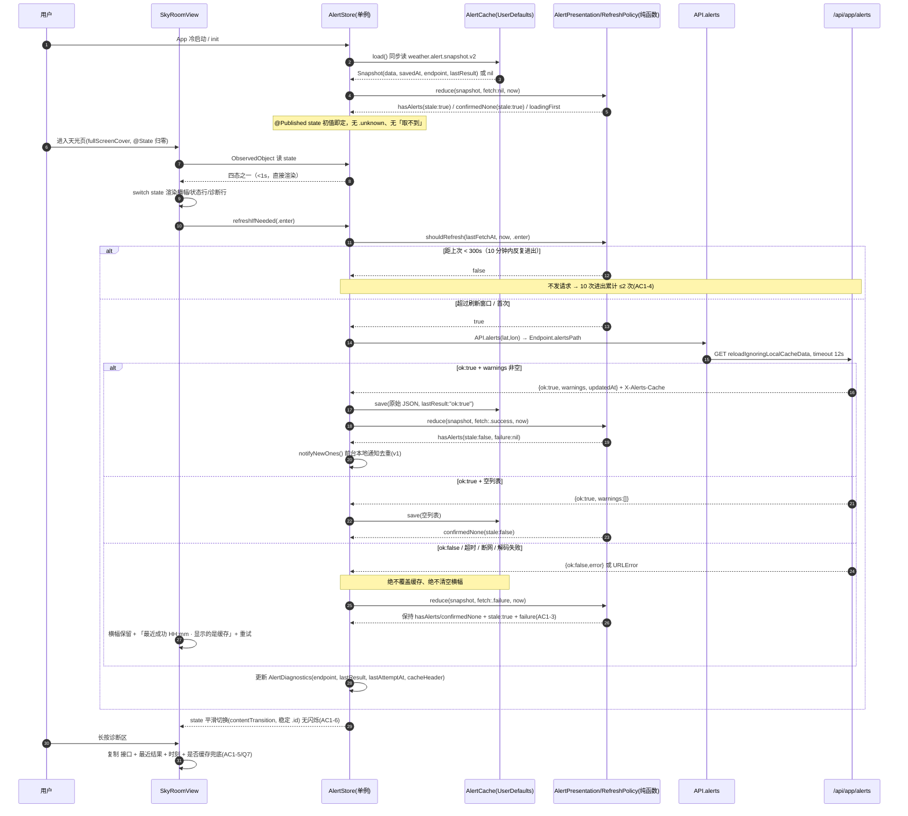
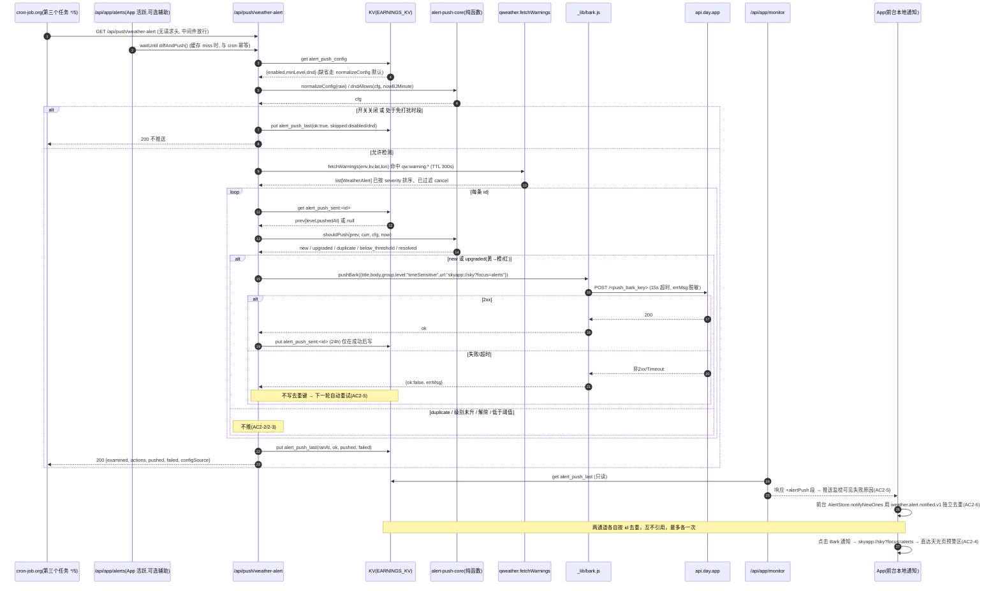
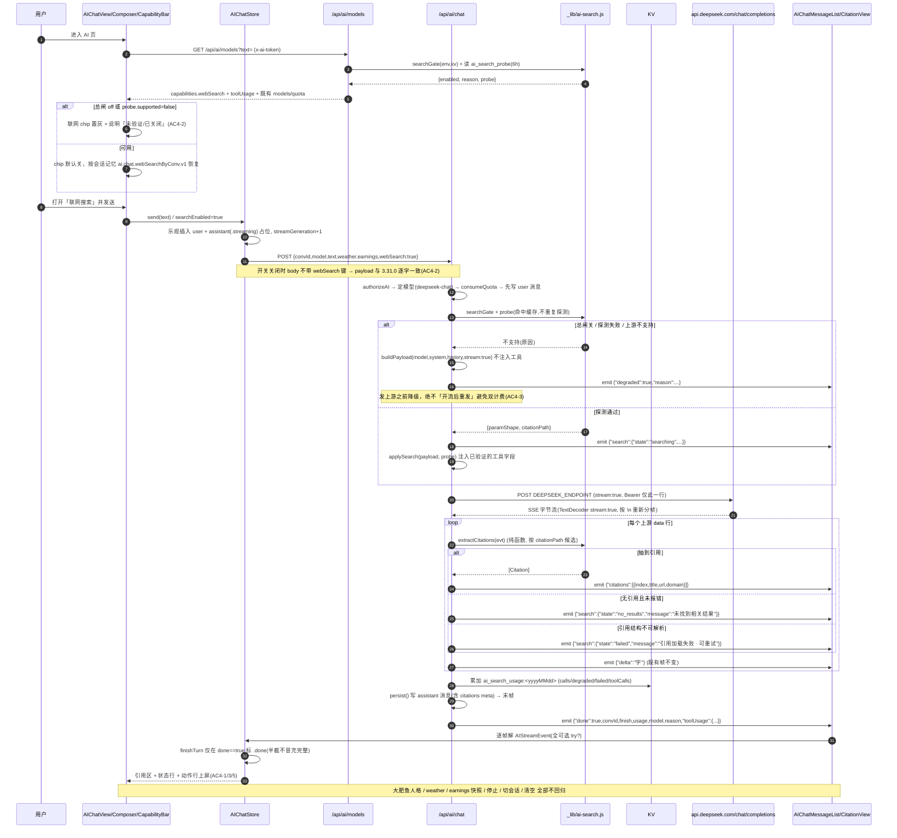
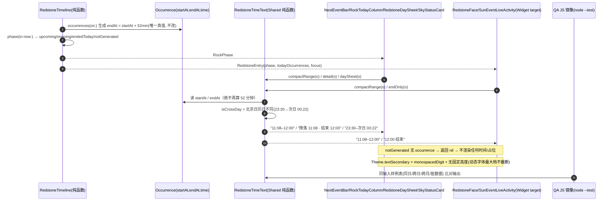
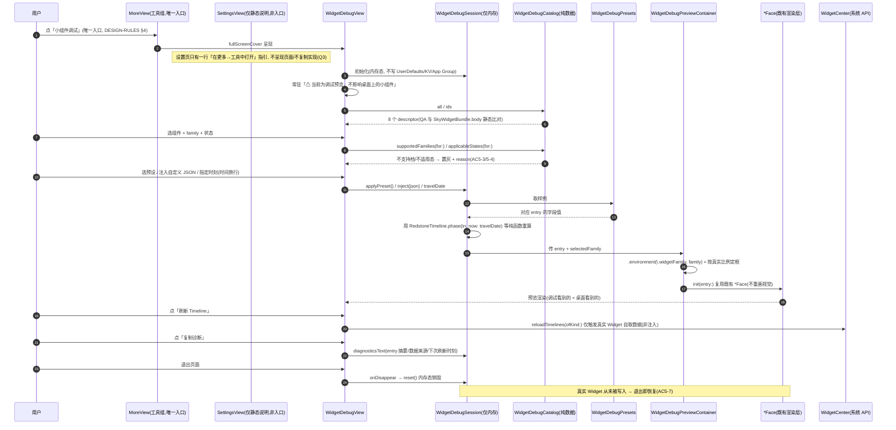
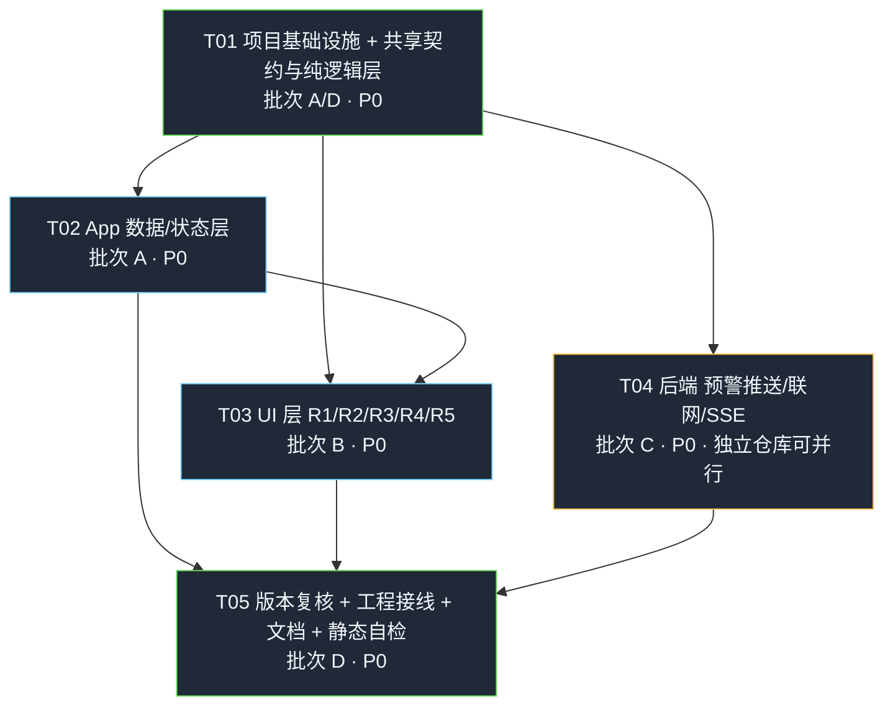

# FF大王 / SkyApp · 5.1.2 系统架构设计与任务分解

| 项 | 值 |
|---|---|
| 文档 | `docs/ARCH-5.1.2.md` · v1.0（交付工程师实施） |
| 撰写 | 架构师 高见远（software-512） |
| 上游输入 | 产品经理 许清楚 `docs/PRD-5.1.2.md` + 主理人 齐活林「10 个待确认项」拍板结论 |
| 交接对象 | 主理人 齐活林 → 工程师 寇豆码（实施） / QA 严过关（验收） |
| Language | 简体中文（全文） |
| 范围 | R1 / R2 / R3 / R4a / R4b（P0）、R4c / R5（P1 但随版交付）；R4d 不做 |
| 本文件性质 | **唯一产物**。只做设计与拆解，不含可编译实现；仅给出函数签名、伪代码、数据结构与契约 |
| 图件说明 | 类图 / 时序图按团队规范以 Mermaid **内嵌于 §3 / §4**，不另存 `.mermaid` 文件（`docs/` 下已有历史版本，不覆盖，避免与主理人「唯一产物」冲突） |

---

## 0 硬事实核对结论（我读源码后确认，实施前必读）

### 0.1 两个仓库、两条发布链，绝不交叉

| 仓库 | 本地权威副本 | 远端 | 发布方式 | 本期改不改 |
|---|---|---|---|---|
| iOS App | `/workspace/ios-app`（**本地不是 git 仓库**） | `ffzyf/ff-ios-app` | `scripts/push.py`（Git Trees API 逐 blob 推送）/ `/workspace/scripts_commit.py`（GitHub Contents API 逐文件），Codemagic 拉代码 → `xcodegen generate` → 无签名编译 | **改** |
| 后端 Pages Functions | `/workspace/gx-main` | `ffzyf/ios-appgx` | git 推 `main` → Cloudflare Pages 自动部署 | **改** |
| 历史镜像 | `/workspace/appsite`、`/workspace/site`、`/workspace/gx-work` | — | — | **一律不改** |

### 0.2 定时任务不是 wrangler/cron 文件（R2 的落地前提）

`gx-main/README.md` §「定时任务（cron-job.org）」明确：**外部 cron-job.org 定时以 HTTP GET 触发端点**，仓库内无 `wrangler.toml`、无 `[triggers]`、无 `scheduled` handler。现有两条：

| 任务 | URL | 时间（北京） |
|---|---|---|
| 每日简报 | `https://app.skyzyf335.top/api/push/daily-brief` | 每天 07:00 |
| 版本监控 | `https://app.skyzyf335.top/api/push/app-monitor` | `10 */3 * * *` |

`functions/_middleware.js` 第 104 行对 `/api/push/*` 直接 `ctx.next()`（`checkAuthed` 之后，非 dry 不需登录），**cron 请求不需要任何请求头**。
→ **R2 落地 = 新增第三个端点 `functions/api/push/weather-alert.js` + 在 cron-job.org 增设第三个任务 + 更新 `README.md` 的 cron 表。严禁凭空新建 `wrangler.toml` / `_scheduled.js` / cron 配置文件。**

### 0.3 AI 上游实测约束（R4a 的最大风险）

`functions/_lib/ai-models.js` 第 13–30 行原文：「已实测，别推翻」——`DEEPSEEK_API_KEY` 云端已配，**`deepseek-chat` 可用，`deepseek-flash` 不存在**；`DEEPSEEK_ENDPOINT = https://api.deepseek.com/chat/completions`；`DEEPSEEK_MODEL = 'deepseek-chat'`；`AI_MAX_TOKENS = 1024`。
`functions/api/ai/chat.js` 是自建 SSE 转发：先写 user 消息 → 扣配额 → `buildPayload()` → `stream:true` → `TextDecoder({stream:true})` 按 `\n` 重新分帧；帧由 `frame(obj) = 'data: ' + JSON.stringify(obj) + '\n\n'` 产出；心跳 `: ping\n\n`。
→ **PRD 文章里的 `deepseek-flash` / `deepseek_web_search` / 引用字段路径 / 计费口径一律不得写成已验证接口契约。** R4a 必须按「能力探测 + 后端总闸 + 自动降级 + 单独记账」设计，并在开工前用已配置的密钥做**一次真实调用验证**再定参数（见 §1.5、§8-1）。

### 0.4 其余核对（与 PRD 一致，补精确落点）

- `project.yml` 版本字面量共 **4 处**：`settings.base` 第 23/24 行 `MARKETING_VERSION "3.31.0"` / `CURRENT_PROJECT_VERSION "43"`，`targets.SkyAppWidget.settings.base` 第 96/97 行同值。`scripts/bump.sh` 是「读当前值自动 +1 后 sed 改写」，发版脚本动态改版本且**未回写工程文件** → 本次必须直接改这 4 处为 `5.1.2` / `47`，**不要只跑 bump.sh**（它会得到 3.32.0 / 44）。
- `Endpoint.swift` 是**全工程唯一允许出现域名/协议字面量**的文件（QA grep 卡这条）：`alertsPath = "/api/app/alerts"`、`ttsPath = "/api/app/tts"`、`aiChatPath = "/api/ai/chat"`、`aiModelsPath = "/api/ai/models"`、`briefBase = "https://app.skyzyf335.top"`。
- `functions/api/app/alerts.js`：`GET` 匿名只读，响应 `{ok, warnings, count, updatedAt}`，失败 `{ok:false, error}`；响应头 `X-Alerts-Cache: hit|miss|no_key|error`；`Cache-Control: public, max-age=120, s-maxage=300`。`_lib/qweather.js::fetchWarnings` 用 KV `qw:warning:<grid>`、TTL **300s**；`mapWarnings` 输出 `id/title/typeName/severity/severityText/colorHex/text/pubTime/startTime/endTime`，最多 5 条，过滤 `cancel`，按 `extreme(0)>severe(1)>moderate(2)>minor(3)>unknown(4)` 排序，`id` 缺失时用 `title|pubTime` 兜底。
- `WeatherAlert.severity` 值域 = `minor / moderate / severe / extreme / unknown`；`colorHex` 四色 `#3B82F6`蓝 / `#EAB308`+`#F59E0B`黄 / `#F97316`橙 / `#EF4444`红。`AlertsResponse` 只有 `ok/warnings/updatedAt`。
- Bark：`BARK_API = https://api.day.app`，KV `push_bark_key`，`POST {key}` body `{title, body, group, level, sound?}`；`errMsg()` 脱敏 `api.day.app/***`；`settings.js` 需 `ctx.data.authed`，掩码只露末 4 位；KV 另有 `brief_config` / `push_sound` / `app_accent`。`daily-brief.js` / `app-monitor.js` 各自内置一份 `pushBark`/`errMsg`/15s 超时实现。
- `functions/api/app/monitor/index.js` 只读 4 个 KV（`app_monitor_history` / `app_monitor_apps` / `app_monitor_versions` / `push_monitor_last`），不 fetch、不写、不推。App 侧「推送监控」读它。
- `functions/api/app/tts.js`：匿名 `POST {"text","voice"}` → `{ok,url,chars}`，MAX_CHARS = 600，KV `tts:{model}:{voice}:{hash}` 24h 缓存，返回 **https 预签名直链**；`SpeechStore` 用 `AVPlayer` 播放，`State = idle/preparing/playing/failed`，目前**只有 `speak()` / `stop()`，无 pause/resume**。
- R1 根因已确认：`SkyRoomView.alertsBlock` 三分支（有预警 / `alertSettled && isAvailable` / else `.unknown`）；`SkyRoomAlertStatusRow.State` **只有 `.none` / `.unknown`**，`.unknown` 文案就是「预警数据暂时取不到」；`AlertStore` 结果只在内存、无持久化、`pollInterval = 600`、`notifiedKey = "weather.alert.notified.v1"`、`ok==false` 保留旧值、`reloadIgnoringLocalCacheData`、`timeoutInterval = 12`。
- R3：`Occurrence` 已有 `startAt / endAt / time`，`RedstoneTimeline.landingMinutes = 52`，`endAt = startAt + 52min` 是**唯一真值**；`RockPhaseText.headline(_:now:)` 在 `NextEventBar.swift` 只拼 `occurrence.time`；`RedstoneFace(entry:)` 已在用 `focus.endAt` 算「还剩」。
- R5 的**关键工程约束（PRD 未点破）**：`project.yml` 里 `SkyApp.sources` 是 `- path: Sources` + `excludes: ["Widget"]`，而 `SkyAppWidget.sources` 只编 `Sources/Widget` + `Sources/Shared` + `GlassBevel.swift`。**因此主 App 进程当前编译不到任何 `*Face`。** 调试面板要「App 进程内复用渲染层」，必须在工程配置上显式接线（见 §1.7），且**绝不能删掉 `excludes: ["Widget"]`**（否则 `SkyWidgetBundle.swift` 的 `@main` 进主 App → `duplicate symbol '_main'`）。
- 设计基线：`Theme` token（`textPrimary/textSecondary/textTertiary/divider/glassStaticFill/statusWarn/statusWarnFill/lime/limeInk/onLime`）、`Typography` / `Spacing` / `Radius` / `Motion`、`LayoutMetrics.PageTier`（single/grid2/grid3/rail）、`Formatters.beijing`（**一律 UTC+8**）。本工程零第三方依赖（`MoreAboutSheet` 注释明写）。

---

## 1 实现方案与框架选型

### 1.0 总体架构

沿用现有 **MVVM + 单例 Store（`@MainActor` / `ObservableObject`）+ 纯领域函数** 三层，不引入新架构、不引入状态管理库、不引入网络层：

```
View (SwiftUI, 只渲染)  ──ObservedObject──▶  Store (状态机 / IO / 持久化)
                                              │
                                              ▼
                          Domain 纯函数 (Shared/，无 SwiftUI / 无网络 / 可 JS 镜像)
                                              │
                          API / Endpoint (唯一地址源) ──▶ Cloudflare Pages Functions
```

**三条贯穿全版的架构裁决：**

1. **所有「判定」下沉为纯函数，放进 `Sources/Shared/`（App + Widget 双 target 都编译）**。View 里只允许 `switch` 一个已算好的状态，不允许在 `if` 里重算语义。这是 R1 四态、R3 结束时间、R4a 引用帧、R5 支持矩阵能被 Linux/JS 验收的前提（§6）。
2. **单一真相源**：预警只认 `API.alerts → Endpoint.alertsPath`；红石结束时间只认 `Occurrence.endAt`；联网能力状态只认 `GET /api/ai/models` 的 `capabilities`；调试面板只认 `WidgetDebugCatalog`；R2 配置只认 KV `alert_push_config`。
3. **入口单一（DESIGN-RULES §4）**：小组件调试的实现与呈现只有一处（§1.7 Q3 兼顾方案）。

### 1.1 R1 · 天光预警：首屏四态 + 缓存 + 刷新收敛 + 数据源诊断

**问题定性**：不是网络问题，是**状态语义缺失 + 跨启动持久化缺失 + 刷新入口发散**。

**方案**

1. **四态状态机**（新增 `Sources/Shared/Domain/AlertPresentation.swift`，纯 Swift，无 `import SwiftUI`）：

   ```
   enum AlertPresentationState: Equatable {
       case hasAlerts([AlertItem], lastSuccessAt: Date, stale: Bool, failure: AlertFailure?)
       case confirmedNone(lastSuccessAt: Date, stale: Bool, failure: AlertFailure?)
       case loadingFirst
       case failed(reason: AlertFailure, lastSuccessAt: Date?)
   }
   ```

   - 四态**互斥**，任一时刻只渲染一种。
   - **关键设计**：AC1-2「四态互斥」与 AC1-3「已有横幅不得消失」不冲突——`failure` 是 `.hasAlerts` / `.confirmedNone` 的**附加信息（附加标记）**，不是第五态。断网 / `ok==false` / 超时时，只要本地有缓存，状态**保持** `.hasAlerts(..., stale: true, failure: .xxx)`，横幅照旧渲染，仅追加「最近成功 18:20 · 显示的是缓存」+ 重试按钮 + 诊断行。只有**连缓存都没有**时才落到 `.failed`。
   - `.loadingFirst` 文案「正在获取预警…」，**禁止出现「取不到」**。
   - `AlertPresentation.reduce(snapshot:fetch:now:) -> AlertPresentationState` 是唯一判定入口（纯函数，JS 镜像见 §6）。

2. **跨启动持久化**（新增 `Sources/Services/AlertCache.swift`）：
   - 缓存**后端响应原始 JSON Data**，不是 `[WeatherAlert]`（`WeatherAlert` 目前只 `Decodable`，缓存原文可零改动模型，也避免 `Codable` 化带来的字段漂移）。
   - `AlertCache.Snapshot { data: Data, savedAt: Date, endpoint: String, lastResult: String, cacheHeader: String? }`。
   - `AlertStore.init()` 里**同步** `load()` → `@Published private(set) var state` 的初值即为 `.hasAlerts(..., stale:true)` / `.confirmedNone(..., stale:true)` / `.loadingFirst`。UserDefaults 读 + `APIJSON.decoder` 解码 < 10ms，满足 AC1-1「1 秒内出四态之一」。
   - `ok == true` 才写缓存（含空列表 = 确认无预警）；`ok == false` / 传输失败**绝不覆盖缓存**。

3. **刷新收敛**（`AlertStore` 改造 + 新增纯函数 `AlertRefreshPolicy`）：
   - `pollCheckInterval = 60`（轮询 tick）、`minFetchInterval = 300`（**与后端 `s-maxage=300` / `qw:warning:*` TTL 300 对齐**）。
   - `shouldRefresh(lastFetchAt:now:force:coordinateChanged:) -> Bool` 是唯一闸门；进场 `.enter`、回前台 `.foreground`、下拉 `.force`、换城市 `.coordinateChanged` 四种 policy，前两者都受 `minFetchInterval` 约束。
   - `SkyRoomView.refreshPolledData()` 中预警那一发改为调 `AlertStore.refreshIfNeeded(.enter)`；删除页面内 `alertSettled` `@State`；`startPolling()` 不再在启动时额外无条件发一发。→ 10 分钟内连续进出 10 次，请求数 = 进场 1 + 回前台 1 = **≤2**（AC1-4）。
   - 后台静默刷新只改 `state` 里的关联值，`SkyRoomAlertBanner` 用稳定 `.id(alert.id)` + `.contentTransition` 平滑切换，不整块条件重建（AC1-6）。

4. **数据源诊断**（AC1-5 / Q7）：`AlertDiagnostics { endpoint, lastResult, lastAttemptAt, lastSuccessAt, cacheUsed, cacheHeader }`，由 `AlertStore` 在每次请求收尾时更新（含 `X-Alerts-Cache` 响应头）。新增 `SkyRoomAlertDiagnosticsView`（低视觉权重小字 + 长按/点击复制 `UIPasteboard`），挂在预警区右侧/下方，**不新增一级卡片**（沿用 `SkyRoomSourceFooter` 的元信息处理原则）。文案固定显示 `Endpoint.briefBase + Endpoint.alertsPath`。

5. **视图改造**：`SkyRoomAlertStatusRow.State` 从 `.none/.unknown` 扩为 `.none / .loading / .failed`，删除「预警数据暂时取不到」字面量；`.failed` 用 `Theme.statusWarn` 系（**不是预警色**，避免被误读为灾害）。`SkyRoomView.alertsBlock` 改为 `switch alerts.state` 四分支。`AlertStore` 现有 `notifyNewOnes` / `notifiedKey` 去重**原样保留**（R2 前台即时通道，AC2-6）。

### 1.2 R2 · 天气预警 Bark 推送（后端定时检测 + 差异推送 + 可配置）

**Q5 已拍板：后端定时检测，不做「仅本地通知增强」。**

**触发链路（双触发，幂等）**

| 触发 | 落点 | 作用 |
|---|---|---|
| **主**：cron-job.org 第三个任务 `GET /api/push/weather-alert` | 新建 `functions/api/push/weather-alert.js` | App 挂起/未启动时的兜底；建议 `*/5 * * * *`（与 5 分钟缓存同频，最坏错过一轮 → ≤10 分钟送达，AC2-1） |
| **辅（增强，可选）**：`GET /api/app/alerts` 缓存 miss 时 `ctx.waitUntil` 惰性触发同一次检测 | 修改 `functions/api/app/alerts.js` | 边缘缓存命中不会执行 Function，实际频率天然 ≈ 每 5 分钟一次；App 活跃时可即时送达 |

两路**共用同一个纯函数 `diffAndPush()`**、共用同一去重 KV → 天然幂等，不会双推。若 cron-job.org 免费版最小粒度 > 5 分钟，辅触发仍能保证时效（见 §8-5）。

**检测与差异判定**（新建 `functions/_lib/alert-push-core.js`，**纯 JS 无 IO，QA 用 `node --test` 直接跑**）

```
levelRank(severity) -> 0..4          // extreme<severe<moderate<minor<unknown
normalizeAlertPushConfig(raw) -> {enabled, minLevel, dnd:{enabled,start,end}}
dndAllows(cfg, nowBJMinute) -> Bool
shouldPush(prev /* {level, pushedAt}|null */, curr /* WeatherAlert */, cfg, now) -> {
    push: Bool, reason: 'new' | 'upgraded' | 'duplicate' | 'below_threshold' | 'disabled' | 'dnd' | 'resolved'
}
```

- 只对**新增**（KV 无 `id` 记录）或**级别升级**（`rank(curr) < rank(prev.level)`）推；**解除不推**（`mapWarnings` 已过滤 `cancel`；本轮列表里消失的 id 不产生动作）。
- 去重 KV：`alert_push_sent:<id>` → `{level, severity, pushedAt, title}`，`expirationTtl = 24h`（预警寿命远短于此，留 24h 防同 id 复活重复推）。**推送成功（Bark 2xx）才写**，失败保留空位让下一轮重试（照 `daily-brief.js` 的 `push_brief_done` 语义）。
- 配置真相源：KV **`alert_push_config`**（单键 JSON，默认 `{enabled:true, minLevel:"moderate"（黄色及以上）, dnd:{enabled:false,start:"23:00",end:"07:00"}}`）。「黄色及以上」= `rank <= 2`（`extreme/severe/moderate`），与 `SkyRoomWeatherCards.levelWord` 的四色字典对齐。免打扰默认**关闭**（避免漏报，AC2-3）。

**配置的两处写入口，一个真相源**

| 入口 | 端点 | 鉴权 | 用途 |
|---|---|---|---|
| 网页设置（已有登录态） | 修改 `functions/api/settings.js`：GET 回显 + POST 合并 `alertPushEnabled/alertPushMinLevel/alertPushDND` 三个字段 | `ctx.data.authed`（现状） | 站主配置 |
| App 设置页（匿名） | 新建 `functions/api/app/alert-push-config.js`：`GET` 匿名只读、`POST` 用 **`x-ai-token` + `authorizeAI()`**（App 已有 `AIKeychain.token()`，零新增密钥） | 窄口令 | AC2-3 开关 |

两个端点都只调 `_lib/alert-push-core.js::normalizeAlertPushConfig()` 并读写**同一个** `alert_push_config` 键 → 无第二真相源。`settings.js` 的 Bark Key 掩码回显、脱敏逻辑**原样不动**（Q4）。

**推送与可观测**（AC2-5）

- 新建 `functions/_lib/bark.js`：`pushBark({key,title,body,group,level,sound,timeoutMs=15000})`、`errMsg(e, secret)`（沿用 `api.day.app/***` 打码）、超时 `AbortController`。新端点只用这一份。**`daily-brief.js` / `app-monitor.js` 本期不改**（避免回归），登记为后续统一的技术债。
- 通知体：`{title:"暴雨黄色预警", body:"郑州市气象台 · 18:20 发布\n防御指南首句", group:"天气预警", level:"timeSensitive", url:"skyapp://sky?focus=alerts"}`。深链沿用 `skyapp://sky`（AC2-4），仅新增 `focus=alerts` query；App `onOpenURL` 解析后滚到预警区，未带 `focus` 时行为逐字不变。
- 每次运行写 KV **`alert_push_last`** = `{ranAt, ok, pushed:[...], failed:[...], errMsg, configSource}`；修改 `functions/api/app/monitor/index.js` 增读该键，在响应加 `alertPush` 段；App 侧 `Sources/Shared/Models/Monitor.swift` 加同名字段、`Sources/Features/Brief/PushStatusRow.swift`（或 `Monitor/VersionStatusCard.swift`）加一行「天气预警推送：最近 HH:mm / 失败原因」。Bark 失败**不影响** `/api/app/alerts` 与 App 内显示（AC2-5）。
- 前台本地通知与 Bark **各自按 `id` 独立去重**：前者 `weather.alert.notified.v1`（App 内，7 天），后者 `alert_push_sent:<id>`（KV，24h），互不引用、互不叠加（AC2-6）。

### 1.3 R3 · 红石结束时间全量展示

**唯一真值 `Occurrence.endAt`，全文不出现第二套时长口径，不重算 52 分钟。**

新建 `Sources/Shared/Domain/RedstoneTimeText.swift`（放 `Shared` 是硬要求：App 的 `RockPhaseText` 与 Widget 的 `RedstoneFace` 分属两个 target，只有 `Sources/Shared` 两边都编译）：

```
enum RedstoneTimeText {
    static func isCrossDay(_ o: Occurrence) -> Bool          // 比较 startAt/endAt 的北京日历日（RedstoneClock.calendar）
    static func compactRange(_ o: Occurrence) -> String       // "11:08–12:00" / "23:30–次日 00:22"
    static func detail(_ o: Occurrence) -> String             // "降落 11:08 · 结束 12:00" / "降落 23:30 · 次日 00:22 结束"
    static func endOnly(_ o: Occurrence) -> String            // "12:00 结束" / "次日 00:22 结束"
    static func daySheet(_ o: Occurrence) -> String           // "11:08 → 12:00（52 分钟）"
}
```

- 全部只读 `o.startAt` / `o.endAt`，时间字符串一律 `Formatters.timeHHmm`（北京 UTC+8 已钉死）；跨日靠 `endAt` 的日历日与 `startAt` 不同判定，**不靠 `endAt.hour < startAt.hour` 这种近似**。
- `RockPhase.notGenerated` 无 occurrence → 调用方返回 nil，**不渲染任何时间 / 占位 `--:--`**（AC3-1）。
- 视觉：结束时间 `Theme.textSecondary`（不抢层级）、`.monospacedDigit()`、不设固定高度、`.minimumScaleFactor` 兜动态字体最大档（AC3-5）。

**逐处落点（AC3-2 逐处点名）**

| 位置 | 文件 | 改动 |
|---|---|---|
| 顶部「下一场」条 | `Sources/Features/Rock/NextEventBar.swift` | `RockPhaseText.headline` 的 `upcoming/ongoing/endedToday` 三分支拼 `compactRange`；`notGenerated` 保持「排期未生成」。概览卡共用同一个 `RockPhaseText`（AC3-6），不新增第二份口径 |
| 概览「下一场」卡 | `Sources/Features/Overview/SkyStatusCard.swift` / `SkyCardPhase.swift` | 只核对是否复用 `RockPhaseText`；若自拼时间则改为调用 `RedstoneTimeText` |
| 日历页场次列表 / 今日列 | `Sources/Features/Rock/RockTodayColumn.swift` | 每场追加 `detail()` |
| 日详情 sheet | `Sources/Features/Rock/RedstoneDaySheet.swift` | 每场 `daySheet()` |
| Widget 小/中/大 | `Sources/Widget/RedstoneFace.swift` | 凡显示 `occurrence.time` 处追加 `compactRange`；小号两行 `11:08` / `至 12:00`；ongoing 追加 `endOnly()` → 「12:00 结束」 |
| Widget 声明 | `Sources/Widget/RedstoneWidget.swift` | 仅核对 family 注释，不改视觉 |
| 红石实时活动 | `Sources/Widget/SunEventLiveActivity.swift` | 锁屏/灵动岛补 `endOnly()`（现文件已有 `endAt` 判定「已结束」，复用之，不新增时间源） |
| 天光实时活动 | `Sources/Widget/DaylightLiveActivity.swift` | **核对**：若不含红石场次时间，登记「不适用」理由，不硬塞（对应 AC5-4「不适用态置灰」的处理原则） |
| 纯函数可测 | `Sources/Shared/Domain/RedstoneTimeline.swift` | **不改**（`endAt` 已正确，`landingMinutes` 保持 52） |

### 1.4 R4b / R4c / R4d

- **R4b 朗读全量**：复用 `SpeechStore` + `POST /api/app/tts`（**不引入新音频通道、不改后端 tts.js**）。在 `AIChatMessageList` 的**每条 assistant 气泡**常驻动作行（新建 `Sources/Features/AIChat/AIChatMessageActions.swift`）：`朗读 / 暂停 / 停止 / 复制`。`SpeechStore.State` 增 `.paused`，新增 `pause()` / `resume()`（保持 `speak()` 开头先 `stop()`、`generation` 代次语义不变）；朗读文本取 `message.text.prefix(600)`（后端 `MAX_CHARS=600` 已一致）。`message.status == .streaming` 时按钮**置灰 + 明确不可用态**（AC4-4），`== .done` 才可用；历史会话消息走同一气泡渲染 → 天然全覆盖。流式中不可用、失败时沿用 `failureText` 人话。
- **R4c 页面改版（Q2）**：沿用「顶栏 + 消息列表 + Composer」三层，**只做交互骨架**：Composer 上方新增能力 chip 行（选中 `Theme.lime` 底 + `Theme.onLime` 字，未选中 `glassStaticFill` + `divider` 描边）、回答气泡内新增引用区（`GlassCard` 轻量变体、序号 `.monospacedDigit()`、域名 `Theme.textTertiary`）与状态行。视觉全走 Theme token，**不做像素级换肤、不引入第二套设计语言**。iPad single/rail 档消息区收在 `metrics.railMainWidth`，引用列表两列（AC4-6）。
- **R4d 明确不做**：深度思考 / 文件输入 / 读链接 / 语音输入 / OCR / ASR / 独立 TTS 能力。能力 chip 行里**不放**这些占位 chip（PRD 设计稿画了「深度思考(灰)」——按「不渲染空壳」原则本期不画，登记 5.1.3）。

### 1.5 R4a · AI 联网搜索开关 + 引用展示（协议设计，本期最大风险项）

**总原则：文章不是契约。`deepseek-chat` 是唯一已验证模型；联网能力 = 运行时探测 + 总闸 + 失败降级 + 单独记账，且关闭时 payload 与 3.31.0 逐字一致。**

#### 1.5.1 后端总闸与能力探测

- **总闸**：`env.AI_SEARCH_ENABLED` 优先、KV `ai_search_enabled` 次之，**默认 `off`**（未验证前不产生任何工具调用费）。新增 `functions/_lib/ai-search.js` 的 `searchGate(env, kv) -> {enabled, reason}`。
- **能力探测**：`probeWebSearch(env, kv)` 对 `DEEPSEEK_ENDPOINT` 发一次**极小、`stream:false`、`max_tokens:16`** 的真实请求，逐条尝试候选工具声明，看是否 2xx / 是否回引用字段。所有候选参数**集中在一张常量表** `SEARCH_PROBE_CANDIDATES`（模型名 / 工具字段名 / 参数形状 / 引用字段候选路径），**验证后只改这张表，不改任何调用点**。结果写 KV `ai_search_probe`（TTL 6h，含 `supported/model/paramShape/citationPath/verifiedAt/error`），避免每轮探测烧钱。
- **下发 App**：修改 `functions/api/ai/models.js`，响应新增
  ```
  capabilities: {
    webSearch: { enabled: Bool, reason: String, probe: {supported:Bool, verifiedAt:String?, note:String?} }
  }
  ```
  App `AIModelsResponse` 解 `capabilities`（全 `try?`，旧响应缺字段 = 不可用）。**总闸关 / 探测失败 → App 联网 chip 置灰并给出说明**（AC4-2），chip 记忆值不生效。
- **真实调用验证是开工前置**：见 §8-1。若验证不通过，R4a 只交付「探测 + 总闸 + 降级 + 状态行」骨架，`enabled` 恒 false，真实搜索顺延 5.1.3，**但不算「只做一半」**（Q10 要求的是 R4c/R5 随版交付，不要求上游一定支持）。

#### 1.5.2 请求协议（关闭时零差异）

`AIChatRequest` 新增 **`webSearch: Bool?`（可选，默认 nil）**：

| App 开关 | 请求体 | 后端 payload | 费用 |
|---|---|---|---|
| 关（默认） | **不带 `webSearch` 键**（`encodeIfPresent`） | `buildPayload({model,system,history,stream})` **逐字不变** | 0 工具调用费（AC4-2） |
| 开 | `webSearch: true` | `ai-search.js::applySearch(payload, probe)` 只在上游验证通过时注入工具字段；否则**不注入**并标记降级 | 单轮工具调用费，单独记账 |

- 按会话记忆：UserDefaults `ai.chat.webSearchByConv.v1`（`[convId: Bool]`，`convId == nil` 用 `"__new__"` 键），`newConversation()` / `load(id:)` 时由 Store 恢复。
- 后端 `chat.js` 判定顺序**不变**（鉴权 → 参数/模型 → 配额 → 先写 user 消息 → 拼 payload → 上游）。**降级必须在发上游之前决定**：读 `searchGate` + `ai_search_probe`，不支持就走普通 `deepseek-chat`，并发一帧 `degraded`。**禁止「上游已开流再重发一次」**——那会造成两次计费 + 历史里两轮脏数据。

#### 1.5.3 SSE 帧契约（扩展现有帧，不开新通道）

在 `chat.js::frame()` 产出的**单行 `data: {…}` + 空行**基础上新增 4 类帧；所有字段在 `AIStreamEvent` 中**全部可选 + 全 `try?` 解码**，旧客户端/旧帧零影响；心跳 `: ping`、末帧 `{done:true,…}`、错误帧 `{error:{…}}` 保持不变。

| 帧 | 载荷 | 语义 |
|---|---|---|
| 状态帧 | `{"search":{"state":"searching"\|"no_results"\|"failed"\|"done","query":"…","message":"…"}}` | AC4-3 搜索中 / 未找到相关结果 / 引用加载失败 / 完成，**不得把「没搜到」渲染成「回答完毕」** |
| 引用帧 | `{"citations":[{"index":1,"title":"…","url":"https://…","domain":"example.com"}]}` | 序号 + 标题 + 域名，可整帧一次下发；正文角标由上游文本决定，App 只做列表渲染 |
| 降级帧 | `{"degraded":true,"reason":"provider_unsupported"\|"gate_off"\|"probe_failed"\|"upstream_rejected"}` | 明确告知「本轮未联网」，App 状态行写「联网不可用，已用普通对话回答」 |
| 末帧扩展 | `{"done":true,"convId":…,"finish":…,"usage":…,"model":…,"reason":…,"toolUsage":{"webSearchCalls":N,"charged":Bool}}` | 单独记账可查 |

- 引用抽取：`_lib/ai-search.js::extractCitations(evt) -> [Citation]`（纯函数，按 `probe.citationPath` 候选路径逐个尝试，未知结构返回 `[]` 并 emit `search.state=failed`；绝不把半个引用渲染成「回答完毕」）。
- URL 校验：只接受 `https?://`，`domain` 由后端用 `new URL(u).hostname` 计算（App 不自己解析，避免两套口径）；App 打开外链沿用既有外链处理（AC4-3）。
- 引用持久化：服务端 `persist()` 写 assistant 消息时把 `citations` 放进 `ai-store.writeMessage` 的 meta 字段；`functions/api/ai/conversation.js` 读历史原样回传；`AIChatMessage` 新增 `citations: [AICitation]?` 解码（全 `try?`）。→ 历史回放也能看到引用；拿不到就整块不渲染，不显示空壳。

#### 1.5.4 单独记账

KV `ai_search_usage:<yyyyMMdd>` → `{calls, degraded, failed, toolCalls, estimated}`；`GET /api/ai/models` 响应新增 `toolUsage` 段（当日读数，App 模型面板可见），后端日志每轮打印 `search: true|false / degraded / toolCalls`，**不打印密钥、不打印引用全文**。

#### 1.5.5 App 状态机

`AIChatStore` 新增 `@Published`：`searchEnabled`（按会话记忆）、`searchCapability`（来自 `/api/ai/models`）、`searchState`（`idle/searching/noResults/failed/degraded/done`）、`citationsByMessage`（`[messageId: [AICitation]]`）。`performStream` 的逐行循环在 `AIStreamEvent` 上多解 4 类帧；`finishTurn` 只在 `done == true` 时标 `.done`（现有「半截不冒充完整」铁律不变）；`stop()` / `newConversation()` / `load(id:)` 的 `streamGeneration` 代次收敛逻辑**原样保留**（AC4-5 不回归）。`weather` / `earnings` 快照与大肥鱼 `SYSTEM_PROMPT_BASE` **一个字不改**（AC4-5）。

### 1.6 R5 · 小组件调试控制面板：无 App Group 下复用 `*Face`

**约束**：`project.yml` 明确不申请 App Group；Widget 自己请求 `/api/app/*`、自算 Timeline；主 App 与 Widget 是**两个进程**，调试数据**不可跨进程注入真实 Widget**。Q8 拍板：App 进程内预览 + 模拟数据，真实 Widget 只通过刷新 Timeline 触发。

#### 1.6.1 工程接线（最易漏，必须做）

主 App target 当前**编不到 `*Face`**。在 `project.yml` 的 `SkyApp.sources` 中，于 `- path: Sources / excludes: ["Widget"]` 条目**之外**，**逐个显式追加**渲染层文件条目（每个是独立 `path:`，`excludes` 只作用于前一个条目，互不冲突）：

```
- path: Sources/Widget/RedstoneFace.swift
- path: Sources/Widget/BriefFace.swift
- path: Sources/Widget/SkyLightFace.swift
- path: Sources/Widget/SunArcFace.swift          # 【新】从 SunArcWidget.swift 平移 Face 代码
- path: Sources/Widget/MoonPhaseFace.swift       # 【新】从 MoonPhaseWidget.swift 平移 Face 代码
- path: Sources/Widget/WindFace.swift            # 【新】从 WindWidget.swift 平移 Face 代码
- path: Sources/Widget/SunEventLiveActivity.swift
- path: Sources/Widget/DaylightLiveActivity.swift
- path: Sources/Widget/WidgetCanvas.swift
- path: Sources/Widget/WidgetTheme.swift
- path: Sources/Widget/WidgetGlassCasing.swift
- path: Sources/Widget/ArcTrack.swift
- path: Sources/Widget/TrackGradient.swift
- path: Sources/Widget/MapScene.swift
- path: Sources/Widget/BriefMinutely.swift
- path: Sources/DesignSystem/GlassBevel.swift    # 与 Widget target 同款例外
```

**为什么多出 3 个新文件（必须做，别图省事直接引入 `*Widget.swift`）**：`RedstoneFace` / `BriefFace` / `SkyLightFace` 本来就是独立文件，可以直接引入；但 `SunArcFace` / `MoonPhaseFace` / `WindFace` 的定义**与各自的 `TimelineProvider`、`struct XxxWidget: Widget` 挤在同一个 `*Widget.swift` 里**（`getTimeline` / `getSnapshot` / `placeholder` 都在其中）。若把这三个 `*Widget.swift` 整文件加入主 App target，会连带把 Timeline/网络请求代码拖进 App 进程，并牵出更多 Widget 目录依赖，工程会越接越脏。
→ 处理方式是**纯代码平移**：把三个 `Face` 的 `struct` 原样搬到新建的 `SunArcFace.swift` / `MoonPhaseFace.swift` / `WindFace.swift`（**只移动，不改一行视觉、不改 `init(entry:)`、不改 `@Environment(\.widgetFamily)` 分档**），原 `*Widget.swift` 保留其余内容并继续被 Widget target 编译。这样渲染层仍是「一份代码、两端共用」，且主 App 只引入纯 View 文件。此平移属于 T01/T03 的明确工作项，QA 用 S3 检查它被引入、用 S14 确认原文件视觉零改动。

**红线**：`Sources/Widget/SkyWidgetBundle.swift`（含 `@main`）**绝对不加入**；`Sources/Widget/WidgetProvider.swift` / `SkyLightProvider.swift` / 三个原 `*Widget.swift` **一律不加入主 App target**（它们带 Provider/网络/Timeline 逻辑，调试面板自己造 entry）。`excludes: ["Widget"]` 那一行**必须原样保留**；上面每一条都是**独立 `path:` 条目**，`excludes` 只作用于前一个 `- path: Sources` 条目，互不冲突。若编译报 `duplicate symbol '_main'`，唯一原因就是误加了 `SkyWidgetBundle.swift`。

#### 1.6.2 渲染层复用（不改视觉）

- 各 `*Face` 一律是 `init(entry: XxxEntry)` + `@Environment(\.widgetFamily)` 分档。调试面板**不自己画一套组件**：按所选组件构造对应的模拟 `TimelineEntry`（`RedstoneEntry` / `BriefEntry` / `SkyLightEntry` / `SunArcEntry` / `MoonPhaseEntry` / `WindEntry` / LiveActivity `ContentState`），直接把 entry 交给 `*Face`。
- family 注入：`WidgetDebugPreviewContainer` 用 `.environment(\.widgetFamily, selectedFamily)` 注入并按该 family 的**真实画布比例**定框（AC5-5）。**需在真机/Xcode 验证该环境值在 App 进程可写**；若不可写，退路是新增 `WidgetDebugFamilyKey` 环境值，各 `*Face` 读取处加一行 `override ?? family`（**只改访问方式，不重画任何视觉**），见 §8-4。
- 两个 LiveActivity 组件用伪 family `.activityLockScreen` / `.activityDynamicIsland`；把 `SunEventLiveActivity.swift` / `DaylightLiveActivity.swift` 里锁屏视图的 body 抽成 `internal` 的 `XxxLockScreenFace`（**仅改访问级别/拆分，不重画**）供预览直接调用。

#### 1.6.3 8 组件 × family × 状态 × 模拟数据（可扩展不写死）

新建 `Sources/Shared/WidgetDebug/WidgetDebugCatalog.swift`（纯数据 + 纯函数，双 target 可编、QA 可静态比对）：

```
struct WidgetDebugDescriptor {
    let id: String                       // 与 SkyWidgetBundle.body 的组件一一对应
    let displayName: String
    let families: [WidgetDebugFamily]    // 支持档 + 不支持档的 reason
    let states: [WidgetDebugState]       // 适用态 + 不适用态的 reason
    let entryKind: WidgetDebugEntryKind  // 决定造哪种 TimelineEntry
}
enum WidgetDebugCatalog {
    static let all: [WidgetDebugDescriptor]      // Redstone / Brief / SunEventLiveActivity /
                                                // DaylightLiveActivity / SkyLight / SunArc / MoonPhase / Wind
    static func supportedFamilies(for id: String) -> [FamilyAvailability]   // {family, supported, reason}
    static func applicableStates(for id: String) -> [StateAvailability]     // {state, applicable, reason}
    static var ids: Set<String>
}
```

- **8 组件**：与 `SkyWidgetBundle.swift` 的 8 个注册项逐项对照；QA 用静态脚本比对 `WidgetDebugCatalog.ids` 与 `SkyWidgetBundle.body` 里出现的类型名集合，不一致即失败（AC5-2 新增可扩展不漏项）。
- **family 矩阵**（据 `SkyWidgetBundle` 注释与各 `*.supportedFamilies`）：Redstone/Brief = 小中大；SkyLight/SunArc = 小中大 + rect/inline；MoonPhase = 小大 + 锁屏三形态；Wind = 小大 + rect/inline；两个 LiveActivity = 实时活动两形态。**不支持档置灰并注原因**（AC5-3）。
- **8 态**：`有数据 / 无数据 / 加载中 / 错误 / 收官 / 进行中 / 未生成 / 待确认`。`applicableStates(for:)` 返回不适用的 reason，不适用**置灰且不渲染空壳**（AC5-4）。
- **模拟数据**：内置预设样例（`WidgetDebugPresets.swift`，每种 entry 一组有数据/无数据样例）、自定义 JSON 注入（`WidgetDebugSession.inject(json:)`，用 `APIJSON.decoder` 解成对应 entry，解不开给明确错误态而非空壳）、**时间旅行**（预览 `now` 用 `Date` 参数注入，`RedstoneTimeline.phase(in:now:)` 等纯函数按该时刻重算，与真实 Widget 同一套逻辑 → 「调试看到的 = 桌面看到的」）。
- **控制**（AC5-6）：`WidgetCenter.shared.reloadTimelines(ofKind:)`（系统 API，非 App Group，允许）刷新真实 Widget；「重置为真实数据」= 清空调试会话；「复制诊断」= `{当前 entry 摘要, 数据来源: debug-preset|custom|real-snapshot, 下次刷新时刻}` 写入 `UIPasteboard`。

#### 1.6.4 调试态隔离（AC5-7）

`WidgetDebugSession`（`@MainActor final class ObservableObject`，新建 `Sources/Features/WidgetDebug/WidgetDebugSession.swift`）**只存活于 App 进程内存**：

- 不写 UserDefaults、不写 KV、不写文件、不碰 App Group、不改任何 Provider；
- 只有用户显式点「刷新 Timeline」才调 `WidgetCenter.reloadTimelines`（那是让真实 Widget 重新取自己的数据，**不是注入调试数据**）；
- `onDisappear` / `deinit` 自动 `reset()`，真实 Widget 从未被写入 → 退出即恢复，**天然不污染**；
- 页面顶部常驻「⚠ 当前为调试预览，不影响桌面上的小组件」提示条；
- iPad：`single` 单列；`grid2/rail` 用「左 ①②③ 控制列（≤368，`Layout.sideColumnWidth`）+ 右 ④⑤ 预览与诊断主列」，两列顶对齐；浅/深、动态字体四档通过（AC5-8）。

#### 1.6.5 Q3 入口兼顾方案（入口单一铁律）

- **唯一实现 + 唯一呈现**：`WidgetDebugView` 一份，`MoreView.toolsGroup` 的「工具」组新增一行 `MoreRow(icon:"square.grid.2x2", title:"小组件调试", detail:"调试预览")`，`.fullScreenCover` 呈现。**这是唯一入口**。
- **设置页的兼顾**：`SettingsView` 新增「小组件」组，放**一行静态说明**（`Text("小组件调试在「更多 → 工具」中打开，入口只有那一个。")`）。它**不是入口**——不呈现页面、不复制实现、不新增 `isPresented`、不产生第二个调试会话生命周期，只是让按用户原话「在设置中加」来找的人能找到指引。
- **理由（须写进实现注释）**：若设置页直接 `.sheet { WidgetDebugView() }`，会出现两个呈现点、两份 `isPresented`、两套「退出恢复真实数据」逻辑，违反 `DESIGN-RULES.md` §4「一个页面只从约定好的入口进入」与「不得出现第二个真相源」。用户原话后半句「进入页面就放在更多里面」已明确归位，前半句的可发现性用一行说明满足。
- 备选（仅当主理人坚持可点）：设置页那行改为「跳转」动作，**只切到「更多」Tab**（复用 `RootView` 的 tab Binding / `MoreView.onOpenEarnings` 同款闭包手法），仍不呈现调试页；入口依旧唯一。

### 1.7 框架与依赖清单（Required Packages）

**本工程零第三方依赖，本期不新增任何 npm / SPM / CocoaPods 包。**

| 层 | 依赖 | 用途 |
|---|---|---|
| iOS | `SwiftUI` / `Foundation` | UI、`URLSession.bytes(for:)` SSE、`UserDefaults`、`JSONDecoder` |
| iOS | `WidgetKit` | `*Face` 的 `@Environment(\.widgetFamily)`、`WidgetCenter.reloadTimelines`；`ActivityKit` 供 LiveActivity 预览 |
| iOS | `AVFoundation` | `AVPlayer` 朗读（既有 `SpeechStore`，不新增） |
| iOS | `UserNotifications` | 前台本地通知（既有 `AlertStore`，不新增） |
| 构建 | `xcodegen`（`project.yml`）、Codemagic 无签名编译 | 双 target；**无签名 CI、无 App Group、无推送证书** |
| 后端 | Cloudflare Pages Functions / Workers 运行时原生 `fetch` / `TransformStream` / `TextDecoder({stream:true})` / `AbortController` / KV `EARNINGS_KV` | SSE 转发、Bark、配额、去重、配置 |
| 外部服务 | DeepSeek Chat Completions HTTP（`https://api.deepseek.com/chat/completions`，**已配 `DEEPSEEK_API_KEY`**） | 对话；联网能力待探测 |
| 外部服务 | Bark `https://api.day.app`（KV `push_bark_key`） | 预警推送 |
| 外部服务 | 阿里云百炼 DashScope TTS（`functions/api/app/tts.js` 既有） | 朗读，本期不改 |
| 外部调度 | **cron-job.org**（第三个 HTTP 定时任务，非 npm 包、非 wrangler cron） | R2 检测触发 |
| QA | Node.js 内置 `node:test` + `node:assert`（`gx-main` 侧纯函数直接跑）；`grep` / Python 静态脚本（Swift 侧） | Linux 无 Xcode 验收 |

---

## 2 完整文件清单

> 标注：**【新建】** / **【修改】**。iOS / Widget 路径相对 `/workspace/ios-app`；后端相对 `/workspace/gx-main`。「不改」的关键文件在 §2.5 单列，防止误动。

### 2.1 iOS App（主 target）

| # | 文件 | 动作 | 职责（一句话） |
|---|---|---|---|
| 1 | `project.yml` | 修改 | 4 处版本字面量 → `5.1.2` / `47`；追加 Widget 渲染层文件到 `SkyApp.sources`（保留 `excludes:["Widget"]`）；**不加 App Group** |
| 2 | `Sources/Shared/Config/Endpoint.swift` | 修改 | 新增 `aiSearchConfigPath` / `alertPushConfigPath` / `alertPushRunPath` 等路径常量（域名仍只在此文件） |
| 3 | `Sources/Shared/Config/API.swift` | 修改 | 新增 `API.alertPushConfig()` / `API.alertPushRun()` 等构造；`alerts()` / `tts()` / `aiChat()` 保持不动 |
| 4 | `Sources/Shared/Domain/AlertPresentation.swift` | 新建 | 四态状态机 + `reduce()` 纯判定 + `AlertFailure` / `AlertDiagnostics` 值类型 |
| 5 | `Sources/Shared/Domain/AlertRefreshPolicy.swift` | 新建 | `shouldRefresh(lastFetchAt:now:force:coordinateChanged:)` 刷新收敛纯函数 |
| 6 | `Sources/Shared/Domain/RedstoneTimeText.swift` | 新建 | 结束时间唯一格式化器（`compactRange/detail/endOnly/daySheet/isCrossDay`） |
| 7 | `Sources/Shared/Models/AIChat.swift` | 修改 | `AIChatRequest` 加 `webSearch: Bool?`；`AIChatMessage` 加 `citations`；`AIStreamEvent` 加 `search/citations/degraded/toolUsage`；`AIModelsResponse` 加 `capabilities/toolUsage`；新增 `AICitation` / `AISearchState` / `AISearchCapability` / `AIToolUsage` |
| 8 | `Sources/Shared/Models/Monitor.swift` | 修改 | 增 `alertPush` 段（最近运行时刻 / 失败原因），供推送监控展示 |
| 9 | `Sources/Shared/WidgetDebug/WidgetDebugCatalog.swift` | 新建 | 8 组件注册表 + family/状态支持矩阵纯函数（与 `SkyWidgetBundle` 一一对照） |
| 10 | `Sources/Shared/WidgetDebug/WidgetDebugPresets.swift` | 新建 | 各 entry 的内置预设样例（有数据/无数据/进行中/未生成…） |
| 11 | `Sources/Services/AlertStore.swift` | 修改 | 四态 `state` 取代三态字段、接 `AlertCache` 同步首帧、刷新收敛、诊断信息、保留本地通知去重 |
| 12 | `Sources/Services/AlertCache.swift` | 新建 | 预警响应原文 + 元信息的 UserDefaults 读写（`weather.alert.snapshot.v2`） |
| 13 | `Sources/Services/AIChatStore.swift` | 修改 | 联网开关按会话记忆、能力回显、4 类新帧解析、引用挂到消息、降级状态；既有代次/停止/历史逻辑不回归 |
| 14 | `Sources/Services/SpeechStore.swift` | 修改 | `State` 加 `.paused`，新增 `pause()` / `resume()`；`speak/stop` 语义不变 |
| 15 | `Sources/Features/SkyRoom/SkyRoomView.swift` | 修改 | `alertsBlock` 改 `switch alerts.state` 四分支；删 `alertSettled`；`refreshPolledData()` 预警改走 `refreshIfNeeded(.enter)`；平滑切换 |
| 16 | `Sources/Features/SkyRoom/SkyRoomWeatherCards.swift` | 修改 | `SkyRoomAlertStatusRow.State` 扩 `.loading/.failed`，删「取不到」文案；横幅加 `stale` 标记与诊断入口 |
| 17 | `Sources/Features/SkyRoom/SkyRoomAlertDiagnosticsView.swift` | 新建 | 接口 + 最近结果 + 时刻 + 缓存兜底的可复制诊断行 |
| 18 | `Sources/Features/Rock/NextEventBar.swift` | 修改 | `RockPhaseText.headline` 三相位拼接 `RedstoneTimeText.compactRange`（概览卡共用同一口径） |
| 19 | `Sources/Features/Rock/RockTodayColumn.swift` | 修改 | 每场补 `RedstoneTimeText.detail()` |
| 20 | `Sources/Features/Rock/RedstoneDaySheet.swift` | 修改 | 每场补 `RedstoneTimeText.daySheet()` |
| 21 | `Sources/Features/Overview/SkyStatusCard.swift` | 修改 | 核对并统一到 `RockPhaseText` / `RedstoneTimeText`（不新增第二份口径） |
| 22 | `Sources/Features/AIChat/AIChatComposer.swift` | 修改 | Composer 上方挂能力 chip 行（R4c 骨架） |
| 23 | `Sources/Features/AIChat/AIChatCapabilityBar.swift` | 新建 | 「联网搜索」chip（默认关、按会话记忆、总闸关时置灰说明） |
| 24 | `Sources/Features/AIChat/AIChatMessageList.swift` | 修改 | 每条 assistant 气泡挂引用区 + 动作行 + 状态行；历史消息同一渲染路径 |
| 25 | `Sources/Features/AIChat/AIChatCitationView.swift` | 新建 | 引用列表（序号 / 标题 / 域名，GlassCard 轻量变体，外链沿用既有处理） |
| 26 | `Sources/Features/AIChat/AIChatMessageActions.swift` | 新建 | 「朗读 / 暂停 / 停止 / 复制」常驻行，流式中不可用态 |
| 27 | `Sources/Features/AIChat/AIChatView.swift` | 修改 | 三层骨架接线（顶栏 / 列表 / Composer + 能力行），iPad rail 档引用两列 |
| 28 | `Sources/Features/AIChat/AIModelPickerSheet.swift` | 修改 | 模型面板显示 `capabilities.webSearch` 与 `toolUsage` 当日读数 |
| 29 | `Sources/Features/Settings/SettingsView.swift` | 修改 | 新增「天气预警推送」组（开关 / 最低级别 / 免打扰）+ 「小组件」静态说明行（Q3 兼顾） |
| 30 | `Sources/Features/Settings/AlertPushSettingsSection.swift` | 新建 | R2 三个设置项，读写 `GET/POST /api/app/alert-push-config` |
| 31 | `Sources/Features/More/MoreView.swift` | 修改 | 「工具」组新增唯一入口行「小组件调试」+ `.fullScreenCover` |
| 32 | `Sources/Features/WidgetDebug/WidgetDebugView.swift` | 新建 | 5 区面板（组件 / 尺寸 / 状态 / 预览 / 模拟数据与控制）+ 常驻「当前为调试预览」条；iPad rail 双列 |
| 33 | `Sources/Features/WidgetDebug/WidgetDebugSession.swift` | 新建 | 仅在内存的调试态（预设 / 自定义注入 / 时间旅行 / reset / reloadTimelines / 复制诊断） |
| 34 | `Sources/Features/WidgetDebug/WidgetDebugPreviewContainer.swift` | 新建 | 按 family 真实比例定框、注入 `\.widgetFamily`、把模拟 entry 分派给 `*Face` |
| 35 | `Sources/Features/Brief/PushStatusRow.swift` | 修改 | 推送监控增一行「天气预警推送」最近运行 / 失败原因（AC2-5） |
| 36 | `Sources/App/…`（深链处理所在文件） | 修改 | `skyapp://sky?focus=alerts` 解析后滚到预警区；不带 `focus` 时行为不变 |
| 37 | `notes-5.1.2.txt` | 新建 | 发版说明（沿用仓库 `notes-*.txt` 惯例） |

### 2.2 Widget（同源 `Sources/Widget`，两个 target 共用渲染层）

| # | 文件 | 动作 | 职责 |
|---|---|---|---|
| 38 | `Sources/Widget/RedstoneFace.swift` | 修改 | 小/中/大 + 锁屏凡显示降落时间处补 `compactRange`；ongoing 补 `endOnly()`；**不重画视觉** |
| 39 | `Sources/Widget/RedstoneWidget.swift` | 修改 | 仅核对/更新 `supportedFamilies` 注释与「结束时间」文案说明，不改视觉 |
| 40 | `Sources/Widget/SunEventLiveActivity.swift` | 修改 | 锁屏/灵动岛补 `endOnly()`；把锁屏视图 body 抽成 `internal` Face 供调试预览复用（仅改访问级别） |
| 41 | `Sources/Widget/DaylightLiveActivity.swift` | 修改 | 同上抽 Face；若不含红石时间，登记「不适用」而非硬塞 |
| 41a | `Sources/Widget/SunArcFace.swift` | 新建 | 从 `SunArcWidget.swift` **纯平移** `SunArcFace`，视觉/`init(entry:)`/family 分档零改动；供主 App target 引入 |
| 41b | `Sources/Widget/MoonPhaseFace.swift` | 新建 | 同上，从 `MoonPhaseWidget.swift` 平移 `MoonPhaseFace` |
| 41c | `Sources/Widget/WindFace.swift` | 新建 | 同上，从 `WindWidget.swift` 平移 `WindFace` |
| 42 | `Sources/Widget/SkyWidgetBundle.swift` | **不改** | 8 组件注册表保持；QA 用它比对 `WidgetDebugCatalog.ids`（**含 `@main`，绝不进主 App target**） |
| 43 | `Sources/Widget/WidgetProvider.swift` | **不改** | `RedstoneEntry` / `BriefEntry` 供调试面板构造模拟 entry；Provider 不进主 App target |
| 44a | `SunArcWidget.swift` / `MoonPhaseWidget.swift` / `WindWidget.swift` | 修改 | **仅删除已平移出去的 Face 代码**，其余 Provider / Widget 定义一字不动；**不进主 App target** |
| 44b | 其余 `*Face.swift` / `WidgetCanvas.swift` / `WidgetTheme.swift` / `ArcTrack.swift` / `TrackGradient.swift` / `MapScene.swift` / `BriefMinutely.swift` / `WidgetGlassCasing.swift` | **不改** | 仅由 `project.yml` 显式引入主 App 编译（见 §1.6.1），视觉零改动 |

### 2.3 后端（`/workspace/gx-main`，推 main 自动部署）

| # | 文件 | 动作 | 职责 |
|---|---|---|---|
| 45 | `functions/api/push/weather-alert.js` | 新建 | **第三个 cron 端点**：读配置 → 取预警 → 差异判定 → Bark 推送 → 写去重/监控 KV；`?dry=1` 预览需登录（照既有惯例） |
| 46 | `functions/_lib/alert-push-core.js` | 新建 | 纯函数：`levelRank` / `normalizeAlertPushConfig` / `dndAllows` / `shouldPush` / `diffAlerts`（无 IO，`node --test` 直测） |
| 47 | `functions/_lib/bark.js` | 新建 | 唯一新增 Bark 实现：`pushBark` / `errMsg` 脱敏 / 15s `AbortController` 超时（旧两端点本期不改） |
| 48 | `functions/api/app/alert-push-config.js` | 新建 | `GET` 匿名只读 / `POST` 用 `authorizeAI()` 校验 `x-ai-token`，读写 KV `alert_push_config` |
| 49 | `functions/api/settings.js` | 修改 | GET/POST 增 `alertPush*` 三字段（网页设置端），复用 `alert-push-core` 归一化，写同一 KV；掩码/脱敏不动 |
| 50 | `functions/api/app/monitor/index.js` | 修改 | 增读 `alert_push_last`，响应加 `alertPush` 段（失败可见，AC2-5） |
| 51 | `functions/api/app/alerts.js` | 修改 | 缓存 miss 时 `ctx.waitUntil` 惰性触发一次 `diffAndPush`（辅助触发，与 cron 幂等）；**响应契约/5 分钟缓存/坐标规则一律不动** |
| 52 | `functions/api/ai/chat.js` | 修改 | 接 `webSearch` 开关、总闸/探测前置判定、4 类新帧 emit、引用抽取、降级、`toolUsage` 末帧；**UTF-8 半包 `pump()` 两行关键代码、先写 user 消息、配额顺序一律不动** |
| 53 | `functions/_lib/ai-search.js` | 新建 | `SEARCH_PROBE_CANDIDATES` 常量表、`searchGate` / `probeWebSearch` / `applySearch` / `extractCitations` / 记账（含纯函数） |
| 54 | `functions/api/ai/models.js` | 修改 | 响应加 `capabilities.webSearch` + `toolUsage` 当日读数 |
| 55 | `functions/_lib/ai-context.js` | **不改** | `buildPayload()` 保持：关闭联网时 `chat.js` 用它产出与 3.31.0 逐字相同的 payload（AC4-2） |
| 56 | `functions/_lib/ai-models.js` | **不改** | `deepseek-chat` / `DEEPSEEK_ENDPOINT` / 大肥鱼 `SYSTEM_PROMPT_BASE` 是已验证事实，禁止把文章模型名写回来 |
| 57 | `functions/_lib/ai-store.js` | 修改 | `writeMessage` 的 meta 支持携带 `citations`（不改键名/不加新键类型） |
| 58 | `functions/api/ai/conversation.js` | 修改 | 读历史时原样回传消息 meta 里的 `citations` |
| 59 | `functions/_middleware.js` | **不改** | `/api/app/*`、`/api/ai/*` 匿名放行、`/api/push/*` cron 放行均为现状，新增端点自动继承 |
| 60 | `functions/api/app/tts.js` | **不改** | R4b 复用既有通道 |
| 61 | `README.md` | 修改 | 「定时任务」表增第三行 `*/5 * * * * → /api/push/weather-alert`；目录/端点说明补 4 个新端点与 `alert_push_config` / `ai_search_*` KV 键；部署检查清单加一条 |
| 62 | `functions/schema.sql` | 修改 | 若该文件登记 KV 键清单，补 `alert_push_config` / `alert_push_sent:*` / `alert_push_last` / `ai_search_enabled` / `ai_search_probe` / `ai_search_usage:*`（仅文档性登记，不建表） |

### 2.4 文档 / 版本

| # | 文件 | 动作 | 职责 |
|---|---|---|---|
| 63 | `docs/ARCH-5.1.2.md` | 新建 | 本文件（唯一架构产物） |
| 64 | `docs/PRD-5.1.2.md` | **不改** | PM 产物，验收判据以此为准 |
| 65 | `docs/DESIGN-RULES.md` | **不改** | 长期铁律，本期不新增条款（入口单一 §4 直接援引） |
| 66 | `docs/class-diagram.mermaid` / `docs/sequence-diagram.mermaid` | **不改** | 历史版本；本期图件内嵌于本文件 §3 / §4，避免覆盖 |
| 67 | `notes-5.1.2.txt` | 新建 | 同 §2.1-37 |
| 68 | `../FF网站与App设计规范-v2.0.md` | **不改** | 视觉基线，只援引 |

### 2.5 明确不动的红线清单（工程师自查）

`project.yml` 的 `excludes: ["Widget"]` 与 `SWIFT_STRICT_CONCURRENCY: minimal`、`CODE_SIGN_STYLE: Manual`、`CODE_SIGNING_ALLOWED: "NO"`；`SkyWidgetBundle.swift`；`WidgetProvider.swift` / `SkyLightProvider.swift`；`_lib/ai-models.js`（模型名/人设）；`_lib/ai-context.js::buildPayload`；`chat.js::pump()` 的 `TextDecoder({stream:true})` 与 `\n` 分帧两行；`/api/app/alerts` 的响应契约与 5 分钟缓存；`tts.js`；`_middleware.js`；4 个历史/旧镜像仓库；`gx-main/VERSION`（站点版本，非 App 版本）。

---

## 3 数据结构与接口

### 3.1 类图（Mermaid `classDiagram`）

```mermaid
classDiagram
    class AlertPresentationState {
        <<enumeration>>
        +hasAlerts(items, lastSuccessAt, stale, failure)
        +confirmedNone(lastSuccessAt, stale, failure)
        +loadingFirst
        +failed(reason, lastSuccessAt)
    }
    class AlertPresentation {
        <<pure>>
        +reduce(snapshot, fetch, now) AlertPresentationState
    }
    class AlertRefreshPolicy {
        <<pure>>
        +shouldRefresh(lastFetchAt, now, force, coordinateChanged) Bool
        +minFetchInterval Int
        +pollCheckInterval Int
    }
    class AlertCache {
        +load() Snapshot
        +save(data, endpoint, result, cacheHeader) void
        +Snapshot
    }
    class AlertStore {
        <<MainActor singleton>>
        +state AlertPresentationState
        +diagnostics AlertDiagnostics
        +refreshIfNeeded(policy) async
        +notifyNewOnes(list) async
    }
    class SkyRoomView {
        +alertsBlock(frame) View
    }
    class SkyRoomAlertStatusRow {
        <<enumeration State>>
        +none
        +loading
        +failed
    }
    class SkyRoomAlertDiagnosticsView {
        +render(diagnostics) View
    }

    class RedstoneTimeText {
        <<pure>>
        +isCrossDay(o) Bool
        +compactRange(o) String
        +detail(o) String
        +endOnly(o) String
        +daySheet(o) String
    }
    class Occurrence {
        +date String
        +startAt Date
        +endAt Date
        +time String
    }
    class RockPhaseText {
        <<pure>>
        +headline(phase, now) String
    }

    class AIChatRequest {
        +convId String
        +model String
        +text String
        +weather AIChatWeather
        +earnings AIChatEarnings
        +webSearch Bool
    }
    class AIStreamEvent {
        +delta String
        +done Bool
        +convId String
        +error AIStreamError
        +search AISearchFrame
        +citations AICitation[]
        +degraded Bool
        +toolUsage AIToolUsage
    }
    class AICitation {
        +index Int
        +title String
        +url String
        +domain String
    }
    class AIChatMessage {
        +id String
        +role AIChatRole
        +text String
        +status Status
        +citations AICitation[]
    }
    class AIChatStore {
        <<MainActor singleton>>
        +messages AIChatMessage[]
        +isStreaming Bool
        +searchEnabled Bool
        +searchCapability AISearchCapability
        +searchState AISearchState
        +send(text) async
        +stop() void
        +performStream(token, userText) async
    }
    class SpeechStore {
        <<MainActor singleton>>
        +state State
        +speak(text) async
        +pause() void
        +resume() void
        +stop() void
    }
    class AISearchCapability {
        +enabled Bool
        +reason String
        +probe AISearchProbe
    }

    class WidgetDebugCatalog {
        <<pure>>
        +all WidgetDebugDescriptor[]
        +ids Set
        +supportedFamilies(id) FamilyAvailability[]
        +applicableStates(id) StateAvailability[]
    }
    class WidgetDebugDescriptor {
        +id String
        +displayName String
        +families WidgetDebugFamily[]
        +states WidgetDebugState[]
        +entryKind WidgetDebugEntryKind
    }
    class WidgetDebugSession {
        <<MainActor, in-memory only>>
        +selectedId String
        +selectedFamily WidgetDebugFamily
        +selectedState WidgetDebugState
        +travelDate Date
        +entry TimelineEntry
        +applyPreset(id) void
        +inject(json) Result
        +reloadTimelines() void
        +reset() void
        +diagnosticsText() String
    }
    class WidgetDebugView {
        +render(session) View
    }
    class RedstoneFace {
        <<View>>
        +init(entry RedstoneEntry)
    }
    class SkyWidgetBundle {
        <<@main WidgetBundle>>
        +body some Widget
    }

    class AlertPushConfig {
        +enabled Bool
        +minLevel String
        +dnd DND
    }
    class AlertPushCore {
        <<pure JS>>
        +levelRank(severity) Int
        +normalizeConfig(raw) AlertPushConfig
        +dndAllows(cfg, minute) Bool
        +shouldPush(prev, curr, cfg, now) Verdict
        +diffAlerts(list, cfg) Verdict[]
    }
    class WeatherAlert {
        +id String
        +title String
        +severity String
        +colorHex String
        +pubTime String
    }
    class BarkClient {
        <<JS lib>>
        +pushBark(opts) Result
        +errMsg(e, secret) String
    }
    class AISearchLib {
        <<pure JS + IO>>
        +SEARCH_PROBE_CANDIDATES
        +searchGate(env, kv) Gate
        +probeWebSearch(env, kv) Probe
        +applySearch(payload, probe) Payload
        +extractCitations(evt) Citation[]
    }
    class ChatEndpoint {
        <<SSE>>
        +onRequest(ctx) Response
        +pump(emit) void
        +frame(obj) String
    }
    class WeatherAlertPushEndpoint {
        <<cron>>
        +onRequestGet(ctx) Response
        +diffAndPush(ctx) Result
    }

    AlertStore --> AlertCache : loads/saves
    AlertStore --> AlertPresentation : reduce
    AlertStore --> AlertRefreshPolicy : gate
    AlertStore ..|> AlertPresentationState : publishes
    SkyRoomView --> AlertStore : ObservedObject
    SkyRoomView --> SkyRoomAlertStatusRow : renders
    SkyRoomView --> SkyRoomAlertDiagnosticsView : renders
    AlertPresentation ..> AlertCache.Snapshot : input

    RockPhaseText --> RedstoneTimeText : uses
    RedstoneTimeText --> Occurrence : reads endAt
    RedstoneFace --> RedstoneTimeText : uses
    RedstoneFace --> Occurrence : reads endAt

    AIChatStore --> AIChatRequest : encodes
    AIChatStore --> AIStreamEvent : decodes frames
    AIChatStore --> AIChatMessage : appends
    AIChatMessage o-- AICitation
    AIChatStore --> SpeechStore : per-message speak
    AIChatStore --> AISearchCapability : from models.js
    AIChatComposer --> AIChatCapabilityBar : hosts
    AIChatMessageList --> AIChatCitationView : hosts
    AIChatMessageList --> AIChatMessageActions : hosts

    WidgetDebugView --> WidgetDebugSession : ObservedObject
    WidgetDebugSession --> WidgetDebugCatalog : queries
    WidgetDebugSession --> RedstoneFace : injects entry
    WidgetDebugCatalog ..> SkyWidgetBundle : ids must match (QA)
    WidgetDebugSession ..> RedstoneEntry : constructs

    WeatherAlertPushEndpoint --> AlertPushCore : diff
    WeatherAlertPushEndpoint --> BarkClient : push
    WeatherAlertPushEndpoint --> WeatherAlert : reads
    AlertPushCore ..> AlertPushConfig : normalizes
    ChatEndpoint --> AISearchLib : gate/probe/apply/extract
    ChatEndpoint ..> AIStreamEvent : emits frames
    AISearchLib ..> AICitation : produces
```



### 3.2 状态机与模型（关键签名 / 伪代码）

**R1 四态判定（唯一入口，纯函数）**

```
// Sources/Shared/Domain/AlertPresentation.swift  —— 不 import SwiftUI / 不 import 网络
enum AlertFailure: Equatable {
    case noKey, okFalse, timeout, transport, decode
    var userText: String   // 「预警读取失败」+ 一句人话，绝不写「当前无天气预警」
}

struct AlertFetchOutcome: Equatable {
    let ok: Bool?               // nil = 根本没发出/失败
    let warnings: [WeatherAlert]
    let failure: AlertFailure?
    let finishedAt: Date
    let cacheHeader: String?    // X-Alerts-Cache
}

static func reduce(snapshot: AlertCache.Snapshot?,
                   fetch: AlertFetchOutcome?,
                   now: Date) -> AlertPresentationState
// 判定表（QA 用 JS 逐行复刻）：
//  fetch == .success(ok:true, list非空)  -> .hasAlerts(list, now, stale:false, failure:nil)   并写缓存
//  fetch == .success(ok:true, list空)    -> .confirmedNone(now, stale:false, failure:nil)     并写缓存
//  fetch == .failure / ok:false         -> 有 snapshot ? 保持 snapshot 的态 + stale:true + failure
//                                          : .failed(failure, lastSuccessAt:nil)
//  fetch == nil                        -> 有 snapshot ? snapshot 的态 + stale:true（首帧）
//                                          : .loadingFirst
// 不变量：ok==false / 超时 / 断网 永不产出 .confirmedNone；无缓存时永不产出 .hasAlerts。
```

**R1 刷新策略（纯函数）**

```
// AlertRefreshPolicy.swift
static let pollCheckInterval: TimeInterval = 60     // Task 每秒检查一次是否该发
static let minFetchInterval: TimeInterval = 300     // 与 s-maxage=300 / qw:warning TTL 300 对齐
enum Policy { case enter, foreground, force, coordinateChanged }
static func shouldRefresh(lastFetchAt: Date?, now: Date,
                          policy: Policy, coordinateChanged: Bool = false) -> Bool
// force / coordinateChanged -> true（用户显式动作）
// 其余：lastFetchAt == nil -> true；now - lastFetchAt >= 300 -> true；否则 false
```

**R1 缓存与诊断 key（见 §3.5 总表）**

**R3 时间口径（纯函数，不依赖 SwiftUI）**：只读 `Occurrence.endAt`；跨日 = `RedstoneClock.calendar` 下 `startAt` 与 `endAt` 的日键不同；所有钟面值走 `Formatters.timeHHmm`。

**R4a 请求 / 帧 / 引用（Swift 侧值类型，全 `try?` 解码）**

```
struct AICitation: Codable, Equatable, Sendable {
    let index: Int; let title: String; let url: String; let domain: String
}
struct AISearchFrame: Codable, Sendable {
    let state: String        // searching | no_results | failed | done
    let query: String?
    let message: String?
}
struct AIToolUsage: Codable, Sendable { let webSearchCalls: Int; let charged: Bool }
struct AISearchCapability: Codable, Sendable {
    let enabled: Bool; let reason: String
    let probe: AISearchProbe?    // supported / verifiedAt / note
}
// AIChatRequest 增：let webSearch: Bool?  （nil/不编码 = 关闭，payload 零差异）
// AIStreamEvent 增：search / citations / degraded / toolUsage（全部可选）
// AIChatMessage 增：var citations: [AICitation]?（历史回放回传，缺则整块不渲染）
```

**R5 注册表（纯数据）**

```
enum WidgetDebugFamily: String, CaseIterable {
    case systemSmall, systemMedium, systemLarge
    case accessoryRectangular, accessoryInline, accessoryCircular
    case activityLockScreen, activityDynamicIsland
}
enum WidgetDebugState: String, CaseIterable {
    case hasData, noData, loading, error, finished, ongoing, notGenerated, needsCheck
}
struct FamilyAvailability { let family; let supported: Bool; let reason: String? }
struct StateAvailability  { let state; let applicable: Bool; let reason: String? }
```

### 3.3 SSE 帧格式（后端 `frame()` → App `AIStreamEvent`）

**既有（不得改）**：`data: {"delta":"字"}`、`data: {"done":true,"convId":"…","finish":"stop","usage":{"promptTokens":…,"completionTokens":…,"totalTokens":…},"model":"…","reason":"…"}`、`data: {"error":{"code":"…","message":"…"}}`、心跳 `: ping\n\n`、响应头 `X-Conversation-Id` / `Cache-Control: no-store, no-transform` / `X-Accel-Buffering: no`。

**新增（全部可选字段，单行 `data:` + 空行）**

| 帧 | JSON | 发出时机 |
|---|---|---|
| 搜索中 | `{"search":{"state":"searching","query":"…","message":"联网搜索中…"}}` | 决定走联网后、上游首字节前 |
| 无结果 | `{"search":{"state":"no_results","message":"未找到相关结果"}}` | `extractCitations` 返回空且上游未报错 |
| 引用失败 | `{"search":{"state":"failed","message":"引用加载失败 · 可重试"}}` | 引用结构不可解析 |
| 引用 | `{"citations":[{"index":1,"title":"…","url":"https://…","domain":"example.com"}]}` | 收到/抽出引用后、末帧前 |
| 降级 | `{"degraded":true,"reason":"gate_off\|probe_failed\|provider_unsupported\|upstream_rejected"}` | 发上游之前判定不支持时 |
| 末帧扩展 | 原末帧 + `"toolUsage":{"webSearchCalls":N,"charged":Bool}` | `done` 帧 |

**约束**：① 状态帧 `no_results` / `failed` 时 App **不得**把消息标成「回答完毕」的视觉终态；② `degraded` 与 `search.state=done` 互斥；③ 未知帧/坏 JSON 一律跳过（沿用 `pump()` 现有容错）；④ 关闭联网时**不发出任何** `search/citations/degraded/toolUsage` 帧，行为与 3.31.0 逐字一致。

### 3.4 后端请求 / 响应字段

**`GET /api/app/alerts`（不改动契约，仅加辅助触发）**：`{ok, warnings, count, updatedAt}`；`X-Alerts-Cache`；`s-maxage=300`。

**`GET/POST /api/app/alert-push-config`（新建）**

```
GET  200 { ok:true, config:{enabled,minLevel,dnd:{enabled,start,end}}, updatedAt }
POST body { enabled?:Bool, minLevel?:"extreme"|"severe"|"moderate"|"minor",
            dnd?:{enabled:Bool,start:"HH:mm",end:"HH:mm"} }
     头 x-ai-token（authorizeAI）→ 200 { ok:true, saved:[...] }；失败 { ok:false, error:{code,message} }
```

**`GET /api/push/weather-alert`（新建，cron）**

```
200 { ok:true, ranAt, source:"qw:warning:*", examined:N,
      actions:[{id,reason:"new"|"upgraded",level,severity}],
      skipped:[{id,reason}],
      pushed:[{id,barkStatus}], failed:[{id,errMsg}],
      configSource:"kv"|"default", dedupWritten:Bool }
     ?dry=1 需 ctx.data.authed（只读预演，不推不写 KV）
```

**`GET /api/ai/models`（修改，追加字段，既有字段不动）**

```
{ ok, apiVersion, defaultModel, auto, models, quota,
  capabilities:{ webSearch:{ enabled:Bool, reason:String,
                probe:{supported:Bool, verifiedAt:String?, note:String?} } },
  toolUsage:{ day, calls, degraded, failed, toolCalls } }
```

**`POST /api/ai/chat`（修改，请求体追加可选字段）**：`{convId, model, text, weather, earnings, webSearch?}`。上游 payload 在关闭时 = `buildPayload({model,system,history,stream:true})` **逐字不变**；开启且探测通过时由 `applySearch()` 注入工具字段（参数以实测为准，候选集中在 `SEARCH_PROBE_CANDIDATES`）。

**`GET /api/app/monitor`（修改，追加段）**：`+ alertPush:{ lastRunAt, ok, lastError, pushedCount }`（取不到给 `null`，App 侧整行隐藏，沿用「空值不占位」）。

**`POST /api/app/tts`（不改）**：`{"text","voice"}` → `{ok,url,chars}`。

**`functions/api/settings.js`（修改）**：GET 追加 `alertPushEnabled/alertPushMinLevel/alertPushDND`；POST 接受同三字段，合并进 `brief_config` 时**同时**写 `alert_push_config`（唯一真相源，两入口共用 `normalizeConfig`）。

### 3.5 Key 总表（去重 / 缓存 / 配置 / 深链 / 版本字段）

| 类别 | Key | 值 / 结构 | TTL / 归属 |
|---|---|---|---|
| KV（后端） | `push_bark_key` | Bark Key 明文（既有，只回掩码） | 既有，不动 |
| KV | `brief_config` | 既有简报配置 + 3 个 `alertPush*` 字段 | 既有 |
| KV | `alert_push_config` | `{enabled,minLevel,dnd:{enabled,start,end},updatedAt}` | 无 TTL（配置） |
| KV | `alert_push_sent:<id>` | `{level,severity,pushedAt,title}` | **24h**，推送成功才写 |
| KV | `alert_push_last` | `{ranAt,ok,pushed,failed,errMsg,configSource}` | 无 TTL（覆盖写） |
| KV | `qw:warning:<grid>` | 和风预警缓存（既有） | 300s，不动 |
| KV | `ai_search_enabled` | `"1"`/`"0"`，`env.AI_SEARCH_ENABLED` 优先 | 总闸 |
| KV | `ai_search_probe` | `{supported,model,paramShape,citationPath,verifiedAt,error}` | 6h |
| KV | `ai_search_usage:<yyyyMMdd>` | `{calls,degraded,failed,toolCalls}` | 3 天（可查） |
| KV | `push_monitor_last` / `app_monitor_*` | 既有 | 不动 |
| UserDefaults（App） | `weather.alert.snapshot.v2` | `{data:原始 JSON, savedAt, endpoint, lastResult, cacheHeader}` | 无 TTL，只在 `ok:true` 覆盖 |
| UserDefaults | `weather.alert.notified.v1` | `[id: TimeInterval]`（既有前台去重） | 7 天，**不动** |
| UserDefaults | `ai.chat.webSearchByConv.v1` | `[convId: Bool]`，新会话用 `"__new__"` | 无 TTL |
| 内存（不持久化） | `WidgetDebugSession` | 调试态全部字段 | 随页面生命周期，退出即弃 |
| 深链 | `skyapp://sky?focus=alerts` | 沿用既有 scheme/host；`focus` 为新增可选 query | 不带 `focus` 行为不变 |
| 版本字段 | `project.yml` 第 23/24/96/97 行 | `MARKETING_VERSION "5.1.2"` ×2 / `CURRENT_PROJECT_VERSION "47"` ×2 | **4 处同步** |
| 版本字段 | `gx-main/VERSION` | 站点版本 `2.1.0` | **不改**（非 App 版本） |

---

## 4 程序调用流程（Mermaid `sequenceDiagram`）

### 4.1 R1 · 冷启动首屏四态 + 缓存 + 刷新收敛（AC1-1/2/3/4/6）



### 4.2 R2 · 后端 cron 检测 → 差异判定 → Bark 推送 → 去重 → 监控（AC2-1/2/5/6）



### 4.3 R4a · 联网搜索一轮问答（探测 / 总闸 / 降级 / 引用帧 / 记账，AC4-1/2/3/5）



### 4.4 R3 · 结束时间全链路（App + Widget 共用一份纯函数，AC3-1~6）



### 4.5 R5 · 调试预览（无 App Group，隔离调试态，AC5-1~8）



---

## 5 有序任务列表（批次 + 依赖 + 实现顺序）

### 5.1 批次视图（每批涉及文件）

| 批次 | 主题 | 涉及文件（编号见 §2） | 仓库 |
|---|---|---|---|
| **A** | 纯逻辑与共享层 + 项目基础设施 | 1–10（含 4/5/6/7/8/9/10 的纯函数与模型）、12（缓存）、46/47/53 的纯函数部分 | iOS + gx-main |
| **B** | UI（App + Widget 渲染层 + 调试面板） | 11、13–36、37、38–41、41a–41c、44a | iOS |
| **C** | 后端（可与 A/B 并行，独立仓库） | 45–54、57–58、61–62、49–52、55/56/59/60 **不动** | gx-main |
| **D** | 版本、工程接线、文档与静态自检 | 1（4 处版本 + sources 接线）、63、67、61、§6 自检清单 | 双仓 |

> 批次 A 与 C **可并行**：两个仓库各改各的，唯一的耦合是 §3 的契约（先由 T01 定义并冻结）。

### 5.2 任务视图（**5 个任务**，符合团队「≤5 个任务 / 每任务 ≥3 文件 / 第一任务为项目基础设施」硬限制）

| Task ID | 任务名 | 批次 | 源文件（≥3） | 依赖 | 优先级 | 交付锚点 |
|---|---|---|---|---|---|---|
| **T01** | **项目基础设施 + 共享契约与纯逻辑层** | A / D | `project.yml`（4 处版本 + Widget 渲染层 sources 接线，保留 `excludes`）、`Endpoint.swift`、`API.swift`、`AlertPresentation.swift`【新】、`AlertRefreshPolicy.swift`【新】、`RedstoneTimeText.swift`【新】、`AIChat.swift`、`Monitor.swift`、`WidgetDebugCatalog.swift`【新】、`WidgetDebugPresets.swift`【新】、`notes-5.1.2.txt`【新】、`docs/ARCH-5.1.2.md` | 无 | **P0** | 契约冻结：四态判定表、时间口径、SSE 帧字段、key 总表、8 组件注册表；版本 5.1.2/47 四字段同步；`grep` 无域名/颜色字面量 |
| **T02** | **App 数据 / 状态层（Store 与缓存）** | A | `AlertStore.swift`、`AlertCache.swift`【新】、`AIChatStore.swift`、`SpeechStore.swift`、`Functions/_lib/alert-push-core.js`【新，纯函数】、`functions/_lib/ai-search.js` 的纯函数部分【新】 | T01 | **P0** | 首帧同步出四态；刷新收敛 ≤2 次/10min；`ok==false` 不清缓存；4 类帧解析；朗读 pause/resume；纯函数可被 `node --test` 与 JS 镜像验证 |
| **T03** | **UI 层：R1 预警区 / R3 结束时间 / R4 AI 页 / R5 调试面板 / R2 设置** | B | `SkyRoomView.swift`、`SkyRoomWeatherCards.swift`、`SkyRoomAlertDiagnosticsView.swift`【新】、`NextEventBar.swift`、`RockTodayColumn.swift`、`RedstoneDaySheet.swift`、`SkyStatusCard.swift`、`RedstoneFace.swift`、`RedstoneWidget.swift`、`SunEventLiveActivity.swift`、`DaylightLiveActivity.swift`、`AIChatComposer.swift`、`AIChatCapabilityBar.swift`【新】、`AIChatMessageList.swift`、`AIChatCitationView.swift`【新】、`AIChatMessageActions.swift`【新】、`AIChatView.swift`、`AIModelPickerSheet.swift`、`SettingsView.swift`、`AlertPushSettingsSection.swift`【新】、`MoreView.swift`、`WidgetDebugView.swift`【新】、`WidgetDebugSession.swift`【新】、`WidgetDebugPreviewContainer.swift`【新】、`SunArcFace.swift` / `MoonPhaseFace.swift` / `WindFace.swift`【新，纯平移】、三个原 `*Widget.swift`（只删已平移的 Face 代码）、`PushStatusRow.swift`、深链处理文件 | T01, T02 | **P0**（R4c/R5 随版） | 四态逐处渲染、跨日文案、每条回复朗读、引用区/状态行、5 区调试面板 + 常驻提示条、入口唯一、iPad 四档 |
| **T04** | **后端：预警推送 / 配置 / 联网能力 / SSE 扩展** | C | `functions/api/push/weather-alert.js`【新】、`functions/_lib/alert-push-core.js`、`functions/_lib/bark.js`【新】、`functions/api/app/alert-push-config.js`【新】、`functions/api/settings.js`、`functions/api/app/monitor/index.js`、`functions/api/app/alerts.js`、`functions/api/ai/chat.js`、`functions/_lib/ai-search.js`、`functions/api/ai/models.js`、`functions/_lib/ai-store.js`、`functions/api/ai/conversation.js`、`README.md`、`functions/schema.sql` | T01（仅契约） | **P0** | 第三个 cron 端点 + cron-job.org 任务；差异推送/去重/分级/免打扰；总闸+探测+降级+引用帧+记账；关闭联网 payload 零差异；监控可见失败 |
| **T05** | **版本复核、工程接线复核、文档与静态自检交付** | D | `project.yml`（复核）、`notes-5.1.2.txt`、`README.md`（cron 表复核）、`docs/ARCH-5.1.2.md`（自检清单执行记录）、`scripts/bump.sh`（**不改，仅在文档中警示**） | T01, T02, T03, T04 | **P0** | 4 处版本一致；`excludes:["Widget"]` 仍在且无 `@main` 混入；两个仓库分别提交；§6 全部静态/JS 自检通过 |

> 说明：`project.yml` 属配置文件，按团队规则「配置全部放第一个任务」在 **T01 一次改到位**；T05 只做复核，避免配置分散到多任务。T04（后端）与 T02/T03 仅依赖 T01 冻结的契约，可并行开发，避免过长线性链。

### 5.3 实现顺序（交给工程师 寇豆码的执行序）

```
T01（先冻结契约 + 版本 + 工程接线）
  ├──▶ T04（后端，独立仓库，可与下面并行）──┐
  └──▶ T02（Store / 纯函数落地）──▶ T03（UI）─┼──▶ T05（版本复核 + 静态自检 + 分别提交）
```

1. **T01**：契约与纯函数签名先定，后端与 App 都按同一份 §3 实现（PRD 排期建议 R3→R1→R4b→R2→R4a→R4c→R5，本设计把「共享层」提前，正因为 R1/R3/R4a/R5 的判定都要共用它）。
2. **T02 与 T04 并行**：两个仓库、两条发布链，互不阻塞。
3. **T03**：UI 全部在 Store / 契约就绪后一次性批量落地；R4c 与 R5 虽为 P1，**同批交付，不得只做一半**（Q10）。
4. **T05**：最后统一复核版本四字段、工程红线、cron 配置、静态自检；iOS 走 `scripts/push.py` / `scripts_commit.py` 推 `ffzyf/ff-ios-app`，后端 `gx-main` 推 `main` 自动部署。

### 5.4 任务依赖图（Mermaid `graph`）



---

## 6 可测试性设计（Linux / 无 macOS、无 Xcode）

> **硬约束**：本环境**无法编译 Swift**，QA 严过关只能做 ① **静态审查**（grep / 文本规则 / AST 级文本检查）② **可本地跑的 JS 逻辑测试**（Node 内置 `node:test`）。因此本设计把**全部判定逻辑**抽成不依赖 SwiftUI / 不依赖网络 / 不依赖 UIKit 的纯函数，并规定：**每个判定函数在 JS 侧有一份可执行镜像或本身就是 JS**，Swift 侧只负责把值喂给纯函数并渲染结果，**任何判定都不许写进 View 的 `if`**。

### 6.1 必抽纯函数清单（工程师硬约束）

| # | 纯函数 | 所在 | 依赖 | QA 验证方式 | 覆盖用例 |
|---|---|---|---|---|---|
| 1 | `AlertPresentation.reduce(snapshot,fetch,now)` | `Sources/Shared/Domain/` | 仅 Foundation（`Date`/`Data`） | JS 镜像 `alert-state.mjs` + `node:test` | 无缓存首次 / 有缓存成功(有预警) / 有缓存成功(空列表) / 有缓存失败 / `ok:false` / 超时 / 断网 / 解码失败 / 无缓存失败 → **9 组**，断言「`ok:false` 永不产出 `confirmedNone`」「无缓存永不产出 `hasAlerts`」 |
| 2 | `AlertRefreshPolicy.shouldRefresh(...)` | 同上 | `Date` | JS 镜像 `refresh-policy.mjs` | 模拟 10 分钟内 10 次 `.enter` + 1 次 `.foreground` → 断言命中次数 **≤2**；`.force` / `.coordinateChanged` 恒 true |
| 3 | `RedstoneTimeText.*` | `Sources/Shared/Domain/` | `Date` / `Calendar`(UTC+8) | JS 镜像 `redstone-time-text.mjs` | 同日 `11:08→12:00`、跨日 `23:30→次日00:22`、跨月、跨年、`endAt == startAt` 脏数据、`notGenerated` 返回 nil；断言输出**不出现** `--:--` / `00:00` 假时间 |
| 4 | `levelRank` / `normalizeConfig` / `dndAllows` / `shouldPush` / `diffAlerts` | `gx-main/functions/_lib/alert-push-core.js` | **无 IO，原生 JS** | `node --test` **直接 import 测** | 同 id 重复 / 黄→橙升级 / 橙→黄降级 / 解除不推 / 低于阈值 / 总开关关 / 免打扰跨零点(`23:00–07:00`) / `unknown` 级别 / 非法配置归一化 |
| 5 | `searchGate` 的判定部分 / `extractCitations(evt)` / `applySearch(payload,probe)` | `gx-main/functions/_lib/ai-search.js` | 纯函数部分无 IO | `node --test` 直接测 | 关闭联网时 `deepEqual(applySearch(原payload), 原payload)`（证明 AC4-2 payload 零差异）；引用字段候选路径命中/未命中/半结构/坏 JSON → 返回 `[]` 且不抛；未知模型名被拒 |
| 6 | `WidgetDebugCatalog.supportedFamilies/applicableStates/ids` | `Sources/Shared/WidgetDebug/` | 纯数据 | JS 读同一张**表数据**（以 JSON 形式在 §附录 B 冻结）+ 静态脚本比对 `SkyWidgetBundle.swift` | 8 个 id 集合与 `SkyWidgetBundle.body` 逐项相等（AC5-2）；每个不支持档/不适用态都有非空 `reason`（AC5-3/5-4） |
| 7 | `AIStreamEvent` 帧容错契约 | `Sources/Shared/Models/AIChat.swift` | `Codable` | JS 模拟帧 + 静态审查 `try? decodeIfPresent` 全覆盖 | 未知字段 / 缺字段 / 半帧 / CRLF 尾 / `[DONE]` / 空 `data:` → 断言「跳过不中断」，且 `done==true` 是唯一 `.done` 凭据 |
| 8 | 版本四字段一致性 | `project.yml` | 无 | `grep -nE 'MARKETING_VERSION|CURRENT_PROJECT_VERSION'` | 恰好 4 处，值 = `5.1.2` / `47`；`bump.sh` 未被调用（发版说明注明） |

> **给工程师的落地纪律**：§6.1 中 1/2/3/6 的**输入→输出样例表**以 JSON 冻结在附录 B；Swift 纯函数与 JS 镜像必须共用同一张表。QA 只跑 JS 镜像 + 对 Swift 源码做「判定是否只调用纯函数」的静态审查，即可在无 Xcode 环境完成逻辑验收。

### 6.2 静态审查清单（QA 直接可跑，全部为 grep / 文本规则）

| # | 规则 | 命令示意 | 期望 |
|---|---|---|---|
| S1 | 域名只在 `Endpoint.swift` | `grep -rn "https://" Sources \| grep -v Endpoint.swift` | 0 行 |
| S2 | 新增 UI 无颜色字面量 | `grep -rnE "Color\(|#[0-9A-Fa-f]{6}" <新增 UI 文件>` | 0 行（一律 `Theme.*`） |
| S3 | 双 target 红线 | `grep -n "excludes:" -A2 project.yml` / `grep -rn "@main" Sources` | `excludes: ["Widget"]` 在；`@main` 恰好 2 处且 `SkyWidgetBundle.swift` **不在** `SkyApp.sources` 的显式清单里 |
| S4 | 预警单一数据源 | `grep -rn "alertsPath\|api/app/alerts" Sources` | 只有 `Endpoint.swift` 定义 + `API.swift` 构造 + `AlertStore` 调用；无第二上游 |
| S5 | 结束时间唯一真值 | `grep -rn "52\|addingTimeInterval\|endAt" Sources/Features/Rock Sources/Widget` | 无 `+52` / `+3120` 重算；所有文案经 `RedstoneTimeText` |
| S6 | 关闭联网零差异 | 静态检查 `AIChatRequest.webSearch` 用 `encodeIfPresent`；`chat.js` 关闭分支直调 `buildPayload` | 无额外字段注入 |
| S7 | 入口单一 | `grep -rn "WidgetDebugView" Sources` | 只在 `MoreView.swift` 与自身文件出现；`SettingsView` 内只出现说明文字，无 `.sheet/fullScreenCover` |
| S8 | 调试态不落盘 | `grep -rn "UserDefaults\|FileManager\|KV\|AppGroup\|group\." Sources/Features/WidgetDebug` | 0 行（仅内存）；`WidgetCenter.reloadTimelines` 是唯一系统副作用 |
| S9 | 无 App Group / 无签名改造 | `grep -nE "APP_GROUPS|CODE_SIGN_ENTITLEMENTS|APPLICATION_EXTENSION_API_ONLY" project.yml` | 主 App 无 App Group；Widget target 保持 `APPLICATION_EXTENSION_API_ONLY: "YES"`、两 target 签名设置不变 |
| S10 | cron 未凭空造文件 | `find gx-main -iname "wrangler*" -o -iname "*scheduled*"` + `grep -n "weather-alert" gx-main/README.md` | 无 wrangler/cron 配置文件；README cron 表有第三行 |
| S11 | 后端只改主仓 | 对比 `appsite/site/gx-work` 与 `gx-main` 的 mtime / diff | 三个镜像零改动 |
| S12 | UTF-8 半包两行未被动 | `grep -n "stream: true\|indexOf('\\\\n')" gx-main/functions/api/ai/chat.js` | 两行仍在原位置 |
| S13 | `deepseek-flash` 未写回 | `grep -rn "deepseek-flash" gx-main Sources` | 0 行（除历史注释外） |
| S14 | 旧镜像 / 历史图件未覆盖 | `git -C gx-main status` / 检查 `docs/class-diagram.mermaid` mtime | 仅 §2.3 清单内文件变更 |

### 6.3 QA 交付形态

- 后端纯函数（4/5）：`node --test functions/_lib/*.test.js` 在 Linux 原生可跑，**无需任何 npm 依赖**。
- Swift 侧判定（1/2/3/6/7）：QA 用附录 B 的 JSON fixture 跑 JS 镜像；同时用 S1–S14 静态确认 Swift 侧「只调用纯函数、不在 View 里重算」。
- **明确写进交付说明**：本环境不编译 Swift，因此**编译级验收（真机 / Xcode / Codemagic）由主理人在有 macOS 的环境补做**；本设计已把无法编译带来的风险收敛到 3 处并给出退路（§8-4 family 环境值、§8-1 上游探测、§8-5 cron 粒度）。

---

## 7 共享知识 / 跨文件约定

1. **API 响应信封**：沿用既有 `{ok, ...}` / 失败 `{ok:false, error:{code,message}}`；AI 侧沿用 `aiError()` 信封；新增端点不得自造第四种信封。空值一律「缺字段 / `null` → 不渲染」，禁止 `—` / `--:--` / `00:00` 占位。
2. **SSE 帧**：一律 `data: {单行 JSON}\n\n`；心跳 `: ping\n\n`；新增字段全可选、全 `try? decodeIfPresent`；未知帧跳过不中断；`done == true` 是唯一「完整」凭据；`degraded` 与 `search.state=done` 互斥；关闭联网不发任何新帧。
3. **时间口径**：存储 / 传输一律 ISO 8601；展示一律 **UTC+8 北京时间**（`Formatters.beijing` / `RedstoneClock.calendar`），禁止 `Calendar.current` / `Date()` 隐式时区。红石**唯一真值 `Occurrence.endAt`**，52 分钟口径只存在于 `RedstoneTimeline.landingMinutes`，展示层不得重算；跨日统一写「次日」。
4. **Theme token 纪律**：新增 UI **零颜色字面量**，一律 `Theme.*`；`Theme.textTertiary` 是对比度下限；`Theme.statusWarn` 在浅色下只作底不作字；结束时间用 `textSecondary`，引用域名用 `textTertiary`，能力 chip 选中 `lime` 底 + `onLime` 字，序号 `.monospacedDigit()`；动效只走 `offset/scaleEffect/opacity`、`Motion.*`、尊重 `reduceMotion`。
5. **命名**：新文件按 `Sources/Shared/Domain/`（纯函数）、`Sources/Shared/Models/`（值类型）、`Sources/Services/`（Store）、`Sources/Features/<模块>/`（UI）归位；后端纯函数一律 `functions/_lib/*-core.js` / `_lib/<能力>.js`，端点一律 `functions/api/<域>/<动作>.js`；KV / UserDefaults key 见 §3.5，**不得在代码里散落字面量**（后端集中常量，App 集中 `enum` 静态常量）。
6. **去重 key 纪律**：前台本地通知 = `weather.alert.notified.v1`（App，7 天）；Bark = `alert_push_sent:<id>`（KV，24h，推送成功才写）。**两条链各自独立、互不引用、互不叠加**（AC2-6）。`id` 由 `mapWarnings` 保证（`title|pubTime` 兜底）。
7. **配置单一真相源**：R2 = KV `alert_push_config`；联网总闸 = `env.AI_SEARCH_ENABLED` > KV `ai_search_enabled`；探测结果 = KV `ai_search_probe`（6h）；调试态 = `WidgetDebugSession` 内存（不落盘）。任何「第二份配置」都视为缺陷。
8. **入口单一**：小组件调试**唯一入口** `MoreView.toolsGroup`；`SettingsView` 只有静态指引（Q3）。天光页入口仍只有 `skyapp://sky`（+ 可选 `focus` query）与概览第二张卡「今日」（DESIGN-RULES §4）。
9. **双 target 红线**：`SkyApp.sources` 保留 `excludes: ["Widget"]`；`SkyWidgetBundle.swift`（`@main`）绝不进主 App；Widget 渲染层通过**独立 `path:` 条目**显式引入；`Sources/Shared` 是 App 与 Widget 唯一共享层（纯函数必须放这里）；不引入 App Group / 签名能力 / 推送证书。
10. **版本**：`project.yml` **4 处** `5.1.2` / `47` 同步；`gx-main/VERSION` 是站点版本不动；发版说明 `notes-5.1.2.txt`；**不要只跑 `scripts/bump.sh`**（它从 3.31.0 自增至 3.32.0 且不回写）。
11. **发布链**：iOS 改动 → `scripts/push.py` / `/workspace/scripts_commit.py` 逐文件推 `ffzyf/ff-ios-app`；后端 → `gx-main` 推 `main` 自动部署；cron-job.org 增设第三个任务。**三个历史镜像零改动**；两个仓库的提交不要交叉。
12. **密钥纪律**：`DEEPSEEK_API_KEY` / `push_bark_key` / `DASHSCOPE_API_KEY` 只在服务端 env/KV；`x-ai-token` 只从 `AIKeychain.token()` 取；所有 `errMsg` / 日志 / 响应**不出现密钥**（`api.day.app/***` 打码既有惯例）；`settings.js` 只回掩码末 4 位。
13. **文案口径**：「没有数据就说没有，绝不编造时间/数值」；「读取失败」不得冒充「当前无天气预警」；「没搜到」不得渲染成「回答完毕」；`notGenerated` 不显示任何时间。
14. **向后兼容**：`GET /api/ai/models`、`POST /api/ai/chat`、`GET /api/app/alerts`、`POST /api/app/tts` 的**既有字段与行为逐字不变**；新增字段全部可选；旧客户端读新响应不报错。

---

## 8 待明确事项 / Anything UNCLEAR（仅列真正阻塞项，均给默认建议）

| # | 阻塞点 | 为什么阻塞 | **默认建议（按此推进，不阻塞开工）** |
|---|---|---|---|
| **1** | **R4a 上游联网能力的真实参数**：`deepseek-flash` 已证不存在，`deepseek_web_search` / 工具参数名 / 引用字段路径 / 计费口径**全部未验证** | 这是唯一会让 R4a「真实搜索」无法验收的前提；若把文章当契约，会写出打不通的 payload | **开工前用已配置的 `DEEPSEEK_API_KEY` 做一次真实调用验证**（`stream:false`、`max_tokens:16`、逐条试 `SEARCH_PROBE_CANDIDATES`），把结果写入 KV `ai_search_probe`。验证通过才把 `AI_SEARCH_ENABLED` 打开；**不通过则 `enabled` 恒 false、chip 置灰**，只交付「探测 + 总闸 + 降级 + 状态行 + 引用区骨架」，真实搜索顺延 5.1.3。Q10 要求的 R4c/R5 仍随版交付，不构成「只做一半」 |
| **2** | R2 App 写配置的鉴权：`/api/app/*` 匿名放行，App 无 `ctx.data.authed` | 匿名可写配置有被刷风险 | **复用既有 `x-ai-token` + `authorizeAI()`**（App 已有 `AIKeychain.token()`，零新增密钥、零新增 env）。若主理人要求更严，改为新增 `APP_CONFIG_TOKEN` env（需云端配置 + App Keychain 新条目，成本高，不建议本期做） |
| **3** | 预警上游 key / 「专门链接」有效性（PRD AC1-7 / Q7） | 若和风 key 未配或 `qw:warning:*` 长期 `ok:false`，R1 只能保证「明确报错」 | 后端开工前 `GET /api/app/alerts` 实测一次，确认 `X-Alerts-Cache` 与 `ok`。**无论结果如何，R1 四态 / 缓存 / 诊断 / 刷新收敛全部可验收**；界面诊断区会如实显示 `no_key`/`miss`，不编造数据。本项**不阻塞设计与实现** |
| **4** | R5 在 App 进程注入 `\.widgetFamily` 是否可写、`*Face` 是否完全不依赖 extension-only API | 本环境**无法编译 Swift**，只有真机/Xcode 能确认 | 首选 `.environment(\.widgetFamily, family)`（Xcode `#Preview(as:)` 同款）。若不可写，退路：新增 `WidgetDebugFamilyKey` 环境值，各 `*Face` 读取处加一行 `override ?? family`，**只改访问方式不重画视觉**。若个别 Face 依赖 extension-only API，则只把该 Face 的纯视图部分抽成 `internal` 子视图（同 §1.6.2 LiveActivity 处理）。已在 §2.2 / T01 预留接线。另：`SunArcWidget.swift` / `MoonPhaseWidget.swift` / `WindWidget.swift` 里的 Face 与 Provider 同文件，已按 §1.6.1 **纯平移**到 3 个独立 `*Face.swift`（视觉零改动），主 App 只引入这 3 个纯 View 文件，不引入任何 Provider/网络代码；这一步在 Linux 只能做静态审查（S14），编译级确认同样留给 macOS 环境 |
| **5** | cron-job.org 免费版最小调度粒度（是否支持 `*/5`） | 若最短 15 分钟，AC2-1「10 分钟内送达」的单靠 cron 不成立 | **双触发**：主 = cron（建议 `*/5`，不行就按平台上限），辅 = `/api/app/alerts` 缓存 miss 时 `waitUntil` 惰性检测（边缘 `s-maxage=300` 使其天然 ≈5 分钟一次，App 活跃时即时）。两路共用 `diffAndPush` + 去重 KV → 幂等不双推。若平台 >10 分钟且需严格 AC2-1，需主理人决定是否升级 cron 套餐；**默认不改验收口径，先按双触发落地** |
| **6** | R2 「最低级别」中文档位与 `severity` 的映射 | 「黄色及以上」是四色口语，`severity` 是 `extreme/severe/moderate/minor` | 默认 `minLevel="moderate"` → `rank<=2`（`extreme/severe/moderate`），与 `SkyRoomWeatherCards.levelWord` 四色字典对齐；设置页用「蓝色及以上 / 黄色及以上 / 橙色及以上 / 仅红色」四档中文，映射集中在 `alert-push-core.js::levelRank`，QA 可测 |
| **7** | 调试面板「刷新 Timeline」是否要能选具体 kind | `WidgetCenter.reloadTimelines(ofKind:)` 需要 kind 字符串 | 默认按当前选中组件的 kind 刷新（catalog descriptor 带 `widgetKind`），「全部刷新」作为第二个按钮；kind 常量与 `SkyWidgetBundle` 注册项同源，QA 静态比对 |

> 除上述 7 项外，Q1–Q10 主理人已拍板，本文按结论落地（对照见附录 A），**无其他待确认项**。

---

## 附录 A · 主理人 10 项拍板结论 → 设计落点对照

| Q | 结论 | 落点 |
|---|---|---|
| Q1 | 5.1.2 / build 47，四字段同步 | §0.4、§2.1-1、§3.5、T01/T05；直接改 `project.yml` 第 23/24/96/97 行 |
| Q2 | 官方 Demo 交互骨架 + 本项目液态玻璃 / Theme token，不换肤 | §1.4 R4c、§7-4 |
| Q3 | 唯一入口「更多 → 工具」，设置页兼顾但不得复制实现 | §1.6.5（静态说明行 + 理由 + 备选）、§2.1-29/31-34、S7 |
| Q4 | 「ark」= Bark，复用 `push_bark_key` / `BARK_API` / `settings.js` 脱敏 | §1.2、§2.3-45/47/49、§3.5 |
| Q5 | 后端定时检测 + 差异推送 + 保留前台本地通知 | §1.2、§4.2、§2.3-45/46 |
| Q6 | P0 只透传联网搜索一个能力，默认关 / 总闸 / 单独记账 / 探测验证 / 失败降级 | §1.5、§4.3、§3.3、§3.4、§8-1 |
| Q7 | 预警只认 `API.alerts → Endpoint.alertsPath`，诊断区显示接口 + 最近结果 + 时刻 | §1.1-4、§3.5、S4 |
| Q8 | 不引入 App Group，App 进程内预览 + 模拟数据，退出恢复 | §1.6、§4.5、S8/S9 |
| Q9 | 紧凑 `11:08–12:00`，详情「降落 11:08 · 结束 12:00」，跨日带「次日」 | §1.3、`RedstoneTimeText`、§7-3 |
| Q10 | R1/R2/R3/R4a/R4b P0；R4c/R5 P1 **但随 5.1.2 交付**；R4d 不做 | §5.2（T03 同批包含 R4c/R5）、§1.4 R4d |

## 附录 B · QA Fixture 冻结样例（JS 镜像与 Swift 纯函数共用）

```json
{
  "alertState": [
    {"snapshot": null, "fetch": null, "expect": "loadingFirst"},
    {"snapshot": "cached_hasAlerts@18:20", "fetch": null, "expect": "hasAlerts(stale:true)"},
    {"snapshot": "cached_none@18:20", "fetch": null, "expect": "confirmedNone(stale:true)"},
    {"snapshot": null, "fetch": "ok:true,list:[]", "expect": "confirmedNone(stale:false)"},
    {"snapshot": null, "fetch": "ok:true,list:[3]", "expect": "hasAlerts(stale:false)"},
    {"snapshot": "cached_hasAlerts@18:20", "fetch": "ok:false", "expect": "hasAlerts(stale:true,failure:okFalse)"},
    {"snapshot": "cached_hasAlerts@18:20", "fetch": "timeout", "expect": "hasAlerts(stale:true,failure:timeout)"},
    {"snapshot": "cached_hasAlerts@18:20", "fetch": "transport", "expect": "hasAlerts(stale:true,failure:transport)"},
    {"snapshot": null, "fetch": "ok:false", "expect": "failed(okFalse,nil)"}
  ],
  "redstoneTime": [
    {"startAt": "2026-11-08T11:08+08:00", "endAt": "2026-11-08T12:00+08:00",
     "compact": "11:08–12:00", "detail": "降落 11:08 · 结束 12:00", "endOnly": "12:00 结束", "crossDay": false},
    {"startAt": "2026-11-08T23:30+08:00", "endAt": "2026-11-09T00:22+08:00",
     "compact": "23:30–次日 00:22", "detail": "降落 23:30 · 次日 00:22 结束",
     "endOnly": "次日 00:22 结束", "crossDay": true},
    {"occurrence": null, "expect": "nil（不渲染任何时间）"}
  ],
  "pushDiff": [
    {"prev": null, "curr": "moderate", "cfg": "default", "expect": "new"},
    {"prev": "moderate", "curr": "moderate", "cfg": "default", "expect": "duplicate"},
    {"prev": "moderate", "curr": "severe", "cfg": "default", "expect": "upgraded"},
    {"prev": "severe", "curr": "moderate", "cfg": "default", "expect": "duplicate"},
    {"prev": null, "curr": "minor", "cfg": "minLevel:moderate", "expect": "below_threshold"},
    {"prev": null, "curr": "extreme", "cfg": "enabled:false", "expect": "disabled"},
    {"prev": null, "curr": "extreme", "cfg": "dnd:23:00-07:00 @ 23:30", "expect": "dnd"},
    {"event": "resolved/cancel", "expect": "resolved（不推）"}
  ],
  "catalogIds": ["Redstone", "Brief", "SunEventLiveActivity", "DaylightLiveActivity",
                 "SkyLight", "SunArc", "MoonPhase", "Wind"]
}
```

> `pushDiff` 一律用 `severity` 值域（`extreme / severe / moderate / minor / unknown`，rank 0/1/2/3/4）；设置页的四色中文档位映射集中在 `_lib/alert-push-core.js::levelRank`：**蓝色及以上 = `rank<=3`、黄色及以上 = `rank<=2`（默认）、橙色及以上 = `rank<=1`、仅红色 = `rank<=0`**（见 §8-6）。`minLevel:"moderate"` 即「黄色及以上」。
>
> 以上为**契约样例**（示意输入/输出），不是实现代码。QA 据此写 `node --test` 断言；工程师据此保证 Swift 纯函数与 JS 镜像对同一输入给同一结论。

---

**文档结束。** 本文件为 5.1.2 唯一架构产物；实施以 §2 文件清单、§3 契约、§5 任务顺序为准，验收以 `docs/PRD-5.1.2.md` 的 AC 条目 + 本文 §6 自检清单为准。
