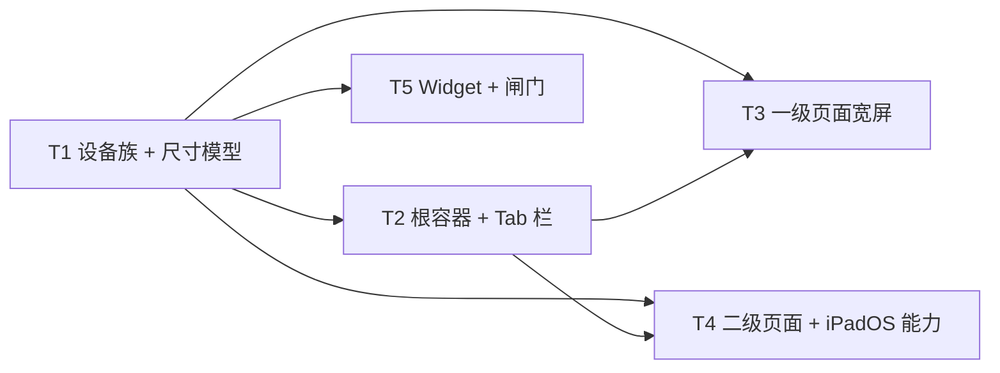
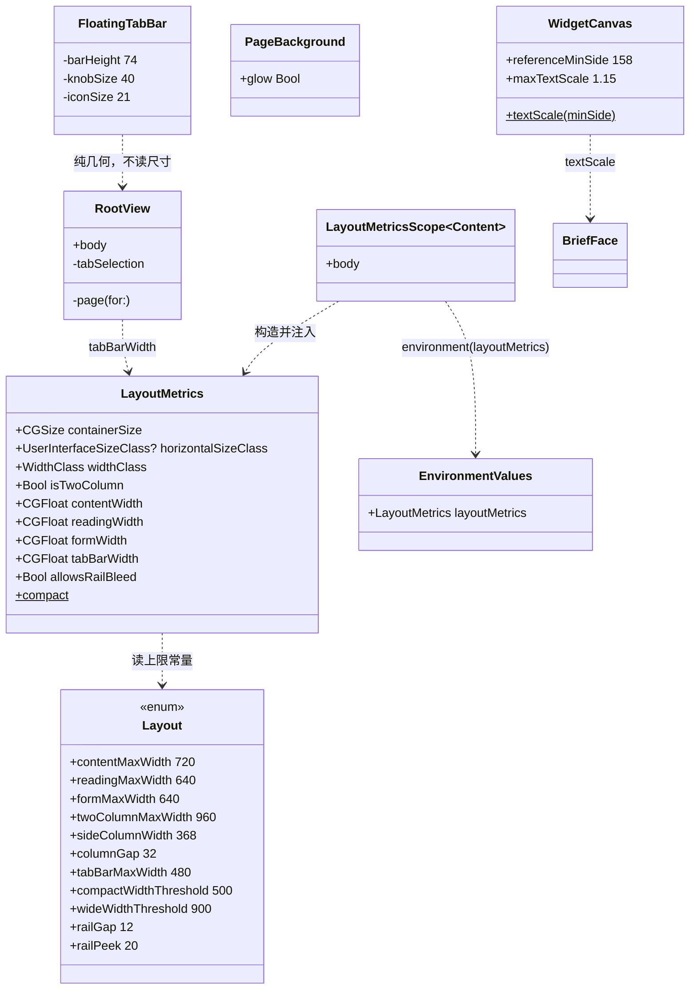
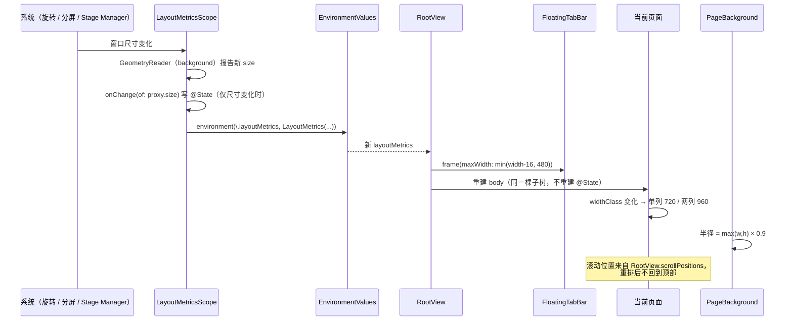
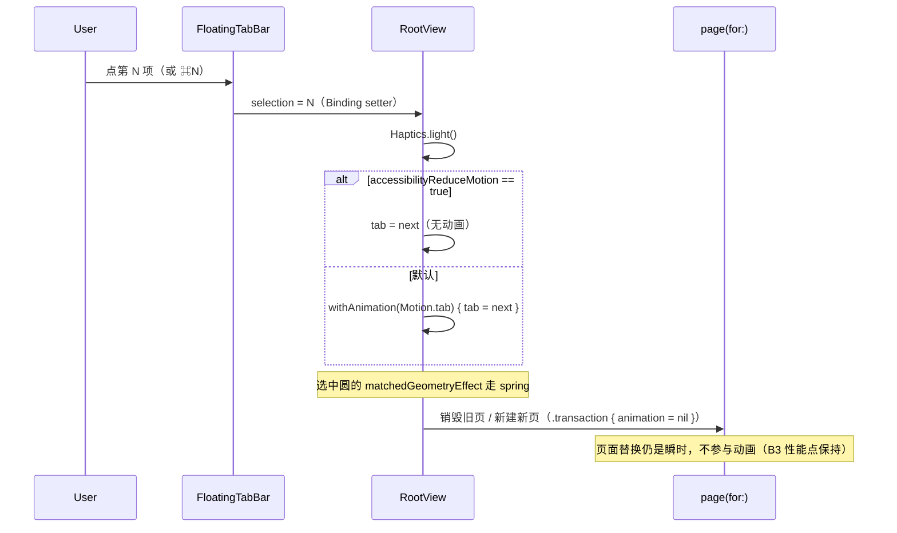

# iPad 支持 + iOS 27 系统层适配 · 架构方案与任务分解

- 日期：2026-10-31
- 角色：架构师（高见远）
- 工程：`/workspace/ios-app`（164 个 `.swift`，xcodegen 生成，无签名 CI 走 Codemagic）
- 版本：3.4.0 (build 10) → 3.5.0（`bash scripts/bump.sh minor`，`project.yml` 两处同步）
- **本文只做设计，不改任何源码。** 所有改动以"新增符号 + 保留旧符号"的方式落地，漏改只会退回 iPhone 尺寸，**不会编译失败**（本机没有 Swift 工具链，这是硬要求）。

---

## 0. 结论速览

| # | 结论 |
|---|---|
| 1 | 尺寸判定只有一处：`LayoutMetrics`（`@Environment`，由 `LayoutMetricsScope` 在 App 根注入一次）。判定输入 = `horizontalSizeClass` + 容器实际宽度，**代码里 `UIDevice.current.userInterfaceIdiom` 出现 0 次**。 |
| 2 | 三档：`compact`（< 500 或 hSizeClass == .compact）/ `regularNarrow`（500…899）/ `regularWide`（≥ 900）。iPad 竖屏 834 → 单列 720；iPad 横屏 1194 → 两列 960；Slide Over 320 → 与 iPhone 完全同构。 |
| 3 | Tab 栏选 **A：底部浮动胶囊限宽 480 居中**。竖栏（B）要重建整个度量模型，会把 3.3 版修掉的"首末项鼓出"问题搬到 Y 轴。 |
| 4 | 只有 3 个页面做两列（红石 / 收益 / 文章列表）。概览、简报、更多、设置、正文、问卷一律限宽单列。**"宁可不缩放"：`CardTier` 高度一个都不改。** |
| 5 | Widget 不做 `.systemLarge`（三条建议 + 判据在 §5.3）；字号改造走"`WidgetCanvas.textScale(minSide:)` 纯函数 + 增量 `xxxScaled(_:)` 重载"，158pt 下恒等 1.0。 |
| 6 | Live Activities 在 iPad 上**不整块隐藏**（无法在不判 idiom 的前提下"仅 iPad 隐藏"），改为同高降级行。 |
| 7 | 多窗口：**不开**（根因是单例 `AppModel` / `RockStore` 会被两个窗口串台）。 |
| 8 | iOS 27：只做 2 件（系统栏样式变化的兼容验证 + 玻璃着色下的文字对比度护栏），其余 8 项写清"不做"的理由。 |
| 9 | 5 个任务，T1 是地基（配置 + 尺寸模型），T2 是根容器与 Tab 栏，T3 一级页面，T4 二级页面 + iPadOS 能力，T5 Widget + 闸门。 |

**不改的东西（越界即返工）**：`.transaction { $0.animation = nil }`、RootView 的条件渲染（同一时刻只 1 页）、`FloatingTabBar` 的 74 / 40 / 21 / 8 / 10、`Spacing` 全部值、`CardTier` 全部值、`Theme` 全部 token、三个 Widget 的 `kind`、entitlements / App Group。

---

## 1. 设备与尺寸模型

### 1.1 为什么不是 idiom

iPad 的 Split View / Slide Over / Stage Manager 会让**同一台设备**在 320pt 与 1194pt 之间自由切换，而 `userInterfaceIdiom` 全程返回 `.pad`。任何按 idiom 分支的布局，要么在 320pt 的 Slide Over 里排成"缩小的 iPad 版"（字挤、图裁），要么在切分屏瞬间不重排。同理 `UIScreen.main.bounds` 在分屏下是**屏幕**尺寸而不是**窗口**尺寸 —— 这正是 `PageBackground.swift:50` 必须改掉的原因（§1.6）。

### 1.2 三档定义

| 档位 | 判定 | 典型场景 | 结果 |
|---|---|---|---|
| `compact` | `hSizeClass == .compact` **或** `width < 500` | iPhone 竖屏 393 / iPhone 横屏（当前锁竖屏，理论 932）/ iPad Slide Over 320 / iPad 1/3 分屏 ≈ 400 | **与 3.4.0 逐像素一致**（所有宽屏分支都不进） |
| `regularNarrow` | `hSizeClass == .regular` 且 `500 ≤ width < 900` | iPad 竖屏 834 / iPad 1/2 分屏 590 / Stage Manager 窗口 700 | 单列，居中限宽 |
| `regularWide` | `hSizeClass == .regular` 且 `width ≥ 900` | iPad 横屏 1194 / 12.9" 竖屏 1024 | 两列（仅 3 个页面） |

> 为什么阈值是 500 / 900 而不是 480 / 1024：500 是"iPhone 最宽竖屏 440 之上、iPad 最小全屏 744 之下"的空档，取中间值避免边界抖动；900 是从两列反推的：副列固定 368、列间距 32，宽度 900 时主列只剩 500（月历格子 67，可用），低于 900 主列会掉到 460 以下、格子瘦到 60，**不如退回单列**。两列满额 960，多出的宽度由居中留白吸收。
> 为什么不是"按宽度等比缩放"：本项目所有几何都是手调 pt（`CardTier` 240/168/96/188 是内容算出来的，不是比例），等比缩放必然出现"iPad 上 240 变成 360，卡里空一半"。

### 1.3 类型与签名（精确到文件）

新增 `Sources/DesignSystem/LayoutMetrics.swift`：

```swift
struct LayoutMetrics: Equatable {
    enum WidthClass: Int, Equatable { case compact, regularNarrow, regularWide }

    /// 容器实际尺寸（不含安全区）。由 LayoutMetricsScope 的 GeometryReader 量一次
    var containerSize: CGSize
    var horizontalSizeClass: UserInterfaceSizeClass?

    static let compact: LayoutMetrics        // containerSize = 393×852, hSizeClass = .compact

    var widthClass: WidthClass               // 判定见 §1.2
    var isTwoColumn: Bool { widthClass == .regularWide }
    var contentWidth: CGFloat                // min(containerSize.width, Layout.contentMaxWidth)
    var readingWidth: CGFloat                // min(containerSize.width, Layout.readingMaxWidth)
    var formWidth: CGFloat                   // min(containerSize.width, Layout.formMaxWidth)
    var twoColumnWidth: CGFloat              // min(containerSize.width, Layout.twoColumnMaxWidth)
    var tabBarWidth: CGFloat                 // min(containerSize.width - Spacing.tabBarInset * 2,
                                             //     Layout.tabBarMaxWidth)
    /// 列宽被限住（= 屏幕比列宽宽）时，横向 rail 不允许出血
    var allowsRailBleed: Bool                // containerSize.width <= Layout.contentMaxWidth
}

extension EnvironmentValues {
    var layoutMetrics: LayoutMetrics         // 默认值 = .compact（任何拿不到环境的场合自动退回今天的版式）
}

struct LayoutMetricsScope<Content: View>: View {
    // 内部：@Environment(\.horizontalSizeClass) + @State width/height + .background { GeometryReader }
    init(@ViewBuilder content: () -> Content)
}
```

`Sources/DesignSystem/Layout.swift` 追加常量（**只加不改**）：

```swift
static let contentMaxWidth: CGFloat = 720      // 单列页面列宽（含 page padding 20×2 → 文字 680）
static let readingMaxWidth: CGFloat = 640      // 正文列宽（文字 600 ≈ 17pt 下 35 个汉字／70 个西文字符）
static let formMaxWidth: CGFloat = 640         // 表单（设置 / 监控 / 填答）
static let twoColumnMaxWidth: CGFloat = 960    // 两列页面总宽（560 + 32 + 368）
static let sideColumnWidth: CGFloat = 368      // 两列的副列（红石：下一场/分布/规律；收益：平台 2×2）
static let columnGap: CGFloat = 32             // 两列之间（= sectionGapLoose，同一套呼吸节奏）
static let tabBarMaxWidth: CGFloat = 480       // Tab 胶囊最大宽
static let compactWidthThreshold: CGFloat = 500
static let wideWidthThreshold: CGFloat = 900
```

### 1.4 注入路径（**全工程只有一处 GeometryReader 参与尺寸判定**）

```
FFWangApp.body
└─ ThemeScope                     （既有，注入 themeMetrics）
   └─ LayoutMetricsScope          （新增，注入 layoutMetrics）
      └─ RootView
         ├─ PageBackground        → 不读 layoutMetrics（自己测绘制区域，见 §1.6）
         ├─ safeAreaInset → FloatingTabBar → 读 layoutMetrics.tabBarWidth
         └─ page(for: tab) → 各页面 → 读 layoutMetrics 决定单列/两列
```

`LayoutMetricsScope` 的实现要点（三条决定"零回归"）：

1. 测量用 **`.background { GeometryReader … }`**，不是包一层 `GeometryReader`。`background` 不参与父级布局，RootView 拿到的 proposal 与今天完全一样 —— 这是不碰 `safeAreaInset` 语义的唯一办法。
2. 只在 **`onAppear` / `onChange(of: proxy.size)`** 时写 `@State`，**不做每帧读**。滚动、Tab 切换、`matchedGeometryEffect` 滑动期间 `proxy.size` 不变，写值不触发。
3. `@State` 初值是 `CGSize.zero` → `widthClass == .compact`。**首帧按 iPhone 版式、第二帧切宽屏**。这个代价换来的是"任何环境丢失都退回今天的样子"，比"猜一个 iPad 宽度"（等于把设备假设重新写回来）安全得多。

> 为什么不是"每个页面自己写 GeometryReader"：6 个一级页 + 5 个二级页 + 3 个弹层，各写一份就有 14 个"设备判定"入口，其中任意一个漏改就是一处只在 iPad 上错位的 bug。**一份环境值，一个判定函数**。
> 为什么不是 `@Environment(\.horizontalSizeClass)` 单独用：它只有两档，无法区分 iPad 竖屏（834，该单列 720）与横屏（1194，该两列 960）。宽度是唯一能表达"还有多少地方可以并排"的量。

### 1.5 与 RootView / FloatingTabBar / 页面容器怎么联动

| 位置 | 读什么 | 做什么 |
|---|---|---|
| `RootView` | `layoutMetrics.tabBarWidth` | Tab 胶囊外层 `.frame(maxWidth: tabBarWidth)` + 水平内缩 8 + `.frame(maxWidth: .infinity, alignment: .center)` |
| `RootView` | `layoutMetrics`（仅透传） | 页面不做任何尺寸判断，统一由各页面自己读环境 |
| `FloatingTabBar` | **不读** | 它保持纯几何组件（74/40/21/8/10 全部不变）；限宽是"容器的事"，不是"栏的事" |
| 各页面 | `layoutMetrics.widthClass / isTwoColumn` | 决定单列/两列与列宽 |
| `PageBackground` | **不读** | 自己测"被绘制的区域"（= 全屏）算半径，替代 `UIScreen.main.bounds`，见 §1.6 |
| `Rail` | `allowsRailBleed` | 列被限宽时关闭左右出血（否则卡片会滑出列外） |

新增 `Sources/DesignSystem/PageColumn.swift`：

```swift
extension View {
    /// 列宽上限 + 水平居中。容器比上限窄时**完全无副作用**（不会多一层 padding）。
    func pageColumn(_ maxWidth: CGFloat) -> some View

    /// 用隐藏按钮挂 ⌘R（iPad 外接键盘）。无键盘时零影响。
    func refreshShortcut(_ action: @escaping () -> Void) -> some View
}
```

实现语义：`self.frame(maxWidth: maxWidth, alignment: .leading).frame(maxWidth: .infinity, alignment: .center)`。
> 为什么先 `maxWidth:` 再 `maxWidth: .infinity`：前者是"最多这么宽、内容左对齐"，后者是"把这块放到屏幕中间"。反过来写（先居中再限宽）会在 720 的框里再居中一次，左对齐的标题会跑到中间。

### 1.6 `PageBackground` 的改法（唯一一处 `UIScreen`）

**不读 `layoutMetrics`**，改为在 `LimeGlow` 自己身上量一次"实际被绘制的区域"：

```swift
struct LimeGlow: View {
    @Environment(\.themeMetrics) private var metrics     // 既有：强度
    @State private var maxDimension: CGFloat = 852       // 首帧兜底（393×852 的长边）
    // body：RadialGradient(endRadius: maxDimension * 0.9) + .background { GeometryReader 里只读不写布局 }
    // 写入条件：onAppear 一次 + onChange(of: proxy.size)（尺寸真变才写）
}
```

数值等价性：`PageBackground` 本身带 `.ignoresSafeArea()`，所以它测到的就是全屏 —— iPhone 393×852 → `max×0.9 = 766.8`，与今天逐像素相同；iPad 1194×834 → 1074.6（宽屏上光斑仍然铺得开，不会缩成一个小绿点）。

> 为什么不复用 `layoutMetrics.containerSize`：根部量到的 `containerSize` 是"窗口的安全区内容尺寸"还是"全窗口尺寸"，取决于 SwiftUI 在该层的 proposal 语义（RootView 自己也有 `safeAreaInset`）。若它不含状态栏/Home Indicator 区域，iPhone 上半径会从 766.8 掉到 ~683（小 11%，肉眼可见）。**半径应当相对"实际被涂的那块区域"算** —— 那就到涂它的那一层去量，语义自洽，且与安全区怎么分配无关。
> 为什么不担心 B7 的"每帧重算"：B7 的问题是 `GeometryReader` 包住渐变、让**布局**参与每帧动画。这里是 `.background` 里的 `Color.clear` 只读 + `onChange` 才写 `@State`，滚动/Tab 动画期间尺寸不变 → 不写 → 不重算渐变。这是 `LayoutMetricsScope` 用的同一个手法。

---

## 2. Tab 栏在 iPad 上的形态

### 2.1 两个候选

| | A. 底部浮动胶囊 · 限宽居中 | B. 左侧浮动竖栏 |
|---|---|---|
| 品牌一致性 | **完全保留**（同一枚胶囊、同一枚 40pt 选中圆、同一套玻璃层级） | 需要新做一套"竖条 + 行"的视觉，用户会认成另一个 App |
| 需要改 `FloatingTabBar` 几何 | 0（只改外层容器宽度） | 需要重排：`HStack` → `VStack`、槽宽 → 槽高、选中圆 `matchedGeometryEffect` 从 X 轴换到 Y 轴、标签从"图标下方居中"变"图标右侧左对齐" |
| 横屏内容空间 | 底部占用 90pt 高度（1194×834 里占 10.8%），横向 100% 可用 | 左侧占用 ~96pt 宽度（占 8%），但内容列只能整体右移 |
| Slide Over 320 | 自动退化为"满宽横排"（档位 = compact，同一份代码） | 必须写第二条布局（竖栏在 320 里会吃掉 30% 宽度）→ **两套几何，两套回归面** |
| 实现风险 | 低（只动 frame） | 高（动的是一个已因观感问题返工过一次的组件） |

### 2.2 选择 A，理由（按权重）

1. **自绘栏是品牌资产**：`FloatingTabBar` 的文件头注释记录了它是照参考图四重做的（整幅宽 + 40pt 选中圆 + 徽标），用户对它的记忆点是"屏幕底部那条会滑的青柠圆"。竖栏在 iPad 上等于换了一个控件。
2. **iPhone 侧零改动的唯一路径**：A 只改"栏外面套一层 frame"，`FloatingTabBar` 内部一个常量都不动；B 必须改内部结构，而内部结构一旦分叉（横排/竖排两套），iPhone 的横排分支就再也不能保证"和 3.4.0 逐像素等价"。
3. **Slide Over 的退化是免费的**：A 的宽屏形态和窄屏形态是**同一个 View 的两个宽度**，320pt 下就是今天的栏；B 在 320pt 下必须切回横排 —— 那意味着"竖栏方案最终还是要写横排"，等于维护两套。
4. **横屏纵向空间比横向更贵**：iPad 横屏 834 高，扣掉状态栏与 Home Indicator 还有 ~790；底部 90 可接受。而左侧 96pt 会永久压缩 7 列月历（560 → 464，格子从 75 瘦到 61）。
5. **命中率**：底部栏在双手握持 iPad 时更靠拇指；左侧栏在 12.9" 上反而要"够"。

> 为什么不是 B：它不是"改一个轴"那么简单。选中圆从横排换到竖排后，**"首末项鼓出"这个几何问题会原样复现**（见 §2.3），而它正是 3.3 版返工的根因。

### 2.3 竖栏为什么必然复现"不对称"（这是 B 被否的硬理由）

3.3 返工的本质是一条公式：选中圆 40、未选中图标 21，两者都在槽心居中，于是

```
左端留白差 = (槽宽 − 40)/2 − (槽宽 − 21)/2 = (40 − 21)/2 = 9.5pt   （与槽宽无关）
```

竖栏把"槽心"从横向改成纵向后，同一类差值立刻出现在 **Y 轴**：

- 行高 44、圆 40、图标 21 → 首行圆的顶边距 = (44−40)/2 = 2pt，末行图标的顶边距 = (44−21)/2 = 11.5pt；
- 选中态若把圆"顶到行首"（对应今天"抬回圆心"的光学修正），首末行的留白差会达到 9.5pt 量级，而且这次是**上下都不对称**（用户对垂直居中的偏移比水平更敏感）；
- 更麻烦的是标签：横排时标签在图标正下方居中，圆鼓出左右不影响文字；竖排时标签在图标右侧左对齐，圆的左边缘与标签的左边缘不再共线，选中项的文字会"看起来缩进了一格"。

**结论**：A 加宽时，上面那条 9.5pt 是**绝对差恒定**，相对差反而变小（377 → 480：2.52% → 1.98%），观感只会更对称，不会更歪。这条数学事实就是"A 不会复现同类返工"的证明。

### 2.4 参数与帧

```
窄屏（compact，393）：栏宽 377 = 393 − 8×2                ← 与今天完全一致
宽屏（regular）：    栏宽 480（上限）居中，两侧各留 (1194−480)/2 = 357
                    栏高 74 / 选中圆 40 / 图标 21 / 内边距 14 / 上下 10·8  ← 全部不变
                    距底 10 + 安全区（iPad 横屏 Home Indicator 20）       ← 不变
```

- 480 的来历：5 项 × 90.4pt 槽宽（今天 69.8），槽宽 ≥ 88 保证拇指落点；480/1194 = 40% 屏宽，读起来仍是"一条栏"而不是"一条带"；再宽（> 560）时槽宽超过 100，选中圆在槽里会显得孤零零。
- 上下渐变遮罩不需要新增：玻璃本身就是浮层，`safeAreaInset` 已经保证内容不被压。

### 2.5 代码落点（只改一处）

```swift
// RootView.body 的 safeAreaInset 内
FloatingTabBar(tabs: …)
    .frame(maxWidth: metrics.tabBarWidth)          // ★ 唯一新增
    .padding(.horizontal, Spacing.tabBarInset)
    .padding(.bottom, Spacing.tabBarBottomGap)
    .padding(.top, 6)
    .frame(maxWidth: .infinity, alignment: .center) // ★ 居中（窄屏下等价于今天的满宽）
```

> 为什么把 maxWidth 放在 `padding(.horizontal, 8)` **之前**：今天栏宽 = 屏宽 − 16，若放在 padding 之后，iPad 上实际栏宽会变成 480 + 16 = 496，且 iPhone 也会变成 361（回归）。放在前面时 393 − 16 = 377 与今天一模一样。

---

## 3. 每个页面的宽屏布局

### 3.1 总表

| 页面 | 宽屏形态 | 最大宽 | 关键理由 | 明确不做 |
|---|---|---|---|---|
| Overview | 单列 | 720 | 一屏一锚点（hero 240 + medium 168 是"此刻"这一组）；并排会让两个锚点打架 | 不做两列；hero 不放大 |
| Rock | **两列** | 960（560 + 32 + 368） | 月历是 7 列网格，拉宽只让格子变胖；右侧 368 恰好放"下一场／分布／规律" | 不改 `cellHeight 56`；不加到 8 列 |
| Brief | 单列 | 720 | 版本对比 → 今日详情 → 记录是线性叙事；两列会把正文压到 340（19 个汉字/行） | 不做侧栏；不做"双栏报纸" |
| Earnings | **两列** | 960（560 + 32 + 368） | 数据看板：hero（总）与平台占比（分）并置才能对照；活动流水仍全宽 | 平台卡不改成 3 列（金额字号是按 150pt 卡宽定的） |
| Articles | **两列网格** | 960（2 × 474） | 列表型内容，一屏 8 篇；不做"列表+预览"（列表接口不返回正文，PRD F3） | 不做主从分栏 |
| More | 单列 | 720 | 只有 2 tile + 4 行，分栏会更空 | 不做两列 |
| Settings（sheet） | 单列 | 640（form） | 短行表单，行宽 > 640 会让"标题 …… 值"之间拉出一条空 | 不改 sheet 呈现方式 |
| Monitor | 单列 | 640 | 两张版本卡 + 一段说明 | 不做两列 |
| ArticleDetail | 单列 | 640（reading） | 阅读行宽 60–75 字符原则：17pt 下 600pt ≈ 35 汉字 / 70 西文字符 | 不做"侧边目录" |
| Survey（列表/详情/结果） | 单列 | 720 | 题目统计是逐行条，横向并排会让每条变短、比较失真 | 不做两列 |
| Survey（填答） | 单列 | 640（form） | 输入型页面 | 不做两列 |

### 3.2 Overview

```
┌──────────────────── 720 居中 ────────────────────┐
│ 10月31日 · 周六  农历九月初十              ⚙︎      │
│ ─────────────── divider ───────────────────────  │
│ [ 红石 hero 240 · 全宽 680 ]                      │
│ [ 简报 medium 168 · 全宽 680 ]                    │
│ 今日一览                                          │
│ [ tile 96 ][ tile 96 ]                            │
│ 继续读                                             │
│ [rail 140×188][rail][rail][rail]  ← 不出血         │
│ 快捷                                               │
│ (全部文章)(光遇简报)(关于)                          │
└───────────────────────────────────────────────────┘
```
- 布局改动只有两处：`.pageColumn(Layout.contentMaxWidth)`，`Rail(bleeds: metrics.allowsRailBleed)`。
- 宽屏下 rail 可见 4 张（(680−3×12)/4 = 161 ≥ 140），不需要改卡宽。
- > 为什么不是"hero + 简报左右并排"：它们是同一条时间线上的"现在"和"今天"，并排会让眼睛在两块之间来回跳；而且 240 vs 168 不等高，并排必然出现一块矮一截 —— 三块等高是今天观感的基础。

### 3.3 Rock

```
┌────────────────────────── 960 ──────────────────────────┐
│ 红石 / 已生成 10.01–10.31                       [攻略]   │
│ ┌───────────── 560 ─────────────┐ ┌────── 368 ──────┐  │
│ │ 本月            ‹ 2026年10月 › │ │ [下一场 · 条]    │  │
│ │ ┌ 月历 7×6 ─────────────────┐ │ │ 场次分布          │  │
│ │ │ 格子 75×56（今天 46×56）   │ │ │ （折叠图）        │  │
│ │ └───────────────────────────┘ │ │ 规律              │  │
│ └───────────────────────────────┘ │ （入口行）        │  │
└───────────────────────────────────┴──────────────────┘
```
- 结构：`header` 通栏；下面 `if isTwoColumn { HStack(top) { monthGroup ; sideColumn } } else { 现有 VStack }`。
- 副列顺序：`NextEventBar` → `distributionGroup` → `rulesGroup`（窄屏顺序不变，宽屏只是把它们从月历下面搬到右边）。
- 格子宽度 75.7（560 − 6×5）/7；高度保持 56。
- > 为什么不把 `cellHeight` 提到 64 让格子接近正方形：高度一变，6 行总高 336 → 384，整页纵向节奏（32/12）就要重新调；而"格子略宽"在 iPad 上不会读出错（日期 + 标记 + 地图短名仍是左对齐）。

### 3.4 Brief

单列 720。三块（两服版本 / 今日详情 / 版本与推送）纵向排列，`SkyVersionPanel` 内部仍是两列（每列 ≈ 334）。
- > 为什么不做两列：简报页的主体是**文字**（`TodayBriefCard` 的正文），两列会把 680 的正文压到 340 ≈ 19 汉字/行，低于 30 字的下限；另外"版本对比"与"今日详情"并排会让读者以为它们是同一层级的两件事。

### 3.5 Earnings

```
┌──────────────────────── 960 ─────────────────────────┐
│ 收益  ⟳                                              │
│ ┌────────── 560 ──────────┐ ┌────── 368 ───────────┐ │
│ │ hero 216                │ │ 平台                 │ │
│ │ 本月  [tile][tile][tile]│ │ [卡 178][卡 178]     │ │
│ │                         │ │ [卡 178][卡 178]     │ │
│ └─────────────────────────┘ └──────────────────────┘ │
│ 最近活动（全宽 960，单列行 72pt）          [全部]      │
│ 页脚说明                                              │
└──────────────────────────────────────────────────────┘
```
- `platformGridColumns` 保持固定两列（(368 − 12)/2 = 178 一张），**不改 `.adaptive`** —— 文件里已经写明理由（金额字号按 150 定档），宽屏改成 4 列会让金额列过宽、字号显得小。
- 活动流水通栏：它天然是"流水"，宽度越大越好读；放副列会让右列比左列高一倍。
- > 为什么 hero 不放右列：hero 是一屏的锚点，必须在左上（中英混排的阅读起点）。

### 3.6 Articles

两列网格，`LazyVGrid(columns: [flexible, flexible], spacing: 12)`，每列 474（960 − 12 后二分）。
- 置顶卡在宽屏下不单独加"置顶"小标题（改成网格第一格，卡片自带 `置顶` 徽标），窄屏保持今天的分段标题 —— 这个分支只在 `isTwoColumn` 里。
- footer（加载更多）通栏居中，仍然挂 `.task(id: paginationKey)`，**不改触底逻辑**。
- > 为什么不做"左列表 320 + 右预览"：预览需要正文（`/api/app/article?id=` 二次请求，PRD F3 列表不返回 content），等于一进页面就预请求一篇文章；而且 `AppModel.articleState` 是单例状态，主从布局会让"列表选中的文章"和"详情页正在读的文章"共用同一份状态，直接把今天的 `fullScreenCover` 契约搞坏。

### 3.7 More / Settings / Monitor

单列 720 / 640 / 640。More 的两张 96 tile 保持 `HStack`（每张 ≈ 334，比今天 176 宽近一倍，`statusTile` 内部是 `VStack` 左对齐，不会变形）。
- > 为什么 Settings 用 640 而不是 720：设置行是"图标 + 标题 …… 值"，值右对齐；行越宽，标题与值之间的空隙越大，扫读成本越高。640 是"最长一行文案（'锁屏与灵动岛显示下一场倒计时' 17 字）+ 值"刚好不折行的宽度。

### 3.8 ArticleDetail

- 内容列 `.pageColumn(Layout.readingMaxWidth)`；**导航条（返回 / 分享）也必须套同一个 `pageColumn`**，否则返回钮贴在 1194 屏幕最左边、正文在中间，视线要横跨 500pt。
- 顶部 `padding(.top, 56)`、底部 `padding(.bottom, 64)` 不变。
- 块级元素（图片 / 视频 / 代码）跟列宽 640；`ImageBlock` 的 `maxWidth: .infinity` 自动适配，不需要改。
- > 为什么不做"正文 + 侧边目录"：正文块（`Block`）没有稳定的目录锚点（标题块可能缺失），做目录要新增解析与滚动定位两套逻辑，收益是"跳读"，不是"适配"。

### 3.9 Survey

- `SurveyWorkspaceView` 只是容器，四页各自加 `pageColumn`：List / Detail / Result → 720，Fill → 640。
- 页头 `SurveyPageHeader` 与内容同列（跟着 `pageColumn` 走，因为它在 ScrollView 里）。
- > 为什么统计页不做两列：`QuestionStatView` 是"选项名 …… 条 …… 百分比"的单行结构，两列会让每条从 680 缩到 320，条形图的可比性（长度对比）反而下降。

---

## 4. 组件档位与间距的宽屏调整

### 4.1 决策表

| 项 | 现状 | 宽屏 | 为什么 |
|---|---|---|---|
| `CardTier.hero` 240 | 240 | **240** | 240 是内容算出来的（眉题 14 + 主数字 48 + 两行 13 + 轨 4 + 三场 30 + 内边距），拉高只会把留白变成"空"。宽屏下卡更宽（680），视觉上已经是"横幅"，不需要更高 |
| `CardTier.medium` 168 | 168 | **168** | 同上（简报摘要 2 行 + 轨迹 + 页脚） |
| `CardTier.tile` 96 | 96 | **96** | 并排小卡，宽屏下变成 2×344 或 4×176，高度不变才叫"同一档" |
| `CardTier.rail` 188 / `railWidth` 140 | — | **不变** | 宽屏靠"多露一张"而不是"放大一张" |
| `Spacing.page` 20 | 20 | **20** | 页边距是"屏幕边"的关系，不是"容器边"的关系；列宽已经限住，再加内边距会把文字挤到 640−80 = 560 |
| `Spacing.sectionGapLoose` 32 | 32 | **32** | 列间距也用 32（`Layout.columnGap`），全页只有一种"组间呼吸" |
| `Spacing.pageBottomInset` 120 | 120 | **120** | 宽屏 Tab 栏仍占 90 + 安全区 20 = 110 < 120 |
| `Radius.*` | — | **不变** | 圆角是"卡片尺寸"的函数；卡片高度没变，圆角也不该变 |
| `Typography.*` | — | **不变** | 字阶是按阅读距离定的（iPad 手持距离与 iPhone 接近），放大字号会让一屏信息量骤降 |

### 4.2 新增常量（9 个，全是 `Layout` 的 `static let`，不动任何旧值）

- **结构性 4 个**：`columnGap 32` / `sideColumnWidth 368`（两列布局）、`tabBarMaxWidth 480`（Tab 栏上限）、`twoColumnMaxWidth 960`（两列页上限）。
- **列宽 3 个**：`contentMaxWidth 720` / `readingMaxWidth 640` / `formMaxWidth 640`。
- **阈值 2 个**：`compactWidthThreshold 500` / `wideWidthThreshold 900`。

> 为什么不给 `Spacing` 加 `pageWide`：页面 20 在 393 与 1194 上都成立（列宽已经限住），多一个"宽屏页边距"等于给未来的自己留一个"什么时候该用哪个"的选择题。

### 4.3 `Rail` 的出血开关

```swift
struct Rail<Content: View>: View {
    var bleeds: Bool = true          // ★ 默认 true：现有调用点零改动
    …
    // bleeds == false 时不加 .padding(.horizontal, -Spacing.page) 与 safeAreaPadding
}
```
- 出血的意义是"卡片滑到屏幕边"，前提是**列宽 = 屏宽**。宽屏下列宽 720 < 1194，出血会让卡片滑到列外、压在空白上。
- > 为什么不是"宽屏时把列宽设成屏宽"：那样卡片会拉成 1194 宽的一条（正是本文明令禁止的"被拉成一条"）。

### 4.4 卡片内部按宽度比算几何的组件（T3 验收清单）

这些组件用 `GeometryReader` 或比例算几何，宽屏下会被"拉平"，必须逐张目视：

`RedstoneCountdownCard` 的进度轨（宽 680 时节点在 0–671 之间走 → 正常）、`StatCompositionBar`、`PlatformCard` 的占比条、`SkyCard` 的地平线、`MonthDistributionChart`。

处置规则（**不许改比例常数**）：若某张卡在 720 宽下明显失真，只允许给该卡加 `.frame(maxWidth: 560)` 上限并居中，iPhone 上无影响。

---

## 5. Widget 在 iPad 上的适配

### 5.1 事实

| | iPhone | iPad |
|---|---|---|
| `.systemSmall` 画布 | 158×158 | ≈170×170 |
| `.systemMedium` 画布 | 338×158 | ≈364×170 |
| 组件圆角 | ≈22 | ≈24–26 |
| 锁屏组件 | accessory 家族 | iPadOS 支持锁屏，但本 App 不支持 accessory 家族 → 不可添加（不是 bug） |

字号是按 158 调的（`RedstoneMetric` 的文件头写明"11pt 是这套语言的下限"）。到 170 只是"四周多出 12pt 余量"，**不会丑**，但会显得"字偏小、边偏空"。7.6% 的差值是"可做可不做"的分界 —— 所以做成**可选增量**，默认恒等，不阻塞发布。

### 5.2 硬编码字号的改造方式（可测、可降级、不用 `UIScreen`）

新增 `Sources/Widget/WidgetCanvas.swift`（只进 Widget target）：

```swift
enum WidgetCanvas {
    /// 158 是现有全部字号的调校基准
    static let referenceMinSide: CGFloat = 158
    /// 上限 1.15：再大就会把 `.systemMedium` 的两行正文挤掉第三行
    static let maxTextScale: CGFloat = 1.15

    /// 纯函数，可单独测：170 → 1.076，158 → 1.0，0/异常 → 1.0
    static func textScale(minSide: CGFloat) -> CGFloat {
        guard minSide > 1 else { return 1 }
        let raw = minSide / referenceMinSide
        return min(max(raw, 1), maxTextScale)
    }
}
```

调用侧（以 `BriefFace` 为例，其余两张同构）：

```swift
@State private var canvasMinSide: CGFloat = 0        // 0 → 比例恒为 1（降级）
private var s: CGFloat { WidgetCanvas.textScale(minSide: canvasMinSide) }

// 在原 body 的根部挂一次测量（background 不参与布局）
.background {
    GeometryReader { p in
        Color.clear
            .onAppear { canvasMinSide = min(p.size.width, p.size.height) }
            .onChange(of: p.size) { _, new in canvasMinSide = min(new.width, new.height) }
    }
}

// 字号：新增"带比例"的重载，**保留原常量**
static func titleScaled(_ s: CGFloat) -> Font { .system(size: 20 * s, weight: .bold) }
// 调用点：.font(BriefMetrics.titleScaled(s))
```

三条纪律：

1. **只保留原常量、另加 `xxxScaled(_:)`，不要改签名。** 漏改一处只会"字号不跟画布"，**不会编译失败** —— 这是无编译环境下的唯一正确写法（把签名从 `static let title` 改成 `static func title()` 会让每一次漏改都变成一轮 CI 报废）。
2. **只缩放最大的 3–5 处字号**（红石 `time` 34、简报 `title` 20 / `body` 13、天光 `phaseLabel` / `countdown`）。11pt 注脚放大 7% 肉眼不可辨，改它只会增加回归面。
3. **几何一律不缩放**（padding / 弧高 / 节点直径全部按 158 调过，缩放会让弧压字）。170 画布多出的 12pt 由 `frame(maxWidth:.infinity)` 的余量吸收。

> 为什么不是 `UIScreen`：Widget 进程里 `UIScreen.main.bounds` 返回的是**屏幕**，iPad 分屏时与组件画布无关；用它算字号在 iPad 竖屏会得到 1024/158 = 6.5 倍，直接爆掉。
> 为什么不是"给 iPad 单独写一套字号"：没有 API 能在 Widget 里区分 iPad（`widgetFamily` 两边一样）。画布尺寸是唯一可用的量。

### 5.3 要不要新增 `.systemLarge`：**本批不加**

| 组件 | 加 large 的后果 | 结论 |
|---|---|---|
| `RedstoneWidget`（正方形）| large 是 364×382 的竖长矩形，而红石卡的全部几何（弧带 22、节点 3、34pt 时刻）是按"158 见方"配平的；换成 364×382 的近正方形（边长 ×2.3、面积 ×5.3）会出现"上半屏一个数字、下半屏一片空天空"。要做 large 等于**重新设计一张卡**，不是适配 | 不加 |
| `BriefWidget` | large 能放下"日期 + 标题 + 3 行正文 + 轨迹 + 宜忌 + 日出日落"，是三张里唯一"有内容可填"的；但仍需新一套行数与字号（`BriefMetrics.dotCount` / 正文行数都是按 small/medium 两档写的） | 本批不加，列入下一版候选（前提：先出 large 版式稿） |
| `SkyLightWidget` | 文件里已写明"不支持大号：把这张版式拉成 4×2 只会让天空变空" | 不加 |

判据（写给以后）：**加尺寸的前提是"新尺寸有独立的版式设计稿"，而不是"把现有版式 stretch"**。本批的任务是"在 iPad 上不坏"，不是"在 iPad 上多一种组件"。同时提醒：`supportedFamilies` 只增不减是安全的（旧实例不受影响），但新增 family 会让已上桌的实例在系统升级后被"升级尺寸"吗？不会 —— 用户桌面上的实例尺寸由用户放置时决定，改 `supportedFamilies` 不影响已有实例。

### 5.4 系统着色（tinted / clear）模式

iOS 18 起用户可把组件设为"着色/透明"。系统会把我们的 `Theme` 自定义色压成单色近似 —— 这是系统行为，**不做自定义 accented 渲染**（要为三张卡各设计一套单色版式 = 一次新设计）。已知结果：着色模式下卡面变单色，文字仍可读（我们的字色是近白/近深，与系统提供的底色对比足够）。记录为已知限制，不列为缺陷。

### 5.5 Widget 验收

- iPhone 上三张卡与 3.4.0 截图逐像素对比（`textScale(158) == 1.0`，保证）；
- iPad 上三张卡文字略大、不裁字、不压弧（`textScale(170) ≈ 1.076`）；
- 旋转 / 分屏组件重建时 `onChange(of: p.size)` 只触发一次。

---

## 6. iPad 缺失能力的降级清单

| 能力 | iPad 上的事实 | 处理 | 位置 |
|---|---|---|---|
| Live Activities（灵动岛 / 锁屏实时活动） | 不可用（无灵动岛，iPadOS 不支持锁屏实时活动） | **不整块隐藏**，改为同高降级行：`Toggle` 置灰 + 副标题换成"此设备不支持锁屏实时活动，可用桌面小组件"（`lineLimit(2)`）；`LiveActivityCoordinator.evaluate` 已有 `guard … areActivitiesEnabled` 守卫，iPad 上自动 no-op，无需改 | `SettingsView` / `LiveActivitySection` |
| 触觉 `UIImpactFeedbackGenerator` | 无马达，不报错、无反馈 | 保留代码（iPhone 需要），**不新增**任何"只靠触觉传达信息"的交互 | `Haptics`（不改） |
| 系统分享面板 | `UIActivityViewController` 在 iPad 上若用 `.popover` 必须给 `sourceRect`，否则崩溃 | 现状是包在 `.sheet` 里 → iPad 上是 form sheet，**不会崩**。明确记录：**不要改成 `.popover`** | `ShareSheet` / `ArticleDetailView` |
| 桌面小组件深链 `skyapp://` | 正常 | 无需改（`onOpenURL` 与 idiom 无关） | `RootView`（不改） |
| 剪贴板 / `openSettingsURLString` | 正常 | 无需改 | `SettingsView` |
| 视频播放（`VideoPlayer`） | 正常；iPad 横屏会切全屏 | 无需改；T4 目视一次 | `VideoBlock` |
| 锁屏组件 | 本 App 不支持 accessory 家族 | 不支持即不出现，属预期 | `supportedFamilies`（不改） |
| iPhone 竖屏锁定 | iPad 需要四向 | `Info.plist` 加 `UISupportedInterfaceOrientations~ipad`（基础键保留，iPhone 仍只竖屏） | `Resources/Info.plist` |

**关于"怎么藏 Live Activities"的正面回答**：除了 `ActivityAuthorizationInfo().areActivitiesEnabled`，没有任何公开 API 能表达"这台设备支持实时活动"。而 `areActivitiesEnabled` 在 iPad 上恒为 `false`、在"用户在系统设置里关掉了实时活动"的 iPhone 上也是 `false`。所以：

- 用 `areActivitiesEnabled` 做**能力判定**，不用 idiom；
- 表现上选择"降级不隐藏"：整块隐藏会让设置页少一组、页面高度突变，用户会以为"设置项丢了"；同高降级行既解释了原因，又保住了布局；
- > 为什么不是"用 `widthClass` 判 iPad"：iPad 在 Slide Over 里是 `compact`，用宽度判会在 Slide Over 里显示一个无效开关 —— 这正是约束 1 要避免的同一类错误。

---

## 7. iPadOS 系统能力接入

### 7.1 键盘快捷键（5 组，全部挂在既有 Button 上，不新增视图）

| 快捷键 | 行为 | 挂载点 |
|---|---|---|
| ⌘1 – ⌘5 | 切 Tab | `FloatingTabBar.tabItem` 的 Button：`.keyboardShortcut(KeyEquivalent(Character(String(tab.id + 1))), modifiers: .command)`（可见 5 项 id = 0…4） |
| ⌘[ | 返回 / 关闭详情 | `ArticleDetailView`、`MonitorView`、`SurveyPageHeader` 的返回钮：`.keyboardShortcut("[", modifiers: .command)` |
| Esc | 关闭当前模态 | 挂在"完成/关闭"钮上：`SettingsView` 的「完成」、`SurveyWorkspaceView` 的关闭钮（`.keyboardShortcut(.cancelAction)`）。**一个 Button 只能挂一个快捷键**，所以返回钮给 ⌘[、关闭钮给 Esc，两者不抢 |
| ⌘R | 刷新当前页 | `PageColumn.refreshShortcut { … }`（隐藏 Button 挂在页面 `.background`；Overview/Brief/Earnings/Rock 四页，各自调用已有的 refresh 方法） |
| ⌘← / ⌘→ | 红石翻月 | `RockCalendarView.monthArrow` 的两个 Button |

> 为什么不给每个可点元素都配快捷键：iPad 外接键盘的用户主要用"切页 + 刷新 + 返回"三类动作；给卡片配 ⌘ 组合会与系统快捷键冲突且没人记。iPhone 上这些快捷键无副作用（无键盘时是死代码）。

### 7.2 指针 hover

- `.hoverEffect(.highlight)`：Tab 项（叠加在 `PressableStyle` 之上，`FloatingTabBar.swift`）、`ArticleRowCard`、`GlassListRow`（`DesignSystem/Cards.swift`）、`MoreRow`（`MoreView.swift` 内的私有行，随 T3 一起改）。
- **玻璃卡片不加 `.lift`**：`GlassShadow` 已经给了双层投影，`lift` 会再叠一层，指针移入时卡片像"跳一下"。
- iPhone 上无指针 → 完全无影响。

### 7.3 `contextMenu` 补齐（3 处）

| 位置 | 菜单项 | 实现约束 |
|---|---|---|
| `ArticleRowCard` | 打开 / 分享 / 复制链接 | 新增两个**带默认值**的闭包参数（`var onShare: (() -> Void)? = nil`、`var onCopyLink: (() -> Void)? = nil`）——现有调用点零改动 |
| `RedstoneMonthGrid` 的日期格 | 看这天的场次 / 复制日期 | 复用既有 `onSelect`；复制走 `UIPasteboard`（与 `SettingsView.copyToPasteboard` 同一手法） |
| `EarningsView` 的活动行 | 复制金额 | 仅当行内已有金额文本时出现 |

> 为什么不给 Tab 项加 `contextMenu`（"在新窗口打开"之类）：多窗口不开（§7.4），放一个点了没反应的菜单项比不放更糟。

### 7.4 多窗口（`UIApplicationSupportsMultipleScenes`）：**不开**

结论：`Info.plist` 里**不写**该键（默认单窗口）。若开启，风险是结构性的：

1. `AppModel` / `RockStore` / `RockGuideStore` / `MonitorStore` 都是 `@StateObject` 挂在 `App` 上（App 级单例）→ 两个窗口共享同一份 `articleState` / `feedState`：A 窗读文章 1、B 窗读文章 2，A 窗的正文会被 B 窗覆盖。
2. `LiveActivityCoordinator` 每个窗口都会跑一条 `scenePhase` 驱动的 task → 同一场红石被评估两次（虽然 `evaluate` 内部幂等，但 60s 轮询翻倍）。
3. `RootView` 的 `fullScreenCover(item: $openedArticle)` 是窗口级的，行为正确；但 `scrollPositions` 字典在 `RootView` 里，每个窗口一份 —— 这部分反而没问题。
4. 真正要开，必须先把 4 个 Store 从 `App` 下移到 `WindowGroup` 的 content 里（每个窗口一份），并让 `LiveActivityCoordinator` 只在"第一个 active 的 scene"跑。这是一次**架构改造**，不是适配。

> 为什么不做：收益是"同时看红石和文章"，代价是四个单例的生命周期重排 + 一处难以复现的双写竞态。本批不做，写进"以后想做必须先做的三件事"。

### 7.5 Dynamic Type / Bold Text

**结论：本批不做字号缩放，只做"不破版"兜底。**

- 全工程 82 处 `.system(size:)` 固定 pt（`Typography` 的设计前提，文件头写明"交给系统字号会导致不同设备上排版漂移"）。固定 pt **不随 Dynamic Type 放大** —— 也就是说 AX 字号下我们的文字尺寸不变，不会撑破布局，但也**没有**无障碍字号支持。这是产品债，不是本次适配引入的缺陷。
- 若强行改成语义字号：iPhone 上每一个页面的断行、卡片高度、`CardTier` 全部要重调 —— 直接违反"零回归"。
- 兜底三条（T3/T4 执行）：新容器一律用 `minHeight` 不用 `height`；标题/标签保持 `lineLimit` + `minimumScaleFactor`；不新增"按字数算高度"的布局。
- Bold Text：`Font.system(size:weight:)` 不响应粗体开关，不做处理（改用 `@ScaledMetric` / `.fontWeight` 动态化会把两套字重变成四套）。
- 后续独立批次建议：只对"正文 + 列表行"做 `@ScaledMetric` 缩放（上限 1.3），并同步给 `CardTier` 增加 AX 变体。

### 7.6 Reduce Motion

已覆盖 2 处（`Skeleton`、`SkyStatusCard` 的呼吸光晕）。本批补 1 处：

```swift
// RootView
@Environment(\.accessibilityReduceMotion) private var reduceMotion
…
if reduceMotion { tab = next } else { withAnimation(Motion.tab) { tab = next } }
```

**不要动**页面侧的 `.transaction { $0.animation = nil }` —— 它本来就是"无动画"，与 reduceMotion 无关。
> 为什么只补这一处：选中圆是唯一"有距离的滑动"（跨 90pt），也是唯一会让前庭敏感用户不适的动效；其余是淡入/缩放（`glassIn` / `press`），可保留。

### 7.7 横屏安全区

- iPad 横屏：左右安全区 0（无刘海），底部 Home Indicator 20，顶部状态栏 24。
- Tab 栏走 `safeAreaInset` → 自动落在 Home Indicator 之上，**不需要**额外 `padding(.bottom)` 硬编码。
- 全屏背景（`PageBackground`）继续 `.ignoresSafeArea()`；新增的两列容器**不要** `ignoresSafeArea`，否则内容会滑到 Home Indicator 下面。
- `Spacing.page 20` 与安全区是叠加关系（20 + inset），iPad 横屏 inset = 0 → 就是 20，与 iPhone 一致。
- 需要实测的两个点：① 横屏时 `fullScreenCover` 的顶部导航条是否仍距状态栏 6pt；② Stage Manager 窗口缩小到 500 宽时 `widthClass` 是否在 500 附近稳定（不在 500 附近抖动：判定是单向阈值，不存在滞回）。

---

## 8. iOS 27 系统层：与本 App 的关系

| 能力 | 相关性 | 做不做 | 怎么做 / 为什么不 |
|---|---|---|---|
| **全面更新的标签页栏与导航栏**（系统级新样式与材质） | 高（导航是每天看到的界面） | **不做跟随，只做兼容验证** | 我们不用系统 `TabView`/`NavigationStack`（RootView 自绘、详情自绘玻璃条），系统栏改版**不波及**我们的栏。验证项只有两条：① 新系统下 `safeAreaInset(.bottom)` 不会额外加一层内边距（栏仍距底 10、高 74）；② 自绘栏在横屏的 Home Indicator 之上位置正确。**不跟随的理由**：自绘栏是品牌资产，换成系统栏会丢掉 `matchedGeometryEffect` 的选中圆，而"圆从旧位置滑到新位置"是 3.3 版专门修过的观感 |
| **Liquid Glass 更新**：更均匀折射、对比度更好、新增"玻璃着色"滑块（超清透 → 完全着色） | 高 | **做（只做文字对比度护栏）** | 用户的着色设置会直接改变 `glassEffect` 的底色，**我们读不到也不该去读**（没有公开 API，猜一个等于把系统行为写死）。因此只做三件事：① Tab 栏未选中标签 `textTertiary` → `textSecondary`（全工程唯一"小字压在浮动玻璃上"的位置，11pt）；② 定一条团队规则：**玻璃面上的文字只允许 `textPrimary` / `textSecondary`，正文不得用 `textTertiary`**；③ iOS 18–25 的手工玻璃路径（`HandGlass`）**不动** —— 这条路径不采样系统着色，本来就不受滑块影响。为什么不重调 `Glass` 参数：系统着色是**叠加**在用户偏好之上的，我们调 tint 只会让两套外观（深浅）更难对齐，且 iPhone 上会立刻看到颜色变化 = 回归 |
| 系统导航栏 / 工具栏新材质 | 中 | **不做** | 全工程没有系统导航栏（没有 `NavigationStack`），无接入点 |
| **Widget 可通过 App Intents 与动态风格自定** | 中 | **不做（本批）** | 需要把 `StaticConfiguration` 换成 `AppIntentConfiguration`、新增 `AppIntent` + `AppIntentTimelineProvider`、处理 kind 迁移与已上桌实例；而本机无 Swift 工具链、CI 是无签名编译，`AppIntents` 的元数据产物（`Metadata.appintents`）在无签名构建下**没有验证手段**。收益只是"用户在组件设置里选项"，与"iPad 不坏"无关 |
| Widget 新渲染模式（着色 / 压平） | 中 | **不做自定义** | 系统会自动把自定义色压成单色。自定义 accent 渲染要为三张卡各设计一套单色版式 = 一次新设计。已知限制记录在 §5.4 |
| Core AI / Foundation Models | 无 | **不做** | App 没有任何自然语言生成/理解需求：内容全部由服务端产出（文章、简报、排期），客户端只做展示与表单。引入等于为一个用不上的框架背 GB 级模型依赖 + 审核说明 + 设备门槛（模型需高内存机型） |
| PencilKit 手写识别 | 无 | **不做** | 唯一输入场景是问卷填答（选项 + 短文本）与记一笔（金额 + 备注）。手写不是更快的输入方式，还要新增画布、识别管线与降级逻辑 —— 这是新功能，不是适配 |
| View Annotations（内容标注类） | 无 | **不做** | 产品语义里没有"批注"：文章是只读转载，问卷结果只读，排期只读。加标注等于新增一个写入面（还要解决"标注存哪"），与"零数据写入"的现状冲突 |
| 新多窗口 / Stage Manager 增强 | 低 | **不做** | 见 §7.4：根因是四个 App 级单例，收益（同屏两页）小于风险（状态串台）|
| 新的 safe area / 边距行为 | 高 | **做** | 回归清单：Tab 栏杆高与距底、横屏左右、`ignoresSafeArea` 背景、键盘弹出、`fullScreenCover` 顶部。每一项在 T2/T4 的验收里都有对应的目视条目 |

> 本表的判断标准：**"不做就会坏 / 不做就丑"才做；"能做但没收益"不做**。逐行看，只有前两行满足；第 4 行（Widget 自定）满足"能做"，但收益是"选项"不是"不坏"，且验证手段缺失，所以不做。

---

## 9. 文件清单与任务分解

### 9.1 新增文件（3 个）

| 文件 | 内容 |
|---|---|
| `Sources/DesignSystem/LayoutMetrics.swift` | `LayoutMetrics` + `EnvironmentValues.layoutMetrics` + `LayoutMetricsScope` |
| `Sources/DesignSystem/PageColumn.swift` | `pageColumn(_:)` 与 `refreshShortcut(_:)` 两个 View 扩展 |
| `Sources/Widget/WidgetCanvas.swift` | `WidgetCanvas.textScale(minSide:)`（纯函数） |

### 9.2 修改文件

| 文件 | 改什么 |
|---|---|
| `project.yml` | 两个 target 的 `TARGETED_DEVICE_FAMILY: "1,2"`；版本 3.5.0 / build 11（两处） |
| `Resources/Info.plist` | 新增 `UISupportedInterfaceOrientations~ipad`（四向）；基础键保持不变（iPhone 仍只竖屏） |
| `Sources/App/FFWangApp.swift` | `ThemeScope { LayoutMetricsScope { RootView() } }` |
| `Sources/App/RootView.swift` | Tab 栏限宽居中；`reduceMotion` 分支 |
| `Sources/DesignSystem/FloatingTabBar.swift` | `.keyboardShortcut` + `.hoverEffect`（几何常量一个不动） |
| `Sources/DesignSystem/Layout.swift` | 追加 9 个宽屏常量 |
| `Sources/DesignSystem/PageBackground.swift` | `UIScreen` → 背景层自测绘制区域（`.background` 里只读一次，§1.6） |
| `Sources/DesignSystem/Rail.swift` | 新增 `bleeds: Bool = true` |
| `Sources/Features/Overview/OverviewView.swift` | `pageColumn` + `Rail(bleeds:)` |
| `Sources/Features/Rock/RockCalendarView.swift` | 两列分支 + `pageColumn` + ⌘←/→ |
| `Sources/Features/Brief/BriefView.swift` | `pageColumn` + ⌘R |
| `Sources/Features/Earnings/EarningsView.swift` | 两列分支 + `pageColumn` + ⌘R |
| `Sources/Features/Articles/ArticlesView.swift` | 两列网格分支 + `pageColumn` |
| `Sources/Features/More/MoreView.swift` | `pageColumn` |
| `Sources/Features/Article/ArticleDetailView.swift` | 正文与导航条同列 640 + ⌘[ |
| `Sources/Features/Settings/SettingsView.swift` | `pageColumn(640)` + Esc |
| `Sources/Features/Settings/LiveActivitySection.swift` | 能力降级行（`ActivityAuthorizationInfo`） |
| `Sources/Features/Monitor/MonitorView.swift` | `pageColumn(640)` + ⌘[ |
| `Sources/Features/Survey/SurveyWorkspaceView.swift`（含 `SurveyPageHeader`） | Esc / ⌘[ |
| `Sources/Features/Survey/SurveyListView.swift` / `SurveyDetailView.swift` / `SurveyResultView.swift` / `SurveyFillView.swift` | `pageColumn(720 / 640)` |
| `Sources/Features/Articles/ArticleRowCard.swift` | `contextMenu` + `hoverEffect` + 两个默认 nil 闭包 |
| `Sources/DesignSystem/Cards.swift` | `GlassListRow` 加 `.hoverEffect(.highlight)`（纯叠加，不改样式） |
| `Sources/Widget/BriefFace.swift` / `RedstoneFace.swift` / `SkyLightFace.swift` | `canvasMinSide` 测量 + 3–5 处 `xxxScaled(_:)` |
| `scripts/preflight.py` | `NAMESPACES` 加 `"Layout": "DesignSystem/Layout.swift"`（让 `Layout.xxx` 的拼写错误在本地闸门就被抓住） |

### 9.3 任务（5 个，按依赖顺序）

#### T1 · 设备族与尺寸模型（地基）

- **文件**：`project.yml`、`Resources/Info.plist`、`Sources/DesignSystem/LayoutMetrics.swift`(新)、`Sources/DesignSystem/Layout.swift`、`Sources/DesignSystem/PageBackground.swift`、`Sources/App/FFWangApp.swift`
- **改什么**
  1. `TARGETED_DEVICE_FAMILY: "1,2"`（主 App + Widget 两处）；`bash scripts/bump.sh minor`（3.5.0 / build 11，两处同步）。
  2. `Info.plist` 加 `UISupportedInterfaceOrientations~ipad`（Portrait / PortraitUpsideDown / LandscapeLeft / LandscapeRight）；**基础键 `UISupportedInterfaceOrientations` 保持只有 Portrait**。
  3. 新增 `LayoutMetrics` + `layoutMetrics` 环境 + `LayoutMetricsScope`（实现见 §1.3/§1.4）。
  4. `Layout` 追加 9 个常量。
  5. `PageBackground.LimeGlow` 去掉 `UIScreen`，改为在背景层自测绘制区域（§1.6）。
  6. `FFWangApp` 套 `LayoutMetricsScope`。
- **依赖**：无
- **验收**
  - `grep -rn "UIScreen.main\|userInterfaceIdiom" Sources` 的**代码行**为 0（`//` 注释里可以提到这两个词，`grep` 后逐行确认）；
  - `grep -n "TARGETED_DEVICE_FAMILY" project.yml` → 两处都是 `"1,2"`；
  - `plutil -lint Resources/Info.plist` 通过；
  - `python3 scripts/preflight.py` 与 `bash scripts/lint-theme.sh` 全绿；
  - 结构：`LayoutMetricsScope` 内部**只有 1 个** GeometryReader（`PageBackground` 自带的那 1 个只量半径，不参与任何布局判定），两处都只在 `onChange(of: proxy.size)` 时写 `@State`。
- **iPhone 回归风险点**
  - ① `PageBackground` 半径：必须等于 `max(393,852)×0.9 = 766.8`。两种典型写错：用宽度单独算 → 353.7（小一半）；在**非** `ignoresSafeArea` 的层上量 → 683（小 11%）。这是本任务最容易写错的一行，改动后先截图比对光斑边缘。
  - ② `LayoutMetricsScope` 若误用"包一层 GeometryReader"（而不是 `.background`），RootView 的 `safeAreaInset` 会重新计算，Tab 栏可能上移/下移 1–2pt。
  - ③ 改 `TARGETED_DEVICE_FAMILY` 不影响布局，但会让 App Store 上架信息出现 iPad，**必须与外发计划同步**。
  - ④ 中间态（T1 完成、T2–T5 未做）不可发版：iPad 上会是"满宽 iPhone 版"。

#### T2 · 根容器与 Tab 栏

- **文件**：`Sources/App/RootView.swift`、`Sources/DesignSystem/FloatingTabBar.swift`、`Sources/DesignSystem/PageColumn.swift`(新)
- **改什么**
  1. `RootView`：`@Environment(\.layoutMetrics)`；Tab 栏外层 `.frame(maxWidth: metrics.tabBarWidth)` + `.frame(maxWidth: .infinity, alignment: .center)`（顺序见 §2.5）；`reduceMotion` 分支（§7.6）。
  2. `FloatingTabBar`：`tabItem` 加 `.keyboardShortcut`（⌘1–5）与 `.hoverEffect(.highlight)`。**几何常量、`matchedGeometryEffect`、徽标布局一律不动。**
  3. `PageColumn.swift`：`pageColumn(_:)` + `refreshShortcut(_:)`。
- **依赖**：T1
- **验收**
  - iPhone 393：栏宽必须仍是 **377**（= 393 − 8×2），栏高 74，选中圆 40，图标 21，距底 10 —— 与 3.4.0 截图对照；
  - iPad 1194 横屏：栏宽 480 居中，左右各 357；Slot 宽 90.4；
  - ⌘1–5 在模拟器外接键盘下切页正确；无键盘时无任何视觉变化；
  - Reduce Motion 开启后选中圆硬切、页面切换仍无动画（`.transaction` 未被破坏）。
- **iPhone 回归风险点**
  - ① `maxWidth` 放在 `padding(.horizontal, 8)` 之后 → 栏宽 361 而不是 377（差 16pt，肉眼可辨）；必须放在之前。
  - ② 给 `FloatingTabBar` 内部再加 `.frame(maxWidth:)` 会与它自己的 `.frame(maxWidth: .infinity)` 打架，导致 5 项不再等分 —— 限宽只能加在**外部**。
  - ③ `.keyboardShortcut` 若写成 `Character(String(tab.id))`（不加 1）会出现 ⌘0–⌘4，且 `articles`（id 5，不在栏里）无影响但快捷键错位。
  - ④ reduceMotion 分支若把 `withAnimation` 整个删掉，正常用户也会硬切。

#### T3 · 一级页面宽屏布局

- **文件**：`OverviewView.swift`、`RockCalendarView.swift`、`BriefView.swift`、`EarningsView.swift`、`ArticlesView.swift`、`MoreView.swift`、`Rail.swift`
- **改什么**：按 §3 逐页加 `pageColumn`；Rock / Earnings / Articles 加 `isTwoColumn` 分支（窄屏走现有代码路径，**不重排**）；`Rail` 加 `bleeds`；Overview / Brief / Earnings / Rock 挂 `refreshShortcut`。
- **依赖**：T1（`pageColumn` 来自 T2，故实际依赖 T2）
- **验收**
  - iPhone：六页截图与 3.4.0 逐像素对照（重点：`padding(.horizontal, 20)` 仍在、`sectionGapLoose 32` 仍在、rail 仍出血、卡片高度未变）；
  - iPad 竖屏 834：全部单列 720 居中，左右各留 57；
  - iPad 横屏 1194：红石/收益/文章两列，列间距 32，总宽 960；
  - 切换分屏（1/2 → 全屏 → Slide Over）时布局随宽度重排且**不闪骨架**（`ScrollPosition` 不丢）。
- **iPhone 回归风险点**
  - ① `pageColumn` 的两次 `frame` 顺序写反 → 标题不再左对齐（会居中），全页偏移 20pt 起。
  - ② 两列分支若写成"宽屏走新代码、窄屏也走新代码"，Rock 的 `NextEventBar` 顺序会从"月历之上"变成"月历之下"。
  - ③ `Rail(bleeds:)` 的默认值若写成 `false`，iPhone 上 rail 不再出血（右边留 20pt 白边）。
  - ④ 给卡片加 `maxWidth` 上限时若顺手改了 `minHeight` → 卡片高度变。

#### T4 · 二级页面 + iPadOS 能力

- **文件**：`ArticleDetailView.swift`、`SettingsView.swift`、`LiveActivitySection.swift`、`MonitorView.swift`、`SurveyWorkspaceView.swift`、`SurveyListView.swift`、`SurveyDetailView.swift`、`SurveyResultView.swift`、`SurveyFillView.swift`、`ArticleRowCard.swift`、`Cards.swift`、（可选）`Rock/RedstoneMonthGrid.swift`、`Earnings/EarningsView.swift`
- **改什么**
  1. 正文与导航条同列 640；`⌘[` / Esc。
  2. Settings / Monitor 列宽 640；Survey 四页列宽 720 / 640。
  3. `LiveActivitySection` 能力降级（§6）。
  4. `ArticleRowCard` 加 `contextMenu`（打开/分享/复制链接）+ `hoverEffect`；新增两个默认 `nil` 的闭包参数。
  5. `RedstoneMonthGrid` 日期格与 `EarningsView` 活动行的 `contextMenu`（可选，若时间紧可延后）。
- **依赖**：T1（+T2 的 `pageColumn`）
- **验收**
  - iPhone：文章正文行宽不变（393 − 40 = 353）、导航条位置不变；设置页行高不变；
  - iPhone（系统关闭实时活动）：降级行文案正确、`Toggle` 置灰、页面高度不变；
  - iPad：正文 600 宽居中、导航条与正文同宽；设置页 600；
  - iPad 分享：从 `.sheet` 弹出，不崩（不改成 `.popover`）；
  - 长按文章卡出现菜单，三个动作可用；指针悬停有高亮。
- **iPhone 回归风险点**
  - ① 正文 `pageColumn(640)` 若漏掉导航条，iPad 上返回钮贴边（iPhone 无影响，属于"只错在 iPad"的隐蔽 bug）。
  - ② `ArticleRowCard` 新增参数若**不给默认值**，`ArticlesView.swift:90/96` 两个调用点会立刻编译失败（点位少，但一旦漏就是一轮 CI）。
  - ③ `LiveActivitySection` 若改成"隐藏整组"，设置页高度突变（iPhone 上关闭了实时活动的用户也会看到）。
  - ④ `contextMenu` 长按与卡片 `Button` 的点击手势并存时，iPhone 上长按会出现"按压态 + 菜单"，需要 `.contentShape` 已有，目视确认即可。

#### T5 · Widget 画布缩放 + 闸门收尾

- **文件**：`Sources/Widget/WidgetCanvas.swift`(新)、`Sources/Widget/BriefFace.swift`、`Sources/Widget/RedstoneFace.swift`、`Sources/Widget/SkyLightFace.swift`、`scripts/preflight.py`
- **改什么**：`textScale` 纯函数；三张 Face 的 `@State canvasMinSide` + 3–5 处 `xxxScaled(_:)`；`preflight.py` 的 `NAMESPACES` 加 `Layout`。
- **依赖**：T1
- **验收**
  - `textScale(158) == 1.0`（iPhone 像素等价）、`textScale(170) ≈ 1.076`、`textScale(0) == 1`；
  - iPhone 三张组件截图与 3.4.0 对照无差异；
  - iPad 三张组件不裁字、不压弧（红石弧带与 34pt 时刻的间距 `gapTimeArc 10` 仍是硬下限）；
  - `python3 scripts/preflight.py` 在新增命名空间后仍全绿（若报 `Layout.xxx` 未定义，说明 T1 的常量名与调用不一致，这正是它该抓的）。
- **iPhone 回归风险点**
  - ① 若把 `BriefMetrics.title` 直接改成函数（而不是新增 `titleScaled`），任何漏改的调用点都会编译失败，一轮 CI 报废。
  - ② `canvasMinSide` 若用 `p.size.width`（而不是 `min(width, height)`），medium 的 364 宽会让 `textScale = 2.3` 被 clamp 到 1.15 —— 所有 medium 档字号一次跳 15%，iPhone 上立刻可见。
  - ③ 缩放若同时作用到 padding，`BriefFace` 的 `particleClearBand 20` 与正文行高会错位（天气粒子穿字）。

### 9.4 依赖图



### 9.5 手动回归清单（iPhone 真机，每个任务后都跑）

1. 首页：Tab 栏宽 377、右端留白比左端多 9.5（3.3 版修过的观感，不能变差）；
2. 切 5 个 Tab：无卡顿（`.transaction` 未被破坏）、选中圆有滑动、页面瞬时切换；
3. 滚动位置：切走再切回，位置保留；
4. 文章详情：进入/返回、下滑 110pt 关闭、图片全屏；行宽 353；
5. 红石翻月：⌘ 与点按都正常，月份切换无骨架闪；
6. 收益：登录/未登录两态、记一笔表单；
7. 设置：清空缓存、复制域名、实时活动开关；
8. 深链：`skyapp://brief`、`skyapp://rock`、`skyapp://earnings`；
9. 桌面小组件：三张卡渲染、点击跳转；
10. 深/浅色 + Reduce Motion 各跑一遍首页与文章页。

---

## 10. 待明确事项（3 条，均给推荐）

| # | 问题 | 推荐 | 备选与代价 |
|---|---|---|---|
| 1 | iPad 竖屏（834）走"单列 720 居中"，整体观感会偏"放大的 iPhone"。要不要在竖屏也开两列（把阈值 900 降到 780）？ | **保持 900，竖屏单列**。理由：834 下两列满额需要 960（560 + 32 + 368），只能压到 434 + 32 + 368，月历格子瘦到 57、副列卡挤成 168 | 降到 780：竖屏也两列，但要用"窄两列"（副列 260、月历 470），等于第三套断点，回归面翻倍 |
| 2 | 系统关闭实时活动的 iPhone 用户，设置页会从"开关"变成"降级行"（因为无法区分 iPad 与"用户关了"）。接受吗？ | **接受**。降级行同高、文案解释原因，比一个点了没反应的开关好 | 保持原样：iPad 上留一个无效开关（用户会误以为坏了） |
| 3 | 本批是否顺带加 `.systemLarge`（简报卡最合适）？ | **不加**。加尺寸需要独立版式设计稿（行数、字号、轨迹点数都是按 small/medium 两档写的） | 加：需要一次新设计 + 一轮 iPhone/iPad 四组合验收，与本批"不坏"的目标不同 |

---

## 附录 A · 类型关系



## 附录 B · 尺寸变化时的调用时序



## 附录 C · Tab 切换（确认未被本次改动破坏）


