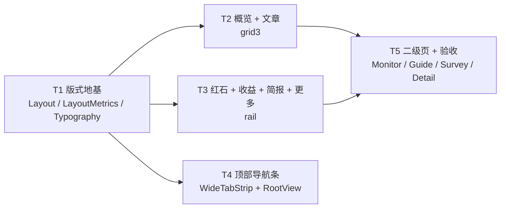
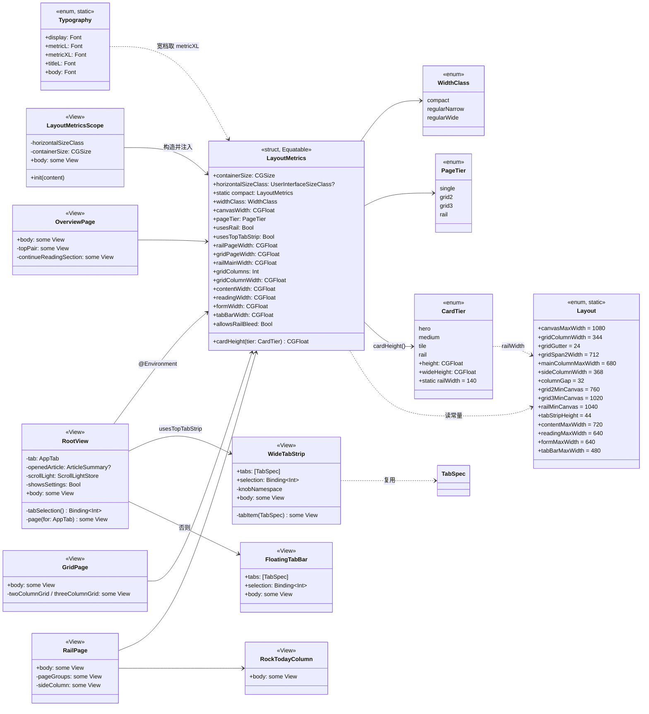

# iPad 版式重做（3.7.0 → 3.8.0）· 设计说明与任务分解

- 日期：2026-10-31
- 角色：架构师（高见远）
- 工程：`/workspace/ios-app`（xcodegen，无签名 CI 走 Codemagic，本机无 Xcode）
- 起点：`MARKETING_VERSION 3.7.0 / build 13`，`TARGETED_DEVICE_FAMILY = "1,2"`，`IPHONEOS_DEPLOYMENT_TARGET 18.0`
- 用户诉求（原话）：「ipad 版你重新设计排版啊这样有点难看……ipad 版布局你可以去网上看看重新设计一下」
- **本文只做设计，不改任何源码。** 所有改动都落在「宽档分支」里，`compact` 档（iPhone / Slide Over / iPad 1⁄3 分屏）走原路径，一行几何都不许动。

---

## 0. 结论速览

| # | 结论 |
|---|---|
| 1 | **"难看"的主因不是卡片矮，是卡片"横着长、竖着不长"**：概览页在 1194 上左右各空 **237**，而纵向内容总高与 iPhone **完全相同（≈1190）**——一屏看到的信息量没变，屏幕面积大了 2.97 倍。这是"手机截图放大"的定量定义。 |
| 2 | **新增"版式档"概念**（与尺寸档分开）：`single` / `grid2` / `grid3` / `rail`，由**画布宽度** `canvasWidth = min(宽 − 40, 1080)` 推出，四个门槛 760 / 1020 / 1040。 |
| 3 | **画布封顶 1080**（1194 下左右各 57）：理由不是"看着舒服"，是 Apple 自己的 News 版式默认值（设计宽 1024 / 左右边距 60 / 栏距 20）按同比例放大到 1194 就是 57；且 1080 = **3 × 344 + 2 × 24**，能被一张三列栅格整除。 |
| 4 | **两列不再 560 + 368**：变成 **680 + 32 + 368 = 1080**。副列 368 一动不动，主列从 560 长到 680（月历格子 71.1 → 88.3 宽，height 56 → 64）。 |
| 5 | **副列"半空"是被误判的**：红石副列 312 vs 主列 458，**短 146**；收益短 **140–248**。不是"半空"，是"短一截 + 底边不齐"。修法不是塞东西，是 `Spacer(minLength: 32)` 把最后一组**压到底边**，再给红石侧栏补一组"今日场次"（今天有这个数据，只是排在弹层里）。 |
| 6 | **卡片档在 iPad 上按"同比例"放大**，不是等比：宽度 ×1.21 → 高度 ×1.22（收益 hero 216→264）；宽度 ×1.22 → 高度 ×1.25（tile 96→120）；概览 hero **240 → 344**（= 栅格列宽，且 344 = 40 + 120 + 12 + 172 正好让右侧一栏与它齐平）。字号只放大**一处**：hero 数字 40 → 56。 |
| 7 | **Tab 栏选 C：宽档搬到屏幕顶部（高 44 的居中胶囊条），窄档保留底部胶囊。** 竖向占用 90 → 50，viewport 700 → 760。依据是 HIG 原文「iPadOS: The system displays a tab bar **near the top of the screen**」——底部条在 iPad 上就是 iPhone 形态。 |
| 8 | **不引入 `NavigationSplitView`**（§7.3 给了三条与 `fullScreenCover` / 自绘栏 / `ScrollLightStore` 的具体冲突）。 |
| 9 | iPhone 零回归的关键：`LayoutMetrics.compact` 兜底值让所有新函数返回**今天的数字**（hero 240 / tile 96 / 单列 720 / 底部胶囊 / `pageTier == .single`）。 |
| 10 | 5 个任务：T1 版式地基 → T2 概览+文章 → T3 红石+收益+简报+更多 → T4 顶部导航条 → T5 二级页 + 验收。 |

**不能碰的东西（越界即返工）**：`.transaction { $0.animation = nil }`、`RootView` 的条件渲染（同一时刻只 1 页）、`FloatingTabBar` 的 74 / 40 / 21 / 8 / 10、`Spacing` 全部值、`Theme` 全部 token、`Radius` 全部值、三个 Widget 的 `kind`、entitlements / App Group / Codemagic、`RockGuideView` 的 `matchedGeometryEffect` namespace。

---

## 0.1 五处纠正（你的判断 vs 我核实的代码）

你给的三条判断：**一条完全成立**（③）、**一条方向成立但数字要改**（①）、**一条要撤掉一半**（②里的"半空"）。另外我补两条你没提但必须先说清的（④⑤）。逐条来：

### ① 「720 居中在 1194 宽屏上左右各空 237」——**成立，但两列页的数字不对**

- 概览 / 简报 / 更多：`OverviewView.swift:61`、`BriefView.swift:40`、`MoreView.swift:122` 都是 `.pageColumn(Layout.contentMaxWidth)`（720）。`pageColumn` 套在 `.padding(.horizontal, 20)` **外面**，所以 720 是"列区 + 页边距"的总宽，文字列 **680**，左右各 `(1194 − 720)/2 = 237`。✅
- 红石 / 收益 / 文章：实参是 `Layout.twoColumnMaxWidth + Spacing.page * 2` = **1000**，不是 960（见 `RockCalendarView.swift:47-51`、`EarningsView.swift:110-114`、`ArticlesView.swift:55-59`）。所以这两列的左右留白是 `(1194 − 1000)/2 = **97**`，不是 117。960 是**列区**宽度。
- 结论：三页单列 237（合计 474，占屏宽 **39.7%**）；三页两列 97（合计 194，**16.3%**）。两列页的留白其实不夸张，它们的问题是**主列只有 560**（详见 ②）。

### ② 「两列时 560 主列配 368 副列，副列常年半空」——**"半空"要撤，"短一截"成立**

按代码算出来的实际高度（字体行高按 1.2 估，误差 ±4pt）：

| 页 | 主列 | 副列 | 差 |
|---|---|---|---|
| 红石 | SectionHeader 41 + 月历卡 417 = **458** | 下一场 68 + 32 + 分布 92 + 32 + 规律 88 = **312** | **−146**（−31.9%） |
| 收益（4 平台） | hero 216 + 32 + 月组 136 = **384** | 平台 40 + 96×2 + 12 = **244** | **−140**（−36.5%） |
| 收益（2 平台） | 384 | **136** | **−248**（−64.6%） |

副列里 **312–244pt 都有内容**（不是空盒子），所以"半空"这个词不准确。真实症状是两件事：
1. **底边不齐**：两列 `HStack(alignment: .top)`，右边比左边早结束 140–250pt，眼睛读成"右下角漏了一块"（146 × 368 = 53,728 pt² 的白洞）；
2. **主列没变宽**：560 与 iPhone 的 353 只差 1.6 倍，而屏幕宽了 3 倍 —— 两列页把多出来的宽度全给了留白（97×2）和副列，主列一点没长。

### ③ 「卡片高度还是 iPhone 档位，整页像手机截图放大」——**成立，而且能给出最硬的一条证据**

`CardTier`（`Layout.swift:20-27`）没有任何宽屏分支：hero 240 / medium 168 / tile 96 / rail 188 / railWidth 140，iPad 与 iPhone 同值。

最硬的证据是**纵向总高完全相等**。概览页内容总高（`8 + 70 + 32 + 240 + 12 + 168 + 32 + 136 + 32 + 228 + 32 + 80 + 120 = 1190`）：

| | 屏 | 可视高（估） | 走完全页要滚 | 屏幕面积 |
|---|---|---|---|---|
| iPhone 393×852 | | 852 − 59 − 90 − 34 ≈ **669** | 1190 / 669 = **1.78 屏** | 334,836 pt² |
| iPad 1194×834 | | 834 − 24 − 90 − 20 ≈ **700** | 1190 / 700 = **1.70 屏** | 995,796 pt²（**2.97×**） |

一屏看到的东西**一模一样**（1 张 hero + 1 张 medium + 半组 tile），屏幕大 3 倍。这就是"放大的手机"，不是感觉。

顺带量化"卡片被拉成条"：hero 在 iPhone 是 353×240 = **1.47:1**，在 iPad 是 680×240 = **2.83:1**；40pt 的倒计时数字占卡内宽度从 **35%** 掉到 **16.5%**。今日一览的两张 tile：176×96 = 1.83:1 → 334×96 = **3.48:1**，20pt 状态字占宽 57% → 30%。

### ④ 你没提、但必须纠正的一条：**设置页今天不难看，不要改**

`SettingsView.swift:42` 的 `.pageColumn(Layout.formMaxWidth)`（640）在 iPad 上**根本不生效** —— 它是 `.sheet` 呈现，iPadOS 把 sheet 画成居中的浮层卡片（不是全屏）。640 只是内层护栏。同理 `LoginPromptView` / `SurveyFillView` 也活在浮层/覆盖里。**"难看"不该归因到设置页**，这一页本次一个字节都不动。

### ⑤ 补充诊断：四个"一屏就完了"的岛

更多页内容总高 ≈752（1.07 屏），却只占 680/1194 = **57%** 的宽度 → 1194×834 上有一个 474 宽的永久空白条。简报页三张同宽卡堆成一列、右侧 474 永空。这两页是"空"感最重的（不是纵向空，是横向空）。

---

## 1. 现状诊断（逐页，含屏幕尺寸与数字）

### 1.0 三个基线与符号

| 符号 | 尺寸 | 说明 |
|---|---|---|
| iPad 11" 横屏 | **1194 × 834** | iPad Pro 11"（2018–2022）/ Air 10.9"。M4 11" 是 1210×834、13" 是 1366×1024，本文所有结论对这两个尺寸同样成立（画布都封顶在 1080） |
| iPad 11" 竖屏 | **834 × 1194** | 走 `regularNarrow`（500…899），今天已是单列 720，左右各 57 —— **这一档今天不难看** |
| Slide Over | **320 × 844** | `widthClass == .compact`，与 iPhone 同构 |

安全区：横屏上 24 / 下 20（Home Indicator）。底部 Tab 栏占 `6 + 74 + 10 = 90`。

### 1.1 概览（`OverviewView`）

- 版式：`.pageColumn(720)` → 文字列 **680**，左右各 **237**。
- hero **680×240（2.83:1）**，40pt 数字占卡宽 16.5%。
- 今日一览：两张 **334×96（3.48:1）**。
- 继续读：`rail` 卡 **140×188**，680 里露出 4 张 + 72pt 露边（iPhone 是 2 张 + 29）。**这一块是唯一没有退化的**。
- 快捷：三枚胶囊总宽 ≈300，落在 680 的行里，右侧 380 全空。
- 纵向总高 ≈1190（见 §0.1 ③）。

**难看在哪儿**：整页是 6 条"同宽、同左边界、高宽比 2.4–3.5:1"的横条，卡片内的大数字相对卡片越来越小；右侧 474 宽永久空白。不是"内容少"，是"每块的内容占比低"。

### 1.2 红石（`RockCalendarView`）

- 版式：`.pageColumn(1000)` → 列区 960，左右各 **97**；主 560 / 间 32 / 副 368。
- 月历卡内宽 528，7 格各 **71.1×56（1.27:1）**，6 行 = 336 + 5×5 = 361，卡高 417。
- 主列 458 / 副列 312（详见 §0.1 ②）。

**难看在哪儿**：主列 560 与 iPhone 文字列 353 只差 1.6×，而屏幕宽 3×；月历格子被压在 71 宽却仍只有 56 高 → "格子比 iPhone 还瘦，屏幕却大 3 倍"；副列底边比主列早结束 146pt。

### 1.3 收益（`EarningsView`）

- 列区 960，左右各 97；主 560 / 副 368。
- hero `minHeight 216`（560×216 = 2.59:1）；本月 3 tile 各 **178.7×96（1.86:1）**；平台卡 2 列各 178×96。
- 活动流**通栏 960**：名称左、金额右，单行横跨 928（iPhone 321）。

**难看在哪儿**：主列 384 vs 副列 244（4 平台）→ 右下角 140×368 空洞；活动流是 960 宽的表，压在 560/368 的两列带下面，"上面的列关系"与"下面的表宽"不一致，视觉上像两页拼在一起。

### 1.4 文章列表（`ArticlesView`）

- 列区 960，左右各 97；2 列各 **474**，卡 **474×116（4.09:1）**。

**难看在哪儿**：2 列这件事是对的，但 474 宽的卡片配 56pt 缩略图，卡片变成"一条长条 + 一个小方块"；一屏 8 篇，密度只比 iPhone 高 1 倍（屏幕宽 3 倍）。

### 1.5 简报（`BriefView`）

- `.pageColumn(720)` → 680，左右各 237。
- 今日详情卡内文宽 648 → 17pt 下约 **38 个汉字/行**（已经在上限，**不能再宽**）。
- 两服版本面板在 680 里被切成 2 × 324。

**难看在哪儿**：正文行宽是对的，问题在**结构**：三张同宽卡竖排，右侧 474 永空；"版本对比"这种对照信息被塞进 324 一列，而右边有 474 的空地。

### 1.6 更多（`MoreView`）

- 680，左右 237；两张状态 tile **334×96（3.48:1）**；四行 `MoreRow` 680×48。
- 内容总高 ≈752（1.07 屏）。

**难看在哪儿**：这是最典型的"孤岛"——一屏就完了的 4 行 + 2 tile，被放在 680 里，右边 474 全空。

### 1.7 文章详情（`ArticleDetailView`）

- 正文 `.pageColumn(640)` → 文字 **600**（17pt 下 35 汉字/行，正确）；左右各 277。
- **导航条也套了同一个 640**（`ArticleDetailView.swift:125`）→ 返回钮距屏幕左边 **277pt**。

**难看在哪儿**：正文窄是对的（行宽由字形决定，这 277 的空白不是浪费）；**但全屏页的返回钮跑到屏幕中间偏左了**，拇指和指针都要往里够 277。今天的设计文档 §3.8 写"导航条必须与正文同列，否则视线横跨 500"——这条在小屏成立，在 1194 上反而更糟：**按钮不在角落**比"视线横跨"更伤手感。本次改（§4.8）。

### 1.8 推送监控（`MonitorView`）

- `fullScreenCover` 全屏，`.pageColumn(640)`，左右 277；两张 `VersionStatusCard` **竖排**，每张 640 宽。

**难看在哪儿**：国服 / 国际服本来就是**对照**信息，在 1194 上却上下隔开一整屏；每张 640×~140 又是横条。

### 1.9 攻略（`RockGuideView`）

- `.pageColumn(720)` → 图卡 **680×510（4:3）**，单列，左右 237。

**难看在哪儿**：图墙最该吃满宽度，却一列 680。

### 1.10 问卷（`SurveyListView` / `SurveyDetailView` / `SurveyResultView` / `SurveyFillView`）

- 列表/详情/结果：`720`；填答：`640`。左右各 237 / 277。
- 结果页每题一条横向占比条。

**难看在哪儿**：列表页（每行 2 个字段）加列无收益，**可以不动**；结果页的题目互相独立，是唯一适合并排的。

### 1.11 设置（`SettingsView`，`.sheet`）

- 在 iPad 上是**居中浮层**，不是全屏。`.pageColumn(640)` 不生效。

**结论：今天不难看，本次不动。**

---

## 2. 调研结论 → 落成规则

调研对象：Apple HIG（Layout / Split views / Tab bars / 2025-06 与 2026-06 两次改版）、WWDC25 "Elevate the design of your iPad app"（session 208）、Apple News Format 的布局默认值、以及 NetNewsWire / Reeder 这类内容型 App 在 iPad 上的实际取舍。下面每条都是**规则**，括号里是依据。

### R1 画布与留白：1080 / 57 / 344 / 24

Apple News Format 的 `Layout` 默认值：**设计宽 1024、左右边距各 60、栏距 20、7 栏**（Apple 官方文档原文）。按它自己的比例（内容占 88.3%）放大到 1194 → 内容 **1054**；取整到能被三列栅格整除：**1080 = 3 × 344 + 2 × 24**（内容占 90.5%，留白 57）。

> **为什么不是 1154（满宽减 40）**：那等于把 iPhone 的 20pt 页边距照搬到 1194 上 —— 20/1194 = 1.7%（iPhone 上是 5.1%），卡片边缘几乎贴屏幕边框，读起来像"内容溢出到框外"。也**不是 1000**：1000 是今天两列的实参，留白 97 反而比单列页的 237 好，但 1000 除不尽任何栅格（1000 − 48 = 952，÷3 = 317 不是 8 的整数倍），会让卡片宽度出现 317.3 这种值。
> **为什么不是 960 直接放大成 1140**：栅格断不开（1140 − 48 = 1092，÷3 = 364 ✓ 其实可以）—— 但 1140 + 57×2 > 1194，留白只剩 27，回到上一个问题。

### R2 导航位置：宽档在**顶部**，窄档在底部

HIG「Tab bars」iPadOS 段原文：*"The system displays a tab bar **near the top of the screen**."* WWDC25 同一句话：*"If you're still not sure which navigation is best for your app, **start with a tab bar**. A tab bar can easily morph into sidebar to help your app scale over time."*

→ 底部浮动胶囊在 1194 上是 iPhone 形态，是"放大手机"最刺眼的一处。宽档换成顶部居中胶囊条（§6）。

### R3 不要为了"像 iPad"而上侧栏

HIG「Tab bars」iPadOS 段：*"**Prefer a tab bar for navigation.** … If your app is more complex, you can provide the option to convert the tab bar to a sidebar."* 本文有 5 个平级目的地、0 层嵌套 → 侧栏只增加 chrome。

### R4 竖屏不硬上多栏（反面教材）

NetNewsWire 6.x 在 iPad 上做三栏，**竖屏时阅读区被压得太窄**，被用户在论坛集中吐槽，6.1.7 才用 `preferredPrimaryColumnWidthFraction = 0.4` 把主列压到 40% 缓和；7.0 又给时间线加了"用户可调宽度"。

→ 规则：**多栏门槛按画布宽度，不按"是 iPad"**。834 竖屏（canvas 794）只允许 2 列列表，不允许主+侧；主+侧要 canvas ≥ 1040（1194 横屏、1366 横屏、1210 横屏可以，1024 竖屏不行）。

### R5 一屏的信息量必须随屏幕面积增长

HIG iPadOS 段：*"Avoid single-column full-width layouts on large screens."*、*"Use multi-column layouts … and increased information density in regular width."*

→ 规则：**每个一级页在 rail/grid 档必须有一处"窄档给不了的形态"**：文章/攻略/监控 = 3 列或 2 列并排；红石/简报/更多 = 主+侧；概览 = 大卡 + 侧栏 + 3 列。只放宽不加列 = 没做完。

### R6 卡片按"同比例"放大，不按"等比缩放"

宽度 ×1.21（560→680）时高度 ×1.22（216→264）：比例不变（2.59:1 → 2.58:1），观感是"同一张卡变大了"；等比缩放（×1.56）会把 216 变 337，卡内只剩空气。

> 同一份设计文档 §1.2 早就写过"iPad 上 240 变 360，卡里空一半"。本次坚持这条，只按比例微调。

### R7 栅格用固定列数 + 明确阈值，不用 `.adaptive`

`ArticlesView.swift:20-27` 已经写明理由（adaptive 一屏从 8 篇变 16 篇、每卡标题可读宽度漂移）。补充调研结论：`.adaptive` 配 `minimum/maximum` 时，列数变化会**重建视图**，滚动中触发就是可见的重排。我们的列数来自 `LayoutMetrics`（只在 `onChange(of: proxy.size)` 时变），不会在滚动中变。

### R8 `LazyVGrid` 里不放 `GeometryReader`

调研一致结论：`GeometryReader` 在 lazy 容器里破坏惰性、增加测量开销。所有列宽都由 `LayoutMetrics` 算好传进去，卡内不读几何。

### R9 行宽由字形决定，不由屏幕决定

正文 17pt 下 30–40 汉字/行。所以：正文类（简报主列、文章详情）**不许因为屏幕变宽而变宽**；卡片类**必须**变宽。这两件事在本次是分开决策的（§5）。

---

## 3. 新版式总规则

### 3.1 三个概念分开

| 概念 | 回答什么 | 载体 |
|---|---|---|
| 尺寸档 `WidthClass` | 有多少地方 | `compact` / `regularNarrow` / `regularWide`（**已存在，不改判定逻辑**） |
| 画布 `canvasWidth` | 内容区最多多宽 | `min(容器宽 − Spacing.page × 2, 1080)` |
| 版式档 `PageTier` | 这一页怎么排 | `single` / `grid2` / `grid3` / `rail`（**新增**） |

> ⚠️ `canvasWidth` **不是**"所有页面的容器宽"。`canvasWidth = min(宽 − 40, 1080)` 在 834 竖屏下等于 **794**，而 834 竖屏的概览/红石/简报/收益/更多必须仍是 **720**。所以页面只用两个派生属性，不许直接用 `canvasWidth`：
> - `railPageWidth`：`usesRail ? canvasWidth : min(effectiveWidth, 720)`
> - `gridPageWidth`：`gridColumns > 1 ? canvasWidth : min(effectiveWidth, 720)`
>
> 唯一的例外是 `ArticleDetailView` 的**导航条**：它可以直接用 `canvasWidth`（正文列 640 不动），因为 `canvasWidth` 永远不会超过容器宽，`compact` 下就等于今天的 353。

### 3.2 四个版式档与门槛

| 档 | 判定（canvas） | 内容宽 | 栅格 | 1194 横屏 | 834 竖屏 | 320 Slide Over |
|---|---|---|---|---|---|---|
| `single` | < 760 | 720 / 640 / 640 | 1 列 | — | ✅ 720（左右 57） | ✅ 353（= 今天） |
| `grid2` | 760 … 1019 | `(canvas − 24) / 2` | 2 列 × 24 栏距 | — | ✅ 385 × 2 | — |
| `grid3` | 1020 … 1039 | `(canvas − 48) / 3` | 3 列 × 24 栏距 | 344 × 3 | — | — |
| `rail` | ≥ 1040 | `canvas − 32 − 368` | 主列 + 32 + 368 | **680 / 32 / 368** | — | — |

> **834 竖屏（canvas 794）落在 `grid2` 档**：列表页（文章 / 攻略 / 监控 / 问卷结果）走 2 列 385；rail 页（概览 / 红石 / 简报 / 收益 / 更多）因为 rail 要 1040 不成立，退回 `single` 720。**这个不一致是有意的**：竖屏是"单列阅读形状"，多栏在竖屏会把阅读区压窄（R4 的 NetNewsWire 教训）。

门槛怎么来的（每个都是算出来的，不是拍的）：

- **760** = 368 × 2 + 24：2 列时每列不小于 **368**（= 副列宽，一个已存在的数）。368 − 24 padding − 56 缩略图 − 12 = 276 ≈ 21 个汉字标题，2 行装得下。834 竖屏 canvas 794 → 385 ✓。
- **1020** = 324 × 3 + 24 × 2：3 列时每列不小于 **324**（324 − 24 − 56 − 12 = 232 ≈ 18 汉字标题，2 行）。低于 324 标题掉成 1 行，卡片高宽比破 2:1，不如退回 2 列。
- **1040**：rail 的主列必须 ≥ 640（= 单列文字列下限，月历 7 格不能更瘦）。640 + 32 + 368 = **1040**。1024 竖屏 canvas 984 < 1040 → 14pt 之差，红石在 13" 竖屏上仍是单列 720（竖屏本来就是单列形状，见 R4）。
- **1020 … 1039 这条 20pt 的窄带**：只出现在 Stage Manager 把窗口拖到 1060–1079 时。落在这条带里的页面，rail 页退 `single`，列表页用 `grid3`。**这是唯一一个"档位不一致"的窗口，写在这里以免以后被当成 bug 修。**

### 3.3 各页选哪一档

| 页面 | 窄档（canvas < 门槛） | 宽档 | 内容宽 | 一句话理由 |
|---|---|---|---|---|
| Overview | single 720 | **grid3**（row A = 712+24+344，其余 3 列） | 1080 | 大卡 + 侧栏 + 3 列，"此刻"当锚点、其余铺开 |
| Rock | single 720 | **rail** 680/32/368 | 1080 | 月历要宽，其余三组是"读一眼" |
| Brief | single 720 | **rail** 680/32/368 | 1080 | 正文 680 不动，版本/推送搬去右侧 |
| Earnings | single 720 | **rail** 680/32/368 | 1080 | 总额（总）与平台（分）并置可对照 |
| Articles | single 720 | **grid3 / grid2** | 1080 | 列表型，密度优先 |
| More | single 720 | **rail** 680/32/368 | 1080 | 状态（看）与工具（做）分列 |
| Settings | 640（sheet 内） | **不改** | — | iPad 上是系统浮层，本来就不难看 |
| ArticleDetail | reading 640 | **single 640**（仅导航条改到 canvas） | 1080 / 640 | 行宽由字形决定 |
| Monitor | single 640 | **grid2** | 1080 | 国服/国际服是对照，必须并排 |
| RockGuide | single 720 | **grid2** | 1080 | 图墙吃满 |
| Survey 列表/详情 | single 720 | **single 720** | — | 每行 2 字段，加列不增信息 |
| Survey 结果 | single 720 | **grid2** | 1080 | 题目互相独立 |
| Survey 填答 | form 640 | **single 640** | — | 输入型 |

### 3.4 为什么是"四个档"而不是"一个自适应栅格"

如果全站一个 `LazyVGrid(.adaptive)`：红石月历会被排成 N 列（月历必须是 7 列）；收益 hero 会被塞进一张 344 的格子里（hero 必须跨列）。**版式档是"页面的排法"，不是"内容的列数"** —— 这两件事混在一起，就是今天"每页各自 `.pageColumn` 一个魔法数字"的来源。

---

## 4. 逐页新排法

所有线框都是 **1194 宽**。列坐标（canvas 从 x=57 起，到 1137 止）：

```
rail:  [57 ──── 680 ──── 737][32][769 ── 368 ── 1137]
grid3: [57 ─ 344 ─ 401][24][425 ─ 344 ─ 769][24][793 ─ 344 ─ 1137]
grid2: [57 ────── 528 ────── 585][24][609 ────── 528 ────── 1137]
```

### 4.0 两条通用规则（下面每一页都按这两条验收）

1. **主侧栏的底边必须齐**：`HStack(alignment: .top)` + 副列 `VStack` 里在"会变长的内容"之后放 `Spacer(minLength: Layout.columnGap)`。副列比主列短 → `Spacer` 把最后一组压到底边；副列比主列长 → `Spacer` 不生效（它只吸不放），此时主列底部留白，差值必须 ≤ 40pt（≤ 主列高的 9%）。
   > 这条规则只对**内容高度固定**的页成立（红石月历 441 / 收益 hero+本月 456）。简报、更多的正文长度随数据变，不设硬阈值，验收时肉眼确认"两列底边差不超过一屏的 1/6"。
2. **每页只有一处"宽档专属"的判断**：`metrics.usesRail`（rail 页）/ `metrics.gridColumns`（grid 页），容器宽只读 `metrics.railPageWidth` / `metrics.gridPageWidth`。不许在页面里再算宽度（`containerSize.width > 900` 这种写法在本次改动中一次都不许出现），也不许直接用 `canvasWidth`（见 §3.1 的 ⚠️）。

### 4.1 Overview（grid3）

- 档：`grid3`；canvas 1080。
- Row A：hero **712 × 344**（`Layout.gridSpan2Width` = 344×2 + 24；高度 = `cardHeight(.hero)` = 344）+ 24 + 侧栏 **344**。
  - 侧栏 = 简报卡（`minHeight 168`，被拉伸到 **172**）+ 12 + 今日一览（`SectionHeader 40` + 两张 tile **166×120**）。
  - 校验：172 + 12 + 40 + 120 = **344** = hero 高 → 两块底边严格齐平，不需要任何 `Spacer`。
- Row B：继续读 = `LazyVGrid` 3 列，`ArticleRowCard` **344×116**，取 `prefix(6)`（2 行 × 3）。
- Row C：快捷 = 三枚胶囊，一行，左对齐（不变）。
- 字号：hero 数字 **40 → 56**（`Typography.metricXL`，仅宽档）；其余一字不改。

```
┌ 57 ───────────────────────────────────────────────────────────────── 1137 ┐
│ 10月31日 · 周六   农历九月初十                                        ⚙︎    │
│ ───────────────────────────────────────────────────────────────────────── │
│ ┌────────────── hero 712 ──────────────┐   ┌── 344 ──┐                    │
│ │ 红石 · 今日                   [2.5×] │   │ 简报摘要 │ 168→172（拉伸）    │
│ │                                      │   │ ─────── │                    │
│ │ 23:08            ← 56pt              │   └─────────┘ 12                 │
│ │ ↘ 还有 39:27   ↗ 霞谷 · 圆梦村        │   今日一览     40                  │
│ │ ──────●──────────────  今日第 2/3 场  │   [国服][国际] 166×120 ×2         │
│ │ 11:08      17:08      23:08          │                                    │
│ └──────────────── 344 高 ─────────────┘                                    │
│ ── 32 ──                                                                   │
│ 继续读                                                            更多 →   │
│ ┌─ 344 ─┐ ┌─ 344 ─┐ ┌─ 344 ─┐    ← 3 列 × 2 行，ArticleRowCard 116 高      │
│ └───────┘ └───────┘ └───────┘                                             │
│ ── 32 ──                                                                   │
│ 快捷                                                                       │
│ (全部文章) (光遇简报) (关于)                                                │
└────────────────────────────────────────────────────────────────────────────┘
```

- **iPhone（compact）**：`pageTier == .single` → 走今天的分支（`topPair` 竖排、`Rail` 横滑、`prefix(8)`、`hero 240 / medium 168 / tile 96 / rail 140×188`）。零改动。
- 依据：R5（信息密度）+ R6（同比例）。hero 344 的来历：`40 + 120 + 12 + 172`，同时 344 = 栅格列宽 → 大卡的高度与侧栏的宽度是同一个数，bento 才"像被设计过"。

### 4.2 Rock（rail）

- 档：`rail`；主 680 / 32 / 副 368。
- 月历：卡内宽 648，7 格各 **88.3 × 64**（1.38:1，今天 71.1×56 = 1.27:1）；6 行 = 384 + 5×5 = 409；卡高 **441**；主列 **481**（含 SectionHeader 40）。
- 副列（顺序由上到下）：下一场 68 → 32 → **今日场次（新增）** 40 + 3×44 = 172 → 32 → 场次分布 92 → `Spacer(minLength: 32)` → 规律 88。
  - 今天有 3 场时：副列 516 vs 主列 481 → 副列长 **35**（7.3%），`Spacer` 不生效（它只吸不放），规律本来就在最后 → 主列底部留 35 白。
  - 今天没有场次时（`RockTodayColumn` 整块不渲染）：副列 312 vs 主列 481 → `Spacer` 吃掉 **169**，规律被压到与月历卡同底。**这才是 `Spacer` 真正起作用的场景，也是"底边不齐"被修掉的地方。**
- **新增 `RockTodayColumn`（今日场次）**：这是让副列"站得住"的关键。数据已经在 `RockStore.visibleDays` 里（今天那条的 `times` + `map` + `rate`），今天只在 `RedstoneDaySheet` 弹层里出现。侧栏常驻 = 少一次点击。

```
┌ 57 ────────────────────────────────────────────────────────── 1137 ┐
│ 红石 / 已生成 10.01–10.31                                  [攻略]   │
│ ┌──────────── 680 ────────────┐    ┌────── 368 ──────┐             │
│ │ 本月              ‹ 2026年10月 › │    │ [下一场 · 条]   │             │
│ │ ┌ 7×6 格 88.3×64 ──────────┐ │    │ 今日场次         │             │
│ │ │ 一 二 三 四 五 六 日      │ │    │ 11:08 圆梦村 2.5×│             │
│ │ │ ·  ·  ●  ·  ·  ●  ·      │ │    │ 17:08 霞谷   2.0×│             │
│ │ │ ●  ·  ·  ●  ·  ·  ●      │ │    │ 23:08 霞谷   2.5×│             │
│ │ └── 441 高 ───────────────┘ │    │ 场次分布（折叠）  │             │
│ └──────────── 481 ────────────┘    │            Spacer │             │
│                                     │ 规律 →           │ 88（贴底）  │
│                                     └──────────────────┘             │
└────────────────────────────────────────────────────────────────────┘
```

- **iPhone**：`pageGroups` 的 `else` 分支一行不改（下一场 → 月历 → 分布 → 规律，顺序是这一页最隐蔽的回归点）；`cellHeight` 默认值仍是 56。

### 4.3 Brief（rail）

- 档：`rail`；主 680 / 32 / 副 368。
- 主列：今日详情（`TodayBriefCard`，卡内文宽 648 → **38 汉字/行，与今天一致，不再变宽**）。
- 副列：两服版本（`SkyVersionPanel` 内部 2 × 168）→ 32 → 版本与推送（`VersionRecordCard` + `PushStatusRow`）→ `Spacer(minLength: 32)`。
- 高度：**两个都由内容决定**（`TodayBriefCard` / `SkyVersionPanel` / `VersionRecordCard` 都没有固定高度）。按今天的数据量估：主列 340–420、副列 380–460，量级接近。`Spacer(minLength: 32)` 只吸不放 —— 副列短时把「推送状态行」压到底边，副列长时主列底部留白（不设阈值，规则见 §4.0）。

```
┌ 57 ─────────────────────────────────────────── 1137 ┐
│ 简报 / 更新于 今天 07:30                              │
│ ┌────────── 680 ──────────┐   ┌───── 368 ──────┐     │
│ │ 今日详情                 │   │ 两服版本        │     │
│ │ ┌──────────────────────┐│   │ [国服][国际]    │     │
│ │ │ 正文 648 → 38 汉字/行 ││   │ 版本与推送      │     │
│ │ │                      ││   │ [记录卡]        │     │
│ │ └──────────────────────┘│   │ [推送状态行]    │     │
│ └─────────────────────────┘   └────────────────┘     │
└──────────────────────────────────────────────────────┘
```

- **iPhone**：`.pageColumn(720)` 不变。

### 4.4 Earnings（rail）

- 档：`rail`；主 680 / 32 / 副 368。
- hero：`minHeight` **216 → 264**（680×264 = 2.58:1，与今天 2.59:1 同比例）。
- 本月：3 张 tile 各 **218.7 × 120**（1.82:1，今天 1.86:1 同比例）。
- 主列 = 264 + 32 + (40 + 120) = **456**。
- 副列：`SectionHeader("平台")` + 2 列卡（各 **178 × 120**，`minHeight` 96→120）+ `Spacer(minLength: 32)` + **页脚说明搬到副列底部**（原来在整页最底部）。
  - 4 平台：40 + 120×2 + 12 = 292 → `Spacer` 吃掉 164，页脚贴底 → 右列与左列同高收尾。
- 活动流：**通栏 1080**（表要满宽，Mail/Files 同理），行高 72 不变。

```
┌ 57 ────────────────────────────────────────── 1137 ┐
│ 收益  ⟳                                              │
│ ┌────────── 680 ──────────┐  ┌──── 368 ────┐        │
│ │ hero 264（40→56 数字）   │  │ 平台         │        │
│ │ ── 构成条 ──    [记一笔] │  │ [178][178]   │        │
│ │ 本月                     │  │ [178][178]   │        │
│ │ [218][218][218] 120 高   │  │      Spacer  │        │
│ │                          │  │ 页脚说明（贴底）│      │
│ └────────── 456 ───────────┘  └──── 456 ─────┘        │
│ ── 32 ──                                              │
│ 最近活动                                       全部 → │
│ ┌──────────────── 1080 ─────────────────────────────┐ │
│ │ 活动名 / 平台·时间                          金额   │ │
│ └───────────────────────────────────────────────────┘ │
└───────────────────────────────────────────────────────┘
```

- **iPhone**：`loadedBlocks` 的 `else` 分支（主列 → 平台 → 活动 → 页脚）顺序不变；`heroMinHeight` 仍 216；平台 2 列不变。

### 4.5 Articles（grid3 / grid2）

- 档：`grid3`（canvas ≥ 1020）→ 3 列各 **344**；`grid2`（760…1019）→ 2 列各 `(canvas−24)/2`；否则 `single`。
- 卡片：`ArticleRowCard` 344×116（2.97:1 ≈ iPhone 3.04:1），缩略图 56 不变，`summary` 2 行。
- 一屏密度：3 列 × ~5 行 ≈ **15 篇**（今天 8）。置顶卡仍在网格第一格（今天已实现的分支，不变）。
- 分隔标题「置顶」在宽档不画（今天已如此）。

```
┌ 57 ─────────────────────────────────────── 1137 ┐
│ 文章 / 96 篇 · 更新于 3 分钟前                    │
│ ┌─344─┐  ┌─344─┐  ┌─344─┐                        │
│ │[56] │  │[56] │  │[56] │  ← 3 列，每卡 116 高   │
│ │标题 │  │标题 │  │标题 │                        │
│ │摘要2│  │摘要2│  │摘要2│                        │
│ └─────┘  └─────┘  └─────┘                        │
└──────────────────────────────────────────────────┘
```

- **iPhone**：`metrics.gridColumns == 1` → 走今天的 `ForEach` + 「置顶」分段标题。

### 4.6 More（rail）

- 档：`rail`；主 680 / 32 / 副 368。
- 主列：「工具」2 行 + 32 + 「其他」2 行（`MoreRow` 680×48）。
- 副列：问卷状态 tile **368×120** + 12 + 推送状态 tile **368×120** + `Spacer(minLength: 32)` + 页脚说明（贴底）。
- 左 ≈ 148 + 32 + 148 = 328；右自然 ≈ 252 → `Spacer` 吃掉 76，页脚贴底 → 底边齐。

```
┌ 57 ──────────────────────────────────── 1137 ┐
│ 更多 / 问卷已连接 · 其余都在这一页              │
│ ┌──────── 680 ────────┐   ┌──── 368 ────┐    │
│ │ 工具                 │   │ [问卷 已连接]│    │
│ │ [问卷工作台      →]  │   │ [推送 12:00] │    │
│ │ [推送监控        →]  │   │       Spacer │    │
│ │ 其他                 │   │ 说明文字     │    │
│ │ [设置            →]  │   │ （贴底）     │    │
│ │ [关于        3.8.0→] │   └──────────────┘    │
│ └──────────────────────┘                       │
└────────────────────────────────────────────────┘
```

- **iPhone**：两张 tile 的 `HStack` + 两组行，顺序与间距不变。

### 4.7 Settings（`.sheet`）

**不改。** iPad 上是系统浮层卡片，`.pageColumn(640)` 本来就不生效。若未来 iPadOS 允许把 sheet 拖到全宽，640 护栏自动接管 —— 这就是它今天存在的作用。

### 4.8 ArticleDetail（single 640 + 导航条到 canvas）

- 正文：`.pageColumn(Layout.readingMaxWidth)` = **640 → 文字 600**，居中。**不变。**
- 导航条：`.pageColumn(Layout.canvasMaxWidth)`（1080）→ 返回钮 x = **57**（今天 277），分享钮 x ≈ **1137 − 36**。玻璃底仍然满宽（`pageColumn` 在 `.background` 之前，顺序不动）。
- 偏移采集（`ArticleScrollOffsetKey` + `coordinateSpace(name:)`）、下滑关闭阈值 110、`chromeOpacity` 的 8→40 插值：**全部不动**。

```
┌ 57 [←]                                         [↗] 1137 ┐   ← 导航条走 canvas 1080
│              ┌──── 640（文字 600）────┐                   │
│              │ 标题 / 封面 / 正文块   │                   │   左右各 277 是
│              │ 17pt · 35 汉字/行      │                   │   **行宽决定的**，
│              └───────────────────────┘                   │   不是浪费
└──────────────────────────────────────────────────────────┘
```

- **iPhone**：两个 `maxWidth` 都 > 393，不生效 → 逐像素一致。

### 4.9 Monitor（grid2）

- 档：`grid2`；两张 `VersionStatusCard` 各 **528**，并排；页头 / 「立即检查」/ 时段说明 在 canvas 1080 内（左右 57）。
- 高度差：两卡数据字段相同 → 自然等高；不等高时 `HStack(alignment: .top)` 顶对齐即可。

```
┌ 57 ──────────────────────────────────────── 1137 ┐
│ [←] 推送监控 / 最近检查 12:00                      │
│ [立即检查]                                         │
│ ┌──── 528 ────┐  ┌──── 528 ────┐                  │
│ │ 国服 1.2.3  │  │ 国际 1.2.2  │  ← 对照并排      │
│ └─────────────┘  └─────────────┘                  │
│ 时段说明                                           │
└────────────────────────────────────────────────────┘
```

- **iPhone**：`VStack` 竖排不变。

### 4.10 RockGuide（grid2）

- 档：`grid2`；图卡 **528 × 396（4:3）**，2 列。`GuideItem.isImage == false` 的文字卡也进同一栅格（文字卡无固定高度，`LazyVGrid` 会按行取高 —— 可接受；若要严格对齐，文字卡也 `frame(minHeight: 396)`，**本次不做**，因为文字卡极少）。
- `matchedGeometryEffect` 的 namespace 与 `transitionID`（序号）**不动** —— 缩放转场靠"来源与目标同一个 namespace + 同一个 id"，改栅格不影响 id。

```
┌ 57 ─────────────────────────────────── 1137 ┐
│ [←] 攻略                                     │
│ ┌──── 528 ────┐  ┌──── 528 ────┐            │
│ │  图 4:3     │  │  图 4:3     │            │
│ └─────────────┘  └─────────────┘            │
└─────────────────────────────────────────────┘
```

- **iPhone**：单列图卡 353×265 不变。

### 4.11 Survey（列表/详情 single，结果 grid2，填答 640）

- 列表 / 详情：**single 720 不变**（每行 2 字段，加列不增信息）。
- 结果（`SurveyResultView`）：`grid2` → 题目统计 2 列各 528。
- 填答：`form 640` 不变（输入型，行宽长一点就够）。

---

## 5. 卡片与字号

### 5.1 卡片档（`CardTier`）

| 档 | iPhone（compact） | iPad（grid2/3 或 rail） | 倍率 | 出现在哪 |
|---|---|---|---|---|
| `hero` | **240** | **344** | ×1.43 | 概览红石卡（344 = 40+120+12+172，且 = 栅格列宽） |
| `medium` | **168** | **168**（minHeight 不变，可被拉伸到 172） | ×1.0 | 概览侧栏的简报卡 |
| `tile` | **96** | **120** | ×1.25 | 今日一览、收益本月、更多状态 |
| `rail` | **188** | 188（宽档不用） | — | 只有 iPhone 会用（宽档「继续读」改 3 列网格） |
| `railWidth` | **140** | 140（宽档不用） | — | 同上 |

- 收益 hero 的 `heroMinHeight` 216 → **264**（不是 `CardTier.hero`，是页面本地常量，见 `EarningsView.swift:66`）。
- 平台卡 `PlatformCard.minHeight` 96 → **120**（与 tile 同档）。

**为什么 hero 是 344 而不是你提的 300**：300 会让侧栏（40 + 120 + 12 + 168 = 340）比 hero 矮 40，row A 右侧出现一条 344×40 的白边；344 让两块**严格齐平**。344 同时等于栅格列宽 —— 一个数字同时管住"列宽"和"大卡高度"，这是 bento 版式最省心的性质。

### 5.2 字号

| 位置 | iPhone | iPad | 为什么 |
|---|---|---|---|
| 页面大标题 `display` 34 | 34 | **34** | 系统 Large Title 在 iPhone/iPad 上都是 34；放大就变成"两个标题打架" |
| 分区标题 `titleL` 22 | 22 | **22** | 同上 |
| 正文 `body` 17 | 17 | **17** | 手持距离相近，正文放大只会让行宽被迫变宽（R9） |
| 元信息 13 / 12 / 11 | 不变 | **不变** | 同上 |
| **hero 数字 `metricL` 40** | 40 | **56（新增 `metricXL`）** | 卡片宽度 ×1.21、高度 ×1.43，40pt 在 712 宽的卡里只占 16.5% —— 卡变大了，锚点必须跟着大，否则就是"放大的空卡" |

### 5.3 圆角

**不变**：`Radius.card 24` / `Radius.smallCard 14` / `Radius.insideCard 8`。

理由有两条，都是硬的：
1. **同心圆角是绑定的**：`Radius.card − Spacing.cardPadding = 24 − 16 = 8 = Radius.insideCard`。改 24 就必须同步改 8（卡内图片/缩略图的圆角），那是 6 个文件里的一组硬编码关系。
2. 圆角是"卡片身份"的度量。同一张卡在 iPhone 24、iPad 32，等于两张不同形状的卡；而 344×120 的 tile 用 24（20% 高度比）与 iPhone 176×96 用 24（25%）是同一档观感 —— **不需要改**。

### 5.4 一条原则（写进代码注释用）

> 宁可增加列，也不要把卡片拉成一条；但也不要在 1080 的画布上还摆 240 高的卡 —— 前者是"内容占比低"，后者是"放大的手机"。
> 验收线：**宽档每张卡的高宽比必须落在 1.4 … 3.1:1**，超出就加列或加高。

---

## 6. Tab 栏去留

### 6.1 三个候选

| | **A 保持底部**（限宽 480 居中） | **B 改左侧竖栏** | **C 宽档顶部胶囊条 / 窄档保留底部** |
|---|---|---|---|
| 1194×834 竖向占用 | 6 + 74 + 10 = **90**（+20 安全区） | 0（但吃掉横向 96） | 6 + 44 = **50** |
| viewport 高（估） | **700** | 790 | **760** |
| 320 Slide Over | 同一份代码，无需处理 | 必须写第二套横排（320 里竖栏吃掉 30% 宽） | 同一份代码（`compact` 分支） |
| iPhone 回归面 | 0 | 0，但要长期维护两套几何 | 0（新组件，`compact` 不渲染） |
| 要改 `FloatingTabBar` 内部？ | 否 | **是**（74/40/21/8/10 全要重排） | 否 |
| 与 iPadOS 原生距离 | **远**：系统 tab bar 在顶部 | 中：有侧栏但无层级 | **近**：同形态 |
| 改动量 | 0 | 大（结构 + 选中圆换轴） | 中（新组件 ~110 行 + `RootView` ~10 行） |

### 6.2 选 C，四条理由（按权重）

1. **底部的 480 胶囊在 1194 上是"iPhone 的签名"**。HIG「Tab bars」iPadOS 段原文：*"The system displays a tab bar **near the top of the screen**."* 底部条是 iPad 上唯一一处"系统级不像 iPad"的东西，而用户说的"难看""放大的手机"正好指向它。WWDC25 也把"tab bar 在顶部 / 可变形为侧栏"当作 iPad 的标准路径。
2. **竖向省 40pt**：90 → 50，viewport 700 → 760（**+8.6%**）。横屏最贵的资源就是纵向（834 里要装 7 行月历）。
3. **320 退化是免费的**：`widthClass == .compact` → 直接渲染今天那枚胶囊，一个像素都不变；C 的两个形态是**两个不同组件**，互不渗透，这比 B 的"一个组件两套几何"安全一个量级。
4. **B 的坑已经被上一份设计文档算过**：竖栏把"槽心"从横轴换到纵轴后，`(40 − 21)/2 = 9.5pt` 的首末项不对称会原样复现在 Y 轴（而且用户对垂直偏移更敏感）。这次不重复踩。

### 6.3 顶部条规格（`WideTabStrip`）

```
高 44 · 胶囊圆角 22（= 高/2）· 左右内边距 10 · 项间距 4
单项：HStack(spacing: 4) { Image(icon).font(15, .semibold); Text(title).font(13, .semibold) }
选中：胶囊填 lime → limeDeep 渐变，字 onLime；未选中：字 textSecondary、图标 textTertiary
材质：.glassSurface(.floating, in: Capsule(), interactive: true)   ← 全工程唯一玻璃入口
选中滑动：matchedGeometryEffect（与 FloatingTabBar 同一手法）
位置：水平居中（1194 下中央 x = 597）；顶部 6pt
整条宽度 ≈ 410（5 × 78 + 20），槽宽 ≥ 74 × 44 → 满足 44pt 点击
```

- **为什么居中、不靠左**：iPadOS 26 的窗口按钮（window controls）浮在窗口左上角。居中的条让左上角保持空白，页面标题在条**下面**一行 → 与窗口按钮不在同一行，不会打架。这也是 Apple 自己在 iPadOS 18+ 的做法。
- **⌘1–⌘5 必须一起搬过去**：快捷键挂在每一项的 `Button` 上（`FloatingTabBar.swift:136` 的同一手法），不能挂在包装 View 上。
- `FloatingTabBar` 文件本身**一个字节都不改**（它继续服务 iPhone / Slide Over）。

### 6.4 `RootView` 的落点

```swift
// 现在：.safeAreaInset(edge: .bottom) { FloatingTabBar(...) ... }
// 之后：
if metrics.usesTopTabStrip {
    // 宽档：顶部条
    content.safeAreaInset(edge: .top, spacing: 0) { WideTabStrip(...) }   // 无底部 inset
} else {
    // 窄档：今天这条，逐字不动
    content.safeAreaInset(edge: .bottom, spacing: 0) { FloatingTabBar(...) ... }
}
```
- `safeAreaInset` 的 `.top` 与各页面自己的「离线细条」`.safeAreaInset(edge: .top)` **会叠加**（细条在条下面），这正是想要的顺序。
- `pageBottomInset 120` 在宽档**保持 120**（多留 80 只是滚动尾部留白，不构成缺陷；改它要动 12 个文件，不值得）。

---

## 7. iPad 专属能力（只做值得且风险低的）

### 7.1 做

| 能力 | 怎么做 | 风险 | 价值 |
|---|---|---|---|
| **顶部导航条** | `WideTabStrip`（§6.3） | 中（新组件，但 `compact` 不渲染） | 最高：这是"像 iPad"的第一眼 |
| **⌘1–⌘5** | 搬到 strip 的每一项 `Button`（已有实现，平移） | 低 | 保持 |
| **⌘,** 打开设置 | `RootView` 加一个隐藏 `Button` `.keyboardShortcut(",", modifiers: .command)` → `showsSettings = true`；`PageColumn.swift` 加 `settingsShortcut(_:)` 修饰器（与 `refreshShortcut` 同一写法） | 低（无键盘时是死代码，0 布局） | 中：iPad 上 ⌘, 是肌肉记忆 |
| **⌃Tab / ⌃⇧Tab** 下一页/上一页 | 在 strip 两端各一个隐藏 `Button`，`.keyboardShortcut(.tab, modifiers: .control)` / `.init(.tab) + [.control, .shift]` | 低 | 中：5 页之间不用点 |
| **指针 hover** | 已有（`hoverEffect(.highlight)`，卡片 + Tab 项），**不新增** | — | — |
| **长按菜单** | 已有（文章卡 / 活动行），**不新增** | — | — |

### 7.2 不做，及理由（别在 review 时再问一遍）

| 想做的 | 为什么不做 |
|---|---|
| **⌘F 搜索** | 全工程没有搜索能力（feed 接口没有 q 参数、UI 里也没有搜索框）。挂一个"按下没反应"的快捷键，违反 PRD §"不出现点了没反应的控件"。**要做搜索是另一个需求，不是版式问题。** |
| **空格预览** | 需要"当前高亮项"这套焦点系统（`@FocusState` + 每行 focusable + 方向键移动）。`LazyVGrid` 里的 focus 顺序在 iPad 上要逐行验证，本机无 Xcode 无法验证 → 这次不做。 |
| **双指滑动翻页** | SwiftUI 没有"双指滑动"这个 Gesture（`DragGesture` 不管手指数）；要做得桥 `UISwipeGestureRecognizer(numberOfTouchesRequired: 2)`，且它会与页面纵向滚动抢手势。**收益低、风险高。** |
| **多窗口 / 多 scene** | `AppModel` / `RockStore` / `SurveyStore` 都是单例，两窗口会串台（上一份文档 §6 已判）。 |
| **可调宽的侧栏**（NetNewsWire 7 的做法） | 侧栏 368 是内容算出来的（平台 2 × 178），可调宽会让卡内字号/行数跟着变 —— 与我们"固定列数、不漂移"的原则冲突。 |
| **`NavigationSplitView` / `sidebarAdaptable`** | 见 §7.3。 |

### 7.3 为什么不引入 `NavigationSplitView`（与现有结构的三个具体冲突）

1. **条件渲染会被破掉**：`RootView` 现在同一时刻只渲染 1 个页面（`page(for:)`，B3 性能点：真玻璃采样层 ×1）。split view 的 sidebar + detail 是**两个常驻视图** → 真玻璃层 ×2，且 `page(for:)` 的"切页 = 销毁 + 新建"语义变成"side bar 里的选中项"。
2. **`ScrollLightStore` 只有一份 `progress`**：滚动光影的生产者是页面里的 `ScrollView`（`pageScrollLight()` 上报），消费者是兄弟节点 `PageBackground`。两个常驻滚动视图会**互相覆盖**同一个 progress（侧栏滚动一下，光斑就跳到侧栏的位置）。要修就得改成"每个滚动视图一个 store"，那是重构。
3. **文章详情是 `fullScreenCover`**：split view 的 detail 列会诱导把详情放进去，而 `AppModel.articleState` 是**单例**（`loadArticle(id:)` 覆盖全局状态）。一旦"列表选中的文章"和"detail 正在读的文章"共用同一份状态，今天 `fullScreenCover(onDismiss:)` 清状态的契约就破了 —— 会出现"看完详情回列表，列表的骨架屏状态被清空"这类 bug。

另外 HIG 本身：*"**Prefer a tab bar for navigation.**"* 5 个平级目的地没有层级，侧栏只增加 chrome。**结论：不引入。** 若将来要做"文章列表 + 正文"分栏，前置条件是先把 `AppModel.articleState` 改成每窗口/每视图实例 —— 那是另一个版本的工作。

---

## 8. 文件清单

### 8.1 新增（2 个源码 + 3 个文档）

| 文件 | 内容 | 大约行数 |
|---|---|---|
| `Sources/DesignSystem/WideTabStrip.swift` | 宽档顶部导航条（`TabSpec` 复用，`glassSurface(.floating)`，`matchedGeometryEffect`，⌘1–5，⌃Tab） | ~120 |
| `Sources/Features/Rock/RockTodayColumn.swift` | 红石侧栏「今日场次」（读 `RockStore.visibleDays` 里今天那条的 times/map/rate；取不到整块不渲染） | ~80 |
| `docs/design/2026-10-31-ipad-layout-redo.md` | 本文 | — |
| `docs/class-diagram.mermaid` | 附录 A 的类型图（单独存一份，方便贴进 review） | — |
| `docs/sequence-diagram.mermaid` | 附录 B 的时序图 | — |

> 文档与 `.mermaid` 都在 `docs/` 下，不进 Xcode target，不影响 Codemagic。

### 8.2 修改（20 个）

| 文件 | 改什么 |
|---|---|
| `Sources/DesignSystem/Layout.swift` | 新增 `canvasMaxWidth 1080` / `gridColumnWidth 344` / `gridGutter 24` / `gridSpan2Width 712` / `mainColumnMaxWidth 680` / `grid2MinCanvas 760` / `grid3MinCanvas 1020` / `railMinCanvas 1040` / `tabStripHeight 44` / `tabStripHorizontalPadding 10`；`CardTier` 加 `wideHeight`（hero 344 / medium 168 / tile 120 / rail 188）；`twoColumnMaxWidth` **本轮不删**（T3 收尾删，见 §9） |
| `Sources/DesignSystem/LayoutMetrics.swift` | 新增 `PageTier` 枚举、`pageTier`、`canvasWidth`、`railPageWidth`、`gridPageWidth`、`railMainWidth`、`gridColumns`、`gridColumnWidth`、`usesRail`、`usesTopTabStrip`、`cardHeight(_:)`；`compact` 兜底让全部新函数返回今天的值 |
| `Sources/DesignSystem/Typography.swift` | 新增 `metricXL = 56 bold rounded` |
| `Sources/DesignSystem/PageColumn.swift` | 新增 `settingsShortcut(_:)`（⌘,；照抄 `refreshShortcut` 的写法，零布局影响）。`pageColumn(_:)` 本身不改 |
| `Sources/App/RootView.swift` | Tab 栏按 `usesTopTabStrip` 分叉（顶部条 / 今天这条）；⌘, 的隐藏按钮 + `showsSettings` |
| `Sources/Features/Overview/OverviewView.swift` | 容器宽改 `metrics.gridPageWidth`；Row A 的 `HStack`（hero 712 / 侧栏 344）；继续读在 `gridColumns == 3` 时改 3 列网格 + `prefix(6)` |
| `Sources/Features/Overview/RedstoneCountdownCard.swift` | 读 `@Environment(\.layoutMetrics)`；`minHeight: metrics.cardHeight(.hero)`；数字走 `metricXL`（仅宽档） |
| `Sources/Features/Overview/TodayBriefTrackCard.swift` | `minHeight: metrics.cardHeight(.medium)` |
| `Sources/Features/Overview/VersionTileRow.swift` | tile 高 `metrics.cardHeight(.tile)` |
| `Sources/Features/Articles/ArticlesView.swift` | 容器宽改 `metrics.gridPageWidth`；`gridColumns` 1/2/3 阶梯替换 `isTwoColumn` |
| `Sources/Features/Rock/RockCalendarView.swift` | 容器宽改 `metrics.railPageWidth`；`pageGroups` 加 `usesRail` 分支（主列 + 副列含 `RockTodayColumn`）；`mainColumnWidth` 改 `metrics.railMainWidth` |
| `Sources/Features/Rock/RedstoneMonthGrid.swift` | `init` 加 `cellHeight: CGFloat = 56` 参数（默认值 = 今天；宽档传 64） |
| `Sources/Features/Earnings/EarningsView.swift` | `heroMinHeight` 216/264 分叉；`mainColumnWidth` 改 `metrics.railMainWidth`；副列 `Spacer` + 页脚搬进副列 |
| `Sources/Features/Earnings/PlatformCard.swift` | `Metrics.minHeight` 96 / 120 分叉（读 `layoutMetrics`） |
| `Sources/Features/Brief/BriefView.swift` | `rail` 分支（主 = 今日详情，副 = 两服版本 + 版本与推送） |
| `Sources/Features/More/MoreView.swift` | `rail` 分支（主 = 两组行，副 = 两 tile + 页脚） |
| `Sources/Features/Monitor/MonitorView.swift` | `grid2`：两张版本卡 528 并排 |
| `Sources/Features/Rock/RockGuideView.swift` | `grid2`：图卡 528 |
| `Sources/Features/Survey/SurveyResultView.swift` | `grid2`：题目统计 528 |
| `Sources/Features/Article/ArticleDetailView.swift` | 导航条 `.pageColumn(Layout.canvasMaxWidth)`（正文 640 不动） |

### 8.3 明确不动（8 个，写在这里防止被"顺手优化"）

`FloatingTabBar.swift`（74/40/21/8/10 全保留）、`Spacing.swift`（全部值）、`Cards.swift`、`Rail.swift`（`bleeds` 逻辑不动，宽档只是不再走它）、`Theme.swift`、`SettingsView.swift`、`RedstoneDaySheet.swift`、三个 Widget。

---

## 9. 任务分解（按实现顺序）

### T1 · 版式地基（P0，无依赖）

- **文件**：`Layout.swift`、`LayoutMetrics.swift`、`Typography.swift`
- **做什么**：
  1. `Layout` 加 9 个常量、删 `twoColumnMaxWidth`；
  2. `CardTier` 加 `wideHeight`；
  3. `LayoutMetrics` 加 `PageTier` + 6 个计算属性 + `cardHeight(_:)` + `usesTopTabStrip`；
  4. `Typography.metricXL`。
- **签名（照抄，不要改形）**：
  ```swift
  enum PageTier: Equatable { case single, grid2, grid3, rail }

  var canvasWidth: CGFloat        // min(effectiveWidth − Spacing.page*2, Layout.canvasMaxWidth)
  var pageTier: PageTier          // single < grid2(760) < grid3(1020) < rail(1040)
  var usesRail: Bool              // pageTier == .rail
  var usesTopTabStrip: Bool       // widthClass != .compact
  var railPageWidth: CGFloat      // usesRail ? canvasWidth : min(effectiveWidth, 720)
  var gridPageWidth: CGFloat      // gridColumns > 1 ? canvasWidth : min(effectiveWidth, 720)
  var railMainWidth: CGFloat      // canvasWidth − Layout.columnGap − Layout.sideColumnWidth
  var gridColumns: Int            // 1 / 2 / 3
  var gridColumnWidth: CGFloat    // (canvasWidth − gutter*(n−1)) / n
  func cardHeight(_ tier: CardTier) -> CGFloat   // compact → tier.height（今天的值）
  ```
- **验收**：
  - `LayoutMetrics.compact.pageTier == .single`；`.cardHeight(.hero) == 240`；`.cardHeight(.tile) == 96`；`.usesTopTabStrip == false`；`.gridColumns == 1`；
  - 1194 宽（`containerSize.width = 1194, hSizeClass = .regular`）：`canvasWidth 1080`、`pageTier == .rail`、`railMainWidth 680`、`gridColumns 3`、`gridColumnWidth 344`；
  - 834 宽（canvas 794）：`pageTier == .grid2`、`gridColumns 2`、`gridColumnWidth 385`；同时 **`railPageWidth == 720`**（rail 不成立 → 退回单列）、`gridPageWidth == 794`；
  - 320 宽：`pageTier == .single`、`usesTopTabStrip == false`；
  - 首帧（`containerSize == .zero`）→ `single`（靠 `effectiveWidth` 的 393 兜底）。
- **iPhone 回归风险**：**无**（只加符号）。唯一风险是 `Layout` 里的新常量与现有名字撞（已核对：`canvasMaxWidth` / `gridColumnWidth` / `gridGutter` / `gridSpan2Width` / `mainColumnMaxWidth` / `railMinCanvas` / `tabStripHeight` 均不存在）。
- **`twoColumnMaxWidth` 在 T1 不动**（还有 4 处引用指向它）。它在 **T3 收尾**时删 —— 那时红石/收益/文章三页都已改完，删了才不会编译失败。

### T2 · 概览 + 文章（P0，依赖 T1）

- **文件**：`OverviewView.swift`、`RedstoneCountdownCard.swift`、`TodayBriefTrackCard.swift`、`VersionTileRow.swift`、`ArticlesView.swift`
- **做什么**：
  1. 概览 body 的 `.pageColumn(Layout.contentMaxWidth)` → `.pageColumn(metrics.gridPageWidth)`（`compact` 下等于 353，**等价于今天**；834 竖屏下等于 720，也不变）；
  2. `topPair` 在 `pageTier == .grid3` 时改成 `HStack(alignment: .top, spacing: 24)`：hero（`frame(width: Layout.gridSpan2Width)` = 712 = 344×2 + 24）+ 侧栏 `VStack(spacing: 12)`（简报卡 `.frame(maxHeight: .infinity)` + 今日一览）；`single` 时仍是今天的 `VStack(spacing: Spacing.cardGap)`；
  3. 继续读：`grid3` 时 `LazyVGrid(3 列)` + `prefix(6)`，`else` 时今天的 `Rail` + `prefix(8)`；
  4. hero / medium / tile 高度改读 `metrics.cardHeight(_:)`；hero 数字 `grid3` 时用 `metricXL`；
  5. `ArticlesView`：`gridColumns` → `[GridItem]`（1/2/3 列），`isTwoColumn` 判断全改 `metrics.gridColumns > 1`，容器宽改 `metrics.gridPageWidth`。
- **验收**：
  - 1194：概览 row A 左右两块底边差 ≤ 4pt（应严格 344/344）；继续读 3 列 × 2 行 6 篇；文章 3 列（344）；canvas 左右各 57；
  - 834 竖屏：概览仍是单列 720；文章 2 列 385；
  - **iPhone 393：hero 240、medium 168、tile 96、rail 140×188、单列、rail 出血 —— 与 3.7.0 逐像素一致**（截图对比）。
- **iPhone 回归风险点**：① `RedstoneCountdownCard` 内部靠 `Spacer(minLength:)` 撑到 240，高度变了内容分布会变 → 必须只在宽档改；② `Rail(bleeds: metrics.allowsRailBleed)` 的 `allowsRailBleed` 判据是 `containerSize.width <= 720`，iPhone 恒 true，**不要顺手改**；③ `TodayBriefTrackCard` 用 `minHeight` 不是 `height`，加 `.frame(maxHeight: .infinity)` 只在宽档包一层。

### T3 · 红石 + 收益 + 简报 + 更多（P0，依赖 T1）

- **文件**：`RockCalendarView.swift`、`RedstoneMonthGrid.swift`、`RockTodayColumn.swift`（新）、`EarningsView.swift`、`BriefView.swift`、`MoreView.swift`
- **做什么**：
  1. `RockCalendarView.pageGroups`：`if metrics.usesRail { HStack(top, 32) { monthGroup.frame(maxWidth: metrics.railMainWidth); sideColumn.frame(width: Layout.sideColumnWidth) } } else { 今天的 4 个块，顺序一字不改 }`；
  2. 副列 = `NextEventBar` → `RockTodayColumn` → `distributionGroup` → `Spacer(minLength: 32)` → `rulesGroup`；
  3. `RedstoneMonthGrid` 加 `cellHeight` 参数，宽档传 64；
  4. `EarningsView.loadedBlocks`：`usesRail` 分支的主列宽改 `metrics.railMainWidth`；`heroMinHeight` = `usesRail ? 264 : 216`；副列 = 平台 + `Spacer(minLength: 32)` + `footerNote`（从 `loadedBlocks` 末尾搬进来）；
  5. `BriefView`：`usesRail` 时 `HStack(top, 32) { 今日详情.frame(maxWidth: railMainWidth); VStack { 两服版本; 版本与推送; Spacer(32) }.frame(width: 368) }`；`else` 今天的 `VStack`；
  6. `MoreView`：`usesRail` 时 `HStack(top, 32) { 主列（工具+其他）; 副列（2 tile + Spacer + 说明）}`；`else` 今天原样；
  7. 这四页的 `.pageColumn(...)` 换 `.pageColumn(metrics.railPageWidth)`（rail 不成立时等于 720，与今天一致）；
  8. 收尾：确认 `grep -r twoColumnMaxWidth Sources` 为空后删掉该常量。
- **验收**：
  - 1194：红石月历 7 格 × 88.3×64、卡高 441；副列底边与主列差 ≤ 40；收益 hero 264、tile 218.7×120、平台卡 178×120、页脚在副列底部贴底；简报 主 680 / 副 368；更多 同；
  - 1024 竖屏（canvas 984）：三页全部回到 `single 720`（`rail` 不成立），布局与今天一致；
  - **iPhone：`cellHeight == 56`、`pageGroups` 的 `else` 顺序（下一场 → 月历 → 分布 → 规律）不变、收益 `else` 分支（主列 → 平台 → 活动 → 页脚）不变、简报顺序不变、更多 tile 横排不变**。
- **iPhone 回归风险点**：① `RedstoneMonthGrid.init` 加参数**必须带默认值 56**（否则 3 个调用点全红）；② 收益页脚搬位置时 `store.activities.isEmpty` 那条黄字提示别丢；③ `BriefView` 的 `section(_:content:)` 是泛型函数，宽档不要复制一份（改排版不改结构）；④ `MoreView` 的两个 `.sheet` / 两个 `.fullScreenCover` 挂在原位置，别挪进子视图分支。

### T4 · 宽屏顶部导航条（P0，依赖 T1）

- **文件**：`WideTabStrip.swift`（新）、`RootView.swift`、`Layout.swift`（`tabStripHeight` 等）、`PageColumn.swift`（`settingsShortcut`）
- **做什么**：
  1. `WideTabStrip(tabs:selection:)`：44 高胶囊、行内图标+文字、青柠胶囊选中、`matchedGeometryEffect`、每项 `.keyboardShortcut(⌘1…⌘5)`、`.hoverEffect(.highlight)`、两端隐藏按钮挂 ⌃Tab / ⌃⇧Tab；
  2. `RootView`：`if metrics.usesTopTabStrip { … .safeAreaInset(edge: .top) … } else { 今天这条 }`；加 `@State showsSettings` + 隐藏按钮 ⌘, + `.sheet(isPresented:) { SettingsView() }`；
  3. `PageColumn.settingsShortcut(_:)`（与 `refreshShortcut` 同款：`background` + 0×0 + `opacity 0` + `accessibilityHidden`）。
- **验收**：
  - 1194：顶部条高 44、水平居中、5 项、选中胶囊滑动有动画；⌘1–⌘5 切页；⌘, 弹设置；⌃Tab 顺序切页；
  - 320 / 393：**底部胶囊，几何与今天完全一致（74/40/21/8/10）**；
  - 竖屏 834（`regularNarrow`）：也走顶部条（`usesTopTabStrip = widthClass != .compact`）；
  - 页面底部留白仍 120，没有多出/少掉黑边。
- **iPhone 回归风险点**：① Tab 栏的两个分支必须共用**同一份** `FloatingTabBar(...)` 调用参数；② `.safeAreaInset(edge: .bottom)` 在 compact 分支**不能删**（删了内容会顶到底部，iPhone 立刻回归）；③ `tabSelection` 这个 `Binding` 与 `scrollLight.reset()` 的调用顺序不能动。

### T5 · 二级页 + 验收（P1，依赖 T1、T2/T3）

- **文件**：`MonitorView.swift`、`RockGuideView.swift`、`SurveyResultView.swift`、`ArticleDetailView.swift`
- **做什么**：
  1. 监控：`gridColumns == 2` 时两张 `VersionStatusCard` 进 `LazyVGrid(2 列, 24)`，页头/按钮/说明走 canvas；
  2. 攻略：图卡进 `LazyVGrid(gridColumns, 24)`（canvas ≥ 760 → 2 列 528）；
  3. 问卷结果：题目统计 2 列；
  4. 文章详情：**只改导航条**那一处 `.pageColumn(Layout.readingMaxWidth)` → `.pageColumn(metrics.canvasWidth)`；正文那处不动。
- **验收**：
  - 1194：监控两张 528 并排（顶对齐）；攻略 2 × 528（图 528×396）；问卷结果 2 列；文章详情返回钮 x ≈ 57、正文文字 600 居中；
  - iPhone：监控竖排、攻略单列、结果单列、详情返回钮贴 20。
- **iPhone 回归风险点**：① `ArticleDetailView` 的 `coordinateSpace(name:)` + `ArticleScrollOffsetKey` + 下滑 110pt 关闭**一行都不能动**（导航条换宽只影响那一行的 `pageColumn` 实参）；② `RockGuideView` 的 `zoomNamespace` 与 `transitionID` 不动；③ `SurveyResultView` 的柱宽依赖列宽，2 列后要确认"百分比条"仍按容器宽算（不用改代码，但要眼看）。

### 9.5 依赖图



---

## 10. 共享知识（给实现的工程师）

1. **尺寸判定只有一处**：`LayoutMetrics`（`@Environment(\.layoutMetrics)`）。代码里 `UIDevice` / `userInterfaceIdiom` / `UIScreen.main` 出现次数必须是 **0**；新代码也一样。判定输入只有 `horizontalSizeClass` + 容器宽度。
2. **首帧按 single 渲染**：`containerSize == .zero` → `effectiveWidth = 393` → `pageTier == .single`。所以任何宽档代码都不能假设"环境一定已测量"。
3. **宽档只在 `!compact` 里出现**：`widthClass == .compact` → `pageTier == .single` → 网格/主侧栏的分支一律不进。这样"漏改"的后果是"iPad 上少一处版式"，而不是"iPhone 上排版爆炸"。
4. **8pt 网格**：1080 = 135×8、344 = 43×8、712 = 89×8、680 = 85×8、368 = 46×8、120 = 15×8、264 = 33×8、44 = 11×4（顶部栏高，44 同时是 iOS 最小点击目标）；24 / 32 / 64 是既有网格值。**新常量不加 4 的倍数以外的数**。
5. **玻璃只有一个入口**：`.glassSurface(level, in: shape, tint:, interactive:)`。新组件（`WideTabStrip`）不许直接写 `glassEffect`。
6. **卡片高度只从 `CardTier` + `LayoutMetrics.cardHeight(_:)` 取**，页面里不许再出现无名高度（除了 `EarningsView.heroMinHeight` 这条已存在的本地常量，它按 216/264 分叉）。
7. **列数变化只发生在尺寸变化时**（`LayoutMetrics` 只在 `onChange(of: proxy.size)` 写值）→ 滚动、切页、动画期间不会重排。
8. **`LazyVGrid` 里不放 `GeometryReader`**（破坏惰性）。
9. **横屏/竖屏/分屏的验收尺寸**：1194×834（主战场）、834×1194（竖屏）、320×844（Slide Over）、597×834（1⁄2 分屏）、700×834（Stage Manager）、1024×1366（13" 竖屏，**必须回到 single**）、1366×1024（13" 横屏，canvas 封顶 1080）。
10. **命名与文案**：文档线框里的中文对得上 `AppTab.title`（概览/红石/简报/收益/更多/文章），别在实现时改名；常量名一律用本文给的名字（`canvasMaxWidth` / `railPageWidth` / `gridPageWidth` / `cardHeight(_:)`），改名的代价是 review 时对不上文档。

---

## 11. 待明确（3 条，都给推荐）

| # | 事项 | 推荐 | 代价 |
|---|---|---|---|
| 1 | **版本号**：本次是"设计变更"还是"修复"？ | **3.7.0 → 3.8.0，build 13 → 14**（`project.yml` 两处同步 + `bash scripts/bump.sh minor`） | 没有 |
| 2 | **Tab 栏上移**是本次观感变化最大的一处。要不要上？ | **上**（选 C）。若否决，退路是 A（保持底部胶囊），此时 §2–§5 的版式改动全部保留，代价是"放大手机"只修掉约七成，且 iPad 竖屏仍被 90pt 底部条压着 | 回退只是"T4 只做 ⌘, + ⌃Tab，不做 strip" |
| 3 | **iPad 竖屏 834** 要不要 2 列（文章/攻略/监控）？当前阶梯给的是 **2 列 385**（canvas 794 ≥ 760） | **2 列**。若你认为竖屏该保持单列，把 `grid2MinCanvas` 从 760 提到 1040 —— 一个常量的事 | 提到 1040 后，834 竖屏的文章/攻略/监控回到单列 720 |

---

## 附录 A · 类型与接口（classDiagram）



## 附录 B · 关键调用流（sequenceDiagram）

```mermaid
sequenceDiagram
    autonumber
    participant App as FFWangApp
    participant Scope as LayoutMetricsScope
    participant Geo as GeometryReader(.background)
    participant Env as EnvironmentValues
    participant Root as RootView
    participant Strip as WideTabStrip
    participant Bar as FloatingTabBar
    participant Page as 一级页(View)
    participant M as LayoutMetrics

    App->>Scope: body
    Scope->>Geo: .background { Color.clear }
    Geo->>Geo: onAppear / onChange(proxy.size)
    Geo-->>Scope: containerSize = (1194, 834)
    Scope->>M: LayoutMetrics(containerSize, hSizeClass)
    Scope->>Env: environment(\.layoutMetrics, M)
    Env-->>Root: metrics

    Note over Root: widthClass = regularWide<br/>canvasWidth = min(1194-40, 1080) = 1080<br/>pageTier = rail（1080 ≥ 1040）

    Root->>Root: usesTopTabStrip = (widthClass != .compact) → true
    Root->>Strip: safeAreaInset(edge: .top) { WideTabStrip }
    Strip-->>Root: 高 44，viewport 700 → 760
    Note over Root,Bar: 窄档（320/393）走 .safeAreaInset(edge: .bottom) { FloatingTabBar }，几何不变

    Root->>Page: page(for: tab)
    Page->>M: railPageWidth / gridPageWidth / railMainWidth / gridColumns
    M-->>Page: 1080 / 1080 / 680 / 3

    alt pageTier == .rail（红石 / 收益 / 简报 / 更多）
        Page->>Page: HStack(top, 32) { 主列.frame(maxWidth: 680); 副列.frame(width: 368) }
        Page->>Page: 副列 = 内容 + Spacer(minLength: 32) + 最后一组（贴底）
    else pageTier == .grid3（概览 / 文章）
        Page->>Page: LazyVGrid(3 × GridItem(.flexible(), spacing: 24))
    else pageTier == .grid2（监控 / 攻略 / 问卷结果）
        Page->>Page: LazyVGrid(2 × GridItem(.flexible(), spacing: 24))
    else pageTier == .single（iPhone / Slide Over / 竖屏 1024）
        Page->>Page: pageColumn(720 / 640)  ← 与 3.7.0 完全一致
    end

    Page->>M: cardHeight(.hero / .tile / .medium)
    M-->>Page: 344 / 120 / 168（compact 时为 240 / 96 / 168）

    Note over Root: 旋转 / 分屏 / Stage Manager 拖宽
    Geo->>Scope: onChange(proxy.size) 尺寸真变才写
    Scope->>M: 重建 LayoutMetrics
    M-->>Root: pageTier 变化
    Root->>Page: 切档（rail ↔ single），滚动位置由 scrollPositions 保活
```

---

## 附录 C · 与上一份文档（`2026-10-31-ipad-ios27-adaptation.md`）的差异

| 上一份的做法 | 本次改为 | 为什么改 |
|---|---|---|
| Tab 栏 A：底部 480 居中 | **C：宽档顶部 44 胶囊条** | HIG：iPadOS 的 tab bar 在顶部；底部条是"放大手机"的第一眼来源 |
| 两列 = 960（560 + 32 + 368） | **rail = 1080（680 + 32 + 368）** | 560 与 iPhone 353 只差 1.6×，屏幕宽 3× —— 多出来的宽度全给了留白 |
| "`CardTier` 高度一个都不改" | **宽档按同比例放大**（hero 344 / tile 120，收益 hero 264） | 240 高配 680 宽的卡，数字只占卡宽 16.5%，读起来是"空卡" |
| 单列页 720（概览/简报/更多） | **概览 grid3、简报 rail、更多 rail** | 1194 上 720 的左右 237 是 39.7% 的屏宽 |
| 副列"恰好放得下三组" | **副列底边与主列对齐 + 红石补「今日场次」** | 副列实际比主列短 146–248，底边不齐是"漏一块"的观感来源 |
| 导航条必须与正文同列（§3.8） | **导航条走 canvas 1080，正文留 640** | 全屏页的返回钮跑到 x=277 比"视线横跨"更伤手感 |
| 设置页 640 限宽 | **不改**（iPad 上是系统浮层） | 那一页今天不难看 |
| 不做两列（文章"主从分栏"被否） | 仍然不做，但**列表改 3 列** | 主从分栏要预请求正文（PRD F3），3 列不谈正文 |
