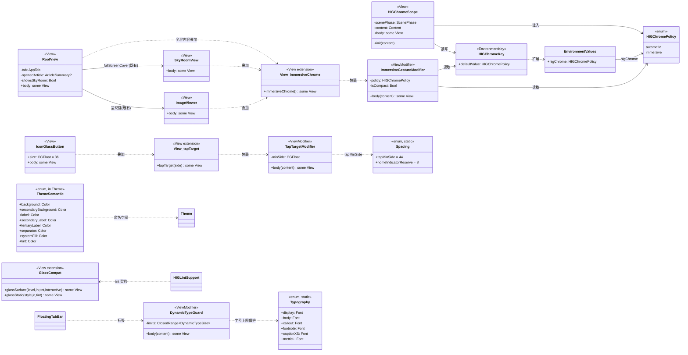
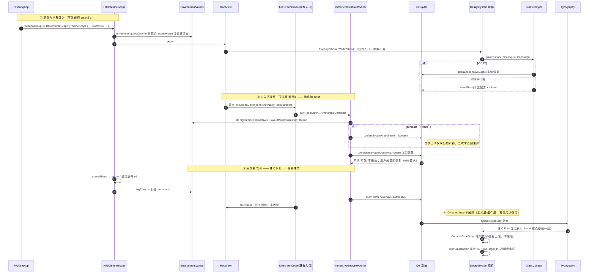
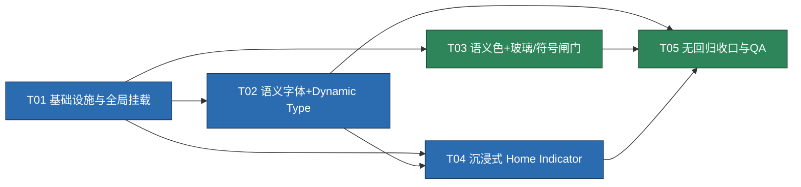

# SkyApp · 叠加式 HIG 合规 UI 迭代 —— 系统架构与任务分解

> 架构师：高见远（Gao） · 版本：HIG-ITER-1 · 基线：5.6.6（MARKETING_VERSION）
> 目标：iOS 18.0 部署 / Xcode 26 + iOS 26 SDK 编译 · SwiftUI 纯 App 生命周期
> 性质：**纯叠加迭代**。不改业务逻辑、不改导航结构、不改任何已有入口与跳转关系。

---

## 0. 输入基线与核查结论（本次设计的事实依据）

我没有凭描述下设计，先读了真实代码。以下结论直接决定了方案：

| 核查项 | 真实状态 | 对设计的意义 |
|---|---|---|
| 部署目标 | `project.yml` → `IPHONEOS_DEPLOYMENT_TARGET: "18.0"`，Xcode 26 / iOS 26 SDK | `.defersSystemGestures` / `.persistentSystemOverlays` / `GlassEffectContainer` 全部可用 |
| 玻璃能力 | `GlassCompat.swift` 已有**唯一入口** `glassSurface(_:in:tint:interactive:)`，`#available(iOS 26)` 分流；30+ 调用点零 `#available` | 本次**复用**，不另起炉灶、不新增玻璃 API |
| 玻璃分组 | `GlassGroup.swift` 已用 iOS 26 `GlassEffectContainer`，18–25 透传 | 已合规，只需核验 |
| 根布局 | `RootView` 用 `ZStack` + `safeAreaInset(edge:)` 挂 `FloatingTabBar`(窄) / `WideTabStrip`(宽)，**刻意不用系统 TabView** | 系统已自动避让 Home Indicator；本次只补"沉浸页"能力 |
| 沉浸入口 | `RootView` 有 3 个 `fullScreenCover`（文章详情 / 天光页 / Debug 预览）+ `SettingsView` sheet | 沉浸页 defer 的接线只需在这些**既有入口**上加一行 modifier |
| Home Indicator | 全工程 `grep`：**无任何** `preferredScreenEdges` / `ignoresSafeArea(edges:.bottom)` 之外处理 | 真缺口，但可由纯 SwiftUI modifier 补齐 |
| Dynamic Type | 仅 `Image.scaledToFill`；`Typography` 全部是固定 pt `Font.system(size:)`，文件头明确写"刻意不用语义字号" | 真缺口；语义字号映射表可做到**默认字号逐点一致**（见 §4.2） |
| 触控目标 | Tab 栏项 ~69.8pt×66pt / 78pt×44pt 已达标；`IconGlassButton` 默认 `size:36` **未达 44pt** | 缺口集中在图标按钮，用透明命中区叠加，不改视觉 |
| 语义色 | `Theme` 用 `UIColor(dynamicProvider:)` 自定义 token，深浅自动，但非 `Color(.systemBackground)` 语义色 | 新增 `Theme.Semantic` 命名空间供新元素用，**既有品牌 token 不动** |
| 深浅色闸门 | `scripts/lint-theme.sh` 4 条硬规则；`ThemeScope` 是全工程唯一读 `colorScheme` 处 | 语义色/字体方案必须不触发闸门 |
| 新文件纳入构建 | `project.yml` → `sources: path: Sources`，`createIntermediateGroups: true` | 新建 `Sources/DesignSystem/HIG/` 子目录**无需改 project.yml** |
| iPad/多窗口 | `LayoutMetrics` 已有 `PageTier` 四档、`usesTopTabStrip`、`saneWidth` 防测量污染、`onChange(size)` 响应 Stage Manager | 分栏/多窗口已很完善，本次以"验证无回归"为主 |

**一句话结论**：本次 5 类需求里，"Liquid Glass / 语义色基础 / 深浅色 / iPad 分栏"的现状已基本合规或已有基础设施；真正的增量只有三块 —— ①沉浸式 Home Indicator、②Dynamic Type、③44pt 图标按钮。因此设计把改动压到最小，能用 token 定义解决的绝不动调用点，能用 modifier 叠加的绝不动 body。

---

## Part A · 系统设计

### 1. 实现方案 + 边界守住策略（核心论证）

#### 1.1 核心挑战

"叠加式"最难的不是加功能，而是**证明没碰旧逻辑**。SwiftUI 的 modifier 链有个特性帮了我们：在视图外层追加 modifier 不改变内部视图的身份（identity）、状态（`@State`）、绑定（`Binding`）与事件流。因此只要严格分层，就能在"视觉/动效全变"的同时"业务链路逐字不变"。

#### 1.2 四层叠加模型（从零侵到微侵）

```
┌─────────────────────────────────────────────────────────────┐
│ L1 定义层 —— 只改 token/enum 的"定义"，调用点一个字不动        │
│   Typography.swift  Font.system(size:) → 语义 Font            │
│   Theme.swift       + Theme.Semantic 命名空间                  │
│   Spacing.swift     + tapMinSize / homeIndicatorReserve        │
│   → 0 个调用点改动，零回归（默认字号逐点一致，§4.2 有映射表）    │
├─────────────────────────────────────────────────────────────┤
│ L2 全局挂载层 —— 只在 App / RootView 根视图外层加 modifier     │
│   FFWangApp.swift   WindowGroup 内挂 HIGChromeScope            │
│   RootView.swift    body 最外层挂一个环境注入 modifier          │
│   → 不动 tabChrome / pageContent / tabSelection / onOpenURL     │
├─────────────────────────────────────────────────────────────┤
│ L3 设计系统组件内部 —— 改 DesignSystem 自有组件，业务调用点不变 │
│   IconGlassButton / FloatingTabBar / GlassCompat               │
│   → 业务页写的还是 IconGlassButton(...)，零改动                │
├─────────────────────────────────────────────────────────────┤
│ L4 沉浸页单行叠加 —— 仅 2 个全屏页各加 1 行 modifier           │
│   SkyRoomView / ImageViewer 首行链尾 + .immersiveChrome()      │
│   → 不改 body 结构、不改 @State、不改 action、不改跳转          │
└─────────────────────────────────────────────────────────────┘
```

#### 1.3 边界守住清单（写进工程师任务卡的红线）

**绝对不碰（碰了即回滚）：**
- ❌ 任何 `Store` / `AppModel` / 网络请求 / 数据模型 / 表单校验 / 按钮 `action` 闭包
- ❌ `RootView.tabSelection` setter（含 `Haptics.light()`、`withAnimation(Motion.tab)`、`scrollLight.reset()`）
- ❌ `RootView.page(for:)` 的 `switch` 与 7 个页面构造参数
- ❌ `RootView.open(deepLink:)` / `AppDeepLink` / `onOpenURL` / `fullScreenCover` 的 `item` 绑定与 `onDismiss`
- ❌ `FFWangApp` 里任何 `.task(id: scenePhase)`（实时活动 / 天气 / 预警 / 云控…）
- ❌ `GlassCompat.glassSurface` 的**函数签名**（30+ 调用点依赖）与 `GlassLevel` 的 `switch`（穷尽）
- ❌ 已有 token 的**值**（`Theme.lime` / `textPrimary` / `glassFill`…），只许新增，不许改值

**允许的最小动作：**
- ✅ 改 token/enum 的**定义体**（Typography 的 Font 定义、Theme 加命名空间、Spacing 加常量）
- ✅ 在视图**外层链尾追加** modifier（不改内部子树）
- ✅ 改 DesignSystem **自有组件内部实现**（对外签名/视觉尺寸不变）
- ✅ 新增文件（自动纳入构建，不改 project.yml）

#### 1.4 框架选型

**不引入任何第三方框架**（用户铁律 + 现有工程零 SPM 依赖的现状）。全部用系统能力：SwiftUI（iOS 16+ 的 gesture/overlay API）、UIKit（仅 `Color(uiColor:)` 语义色，已被现有 `Theme` 采用）、Foundation。Dynamic Type 用 SwiftUI 语义 `Font` + `@Environment(\.dynamicTypeSize)`；玻璃用既有 `GlassCompat`。

#### 1.5 架构模式

保持现有 **MVP-ish + ObservableObject Store + Environment 注入** 模式不变。本次新增的只有一个纯 UI 层：`HIG` 目录（ViewModifier + EnvironmentKey + Policy），它**不持有业务状态、不做网络、不参与导航**，是纯粹的"表现层横切关注点"（cross-cutting presentation concern）。

---

### 2. 文件清单（相对路径 · 精确到函数/modifier 级）

#### 2.1 新建文件（6 个，均在 `Sources/DesignSystem/HIG/`，自动纳入构建）

| 文件 | 内容（函数/modifier 级） | 归属层 |
|---|---|---|
| `Sources/DesignSystem/HIG/HIGEnvironment.swift` | `enum HIGChromePolicy { case automatic, immersive }`；`struct HIGChromeKey: EnvironmentKey`（默认 `.automatic`）；`extension EnvironmentValues { var higChrome: HIGChromePolicy }`；`struct HIGChromeScope<Content: View>: View`（`@Environment(\.scenePhase)`，注入策略 + 回前台恢复） | L2 |
| `Sources/DesignSystem/HIG/ImmersiveGestureModifier.swift` | `struct ImmersiveGestureModifier: ViewModifier`：内部按 `higChrome` 与 `layoutMetrics` 决定 `.defersSystemGestures(on: .bottom)`(仅 compact/iPhone) + `.persistentSystemOverlays(.hidden)`；`func body(content:) -> some View`；`extension View { func immersiveChrome() -> some View }` | L1/L4 |
| `Sources/DesignSystem/HIG/TapTargetModifier.swift` | `struct TapTargetModifier: ViewModifier`（`minSide: CGFloat = 44`，`content.shape` 透明命中区，`frame(minWidth:minHeight:)`）；`extension View { func tapTarget(_ side: CGFloat = 44) -> some View }` | L3 |
| `Sources/DesignSystem/HIG/DynamicTypeGuard.swift` | `struct DynamicTypeGuard: ViewModifier`（`.dynamicTypeSize(...)` 上下限，保护固定高度的数字读数/徽标）；`extension View { func guardedDynamicType(_ range: DynamicTypeSize... ) -> some View }`；`enum HIGTypeScale`（供需要手动 scaledMetric 的少数位置） | L3 |
| `Sources/DesignSystem/HIG/HIGLintSupport.swift` | 纯文档/常量：`enum HIGContract`（`glassEntrypoint = "glassSurface"`、`symbolAPIPrefix = "Image(systemName:)"`、`minTapSide: 44`），供 `scripts/lint-hig.sh` 与代码注释引用，不参与运行时逻辑 | L1 |
| `Sources/Shared/Theme/SemanticColors.swift` | `extension Theme { enum Semantic }`，静态属性映射到 `UIColor.systemBackground/secondarySystemBackground/label/secondaryLabel/tertiaryLabel/separator/opaqueSeparator/systemFill/tintColor`（统一走 `Color(uiColor:)`，不写 hex，不触发 lint 规则1） | L1 |

#### 2.2 修改文件（10 个，逐文件列出改动点）

| 文件 | 改动（精确到函数/modifier） | 层 |
|---|---|---|
| `Sources/App/FFWangApp.swift` | 在 `WindowGroup` 内、`ThemeScope { LayoutMetricsScope { RootView() … } }` 的**最外层**套 `HIGChromeScope { … }`；**不增/删/改**任何 `.task(id: scenePhase)`、`.environmentObject`、`.preferredColorScheme`、`.sheet(item:)` | L2 |
| `Sources/App/RootView.swift` | 仅两处：① `body` 最外层链尾追加 `.environment(\.higChrome, …)` 的读取宿主（实际由 `HIGChromeScope` 提供，此处只读不写）；② 三个 `.fullScreenCover` 的**内容闭包**里，给 `ArticleDetailView` / `SkyRoomView` 的首个视图追加 `.immersiveChrome()`。**不动** `tabChrome` / `pageContent` / `tabSelection` / `open(deepLink:)` / `KeyboardVisibilityModifier` | L2/L4 |
| `Sources/DesignSystem/Typography.swift` | 把 9 个文本 token（`display/titleXL/titleL/titleM/titleS/body/callout/footnote/footnoteMedium/caption/captionXS`）的 `static let` 定义从 `Font.system(size:weight:)` 改为语义 Font（见 §4.2 映射表，`static var` + `.weight()`）；**保留** `metricL/XL/M`、`code`、`version*`、`eyebrow`、`coverWatermark`、`lineSpacing`、`ReaderScale` 原样；文件头注释更新为"默认字号逐点一致，同时响应 Dynamic Type" | L1 |
| `Sources/Shared/Theme/Theme.swift` | 仅在文件末尾追加 `extension Theme { enum Semantic { … } }` 的**转发声明**（真正实现在 `SemanticColors.swift`），或仅加注释说明语义色出口；**既有 token 数值一个都不改** | L1 |
| `Sources/DesignSystem/Spacing.swift` | 在 `Spacing` 增 `static let tapMinSide: CGFloat = 44`、`static let homeIndicatorReserve: CGFloat = 8`（供沉浸页底部留白）；`Motion` 增 `static let immersiveChrome = Animation.easeInOut(duration: 0.25)`（浮层显隐） | L1 |
| `Sources/DesignSystem/GlassButtonStyles.swift` | `IconGlassButton.body`：在 `Image` 的 `.frame(width:size,height:size)` 之后、玻璃之前插入 `.tapTarget(Spacing.tapMinSide)`，视觉尺寸 36 不变；`CapsuleGlassButton.body` 同类叠加；**不改 action、不改 `Haptics.light()`、不改参数签名** | L3 |
| `Sources/DesignSystem/FloatingTabBar.swift` | `tabItem(_:position:)` 的 `Text` 字号 `.system(size:11…)` → `Typography.captionXS` + `.guardedDynamicType`，并给 Button 补 `.tapTarget()`（已达标，双保险）；`knob()` 数字/图标保持固定 | L3 |
| `Sources/DesignSystem/WideTabStrip.swift` | `tabItem` 的 `Text` `.system(size:13…)` → `Typography.footnote` + `.guardedDynamicType`；`.frame(minWidth:78,minHeight:44)` 保持不变 | L3 |
| `Sources/DesignSystem/GlassCompat.swift` | 仅在 `glassSurface` 文档注释补一段"HIG 合规说明 + 禁止裸用 `glassEffect`"，**函数体与签名不动** | L1 |
| `scripts/lint-hig.sh`（新建，放 scripts） | 3 条检查：①禁止业务层裸用 `.glassEffect(`/`.glassEffectContainer`（`GlassCompat.swift`/`GlassGroup.swift` 白名单）；②禁止 `Image(` 非 `systemName` 的图标构造（可选/渐进）；③`IconGlassButton` / `CapsuleGlassButton` 的 `.tapTarget(` 存在性检查 | L1 |

> 合计：新建 7 个文件（6 个源码 + 1 个脚本）、修改 10 个文件。全部落在 L1–L4，无一处触碰业务 Store / 网络 / 导航。

---

### 3. 数据结构与接口（Class Diagram）



---

### 4. 程序调用流（Sequence Diagram）



---

### 5. 逐条 HIG 落点（改写文件 / SwiftUI 手段 / iOS 18 降级 / 风险）

| # | 需求 | 改哪些文件 | SwiftUI 手段 | iOS 18 降级 | 风险点 |
|---|---|---|---|---|---|
| 1a | 布局避让 Home Indicator + 安全区边距 | `RootView`（验证，基本不改）、`Spacing` | 既有 `safeAreaInset(edge:)` 已避让；新增 `homeIndicatorReserve` token 供沉浸页底部留白 | 无（safeAreaInset iOS 15+） | 沉浸页 `ignoresSafeArea` 与留白冲突 → 只在需要处用 token，不强加 |
| 1b | 指示器自动隐藏（defer） | 新建 `ImmersiveGestureModifier` / `HIGEnvironment`；改 `RootView`、`SkyRoomView`、`ImageViewer`、`FFWangApp` | `.defersSystemGestures(on:.bottom)` + `.persistentSystemOverlays(.hidden)`，经 `higChrome` 环境按页生效 | **无需降级**：两 API 均 iOS 16+，部署目标 18 | ①iPad 上 bottom defer 影响多任务手势 → 仅 compact 启用；②"自动隐藏"是偏好非强制 → UI 不能依赖指示器消失；③不可永久隐藏（HIG） → dismiss 即恢复 |
| 2a | Liquid Glass | `GlassCompat`（仅注释）、新建 `HIGLintSupport` + `lint-hig.sh` | **复用** `glassSurface` 唯一入口；`GlassGroup` 融合相邻玻璃；lint 禁裸用 | 已在 `GlassCompat` 内 `#available` 分流 | `GlassLevel.switch` 穷尽依赖，禁止加级别；lint 需给 `GlassCompat.swift`/`GlassGroup.swift` 白名单 |
| 2b | 系统语义色 | 新建 `SemanticColors.swift`；改 `Theme`（仅命名空间/注释） | `Theme.Semantic.* = Color(uiColor: .systemBackground/.label/…)`；只供新元素，既有 token 不动 | 无（语义色全版本） | 浅色下 `systemBackground` 与品牌 `bgBase` 略有差异 → 不同色域并排会显脏，故不替换既有 token |
| 2c | SF Symbols | `lint-hig.sh`（核验） | 现状已是 `Image(systemName:)`，`TabSpec.icon` 为符号名 | 无 | Mac Catalyst 无（本工程纯 iOS）；符号名拼写错误 → lint/人工核验 |
| 2d | SF Pro | 不改文件（核验） | `Typography` 已 `Font.system`；中文自动苹方回退 | 无 | 无 |
| 2e | Dynamic Type | 改 `Typography`（定义）；新建 `DynamicTypeGuard`；改 `FloatingTabBar`、`WideTabStrip`、`GlassButtonStyles` | 文本 token 改**语义 Font**（默认字号逐点一致→零视觉回归，同时随 `dynamicTypeSize` 缩放）；固定高度处用 `.dynamicTypeSize` 上下限护栏 | 无（语义 Font iOS 起） | ①大字号下固定 frame（knob 40 / metricL 36-56 / 徽标）可能溢出 → 护栏 + QA 五档；②`bodySmall 16pt` 无精确语义档 → 保留固定 pt（见待明确）；③原文件注释反对语义字号，本次需求覆盖该决策 → 需产品确认 |
| 3a | 触控目标 ≥44pt | 改 `GlassButtonStyles`；新建 `TapTargetModifier`；改 `FloatingTabBar`/`WideTabStrip` | `.tapTarget(44)` 透明命中区叠加，`IconGlassButton` 视觉仍 36；Tab 栏本已达标补双保险 | 无 | 命中区叠加不可改变布局尺寸 → 用 `contentShape` + `frame(minWidth:minHeight:)`，QA 核对相邻按钮不重叠 |
| 3b | 深浅色模式 | 不改（核验）+ `lint-hig.sh` | 现有 `dyn`/`dyna` 语义色自动 + lint 闸门 | 无 | 语义色新元素必须走 `Color(uiColor:)`，禁止 hex（lint 规则1） |
| 3c | iPad 分栏/多窗口 | 不改（验证无回归） | `LayoutMetrics.PageTier` 四档 + `usesTopTabStrip` + `saneWidth` + `onChange(size)` | 无 | Stage Manager 拖窗时 `containerSize` 变化 → 已有处理，QA 复查沉浸 defer 在宽档不误触 |
| 4 | 导航/弹窗/TabBar/模态沿用原入口 | **红线：不改** | 只在外层加 modifier；所有 present 逻辑、item 绑定、onDismiss、deep link 保持 | — | 任何对 `RootView` 绑定/跳转的改动即视为回归，回滚 |
| 5 | 新增视觉/动效叠加不破坏链路 | 全部新增文件 | 只用 ViewModifier + Environment，无业务状态、无网络、无导航参与 | — | 新增 `HIGChromeScope` 不得订阅/改写任何 Store |

#### 5.1 Home Indicator —— 关键决策详述（用户点名要求）

**结论先行：不需要 UIKit 桥接，也不需要 `preferredScreenEdgesDeferringSystemGestures` 的 SwiftUI 缺失补丁。**

事实链：
1. 用户提示里的 `preferredScreenEdgesDeferringSystemGestures` 是 **UIKit `UIViewController` 的属性**，SwiftUI 不直接暴露。历史上确实有人用自定义 `UIHostingController` 子类 + PreferenceKey + method swizzling（搜索结果中的 gist）来桥接 —— 那是 iOS 15 及以前的老办法。
2. 但 **SwiftUI 从 iOS 16 起**提供了原生等价物：
   - `.defersSystemGestures(on: Edge.Set)` —— 官方定义："Sets the screen edge from which you want your gesture to take precedence over the system gesture." 就是 `preferredScreenEdgesDeferringSystemGestures` 的 SwiftUI 版。
   - `.persistentSystemOverlays(Visibility)` —— 官方定义："Sets the preferred visibility of the non-transient system views overlaying the app."，文档明确："The Home indicator doesn't appear without specific user intent when you set visibility to hidden."，且"the system might or might not honor that preference."
3. 本项目部署目标 **iOS 18.0**，两者全版本可用。因此最小侵入写法就是两行 modifier，**零桥接、零 swizzling、零改 App 生命周期**。这与"纯叠加"铁律完全契合。

**"自动隐藏"的真实语义（澄清需求含糊点）：**
- HIG 不允许永久隐藏 Home Indicator（那是用户返回主屏的唯一手势）。所谓"自动隐藏"= 全屏沉浸时**延后系统手势 + 让浮层自动淡出，用户一碰即恢复**。
- 因此设计只对**真正沉浸的全屏内容**（天光页 `SkyRoomView`、全屏看图 `ImageViewer`）启用；文章详情 `ArticleDetailView` 是长文阅读、用户频繁上滑返回，默认只 defer 不 hide（或维持 `automatic`），避免过度隐藏导致"找不到出口"。
- 只在 **compact（iPhone）** 启用 `.bottom` defer；iPad 的底部上滑是分屏/切 App 手势，`usesTopTabStrip == true` 时跳过 defer。
- dismiss / 回前台 → `.automatic` 复位（`HIGChromeScope` 监听 scenePhase + 呈现态），绝不留下悬挂的隐藏态。

---

### 6. 待明确事项（Anything UNCLEAR）

| # | 含糊点 | 我的默认假设（未确认前按此执行） | 需谁拍板 |
|---|---|---|---|
| U1 | "指示器自动隐藏"真实意图 = 永久隐藏 or 沉浸时 defer | 按 **HIG 合规的 defer + auto-hide**，可恢复；不做永久隐藏 | 产品 |
| U2 | 哪些页面算"沉浸" | 天光页 + 全屏看图；文章详情默认不隐藏 | 产品 |
| U3 | Dynamic Type 是否接受"语义字号"取代"固定 pt 视觉规范" | 接受：默认字号逐点一致，仅在大字号放大（`Typography` 原注释反对语义字号，本次需求覆盖它） | 设计 + 产品 |
| U4 | `bodySmall 16pt` / `eyebrow 11pt` 等无精确语义档 | 保留固定 pt，仅加护栏；不做缩放 | 设计 |
| U5 | 语义色是否要**替换**既有中性 token（`textPrimary`→`.label`） | 不替换，只新增 `Theme.Semantic` 供新元素；避免深浅视觉漂移 | 设计 |
| U6 | iPad 上是否也要 defer 底部手势 | 否，仅 iPhone（compact）；iPad 多任务手势优先 | 产品 |
| U7 | 44pt 是否覆盖业务页里散落的自定义小按钮 | 本次只覆盖 DesignSystem 自有按钮；业务页散落按钮列入后续专项（改它们违反"不动业务 body"） | 产品 |

---

## Part B · 任务分解

### 7. 依赖包（Required Packages）

**无新增第三方依赖。** 全部为系统框架：SwiftUI、UIKit、Foundation。现有工程无 SPM/CocoaPods 包管理依赖，本次保持零依赖，符合"不引入新框架"铁律。

### 8. 任务列表（按依赖顺序，≤5 个）

#### T01 · HIG 叠加基础设施与全局挂载（P0）
- **源文件**：`Sources/DesignSystem/HIG/HIGEnvironment.swift`（新建）、`Sources/DesignSystem/HIG/ImmersiveGestureModifier.swift`（新建）、`Sources/DesignSystem/HIG/TapTargetModifier.swift`（新建）、`Sources/App/FFWangApp.swift`（改）、`Sources/DesignSystem/Spacing.swift`（改）
- **内容**：定义 `HIGChromePolicy` / `HIGChromeKey` / `HIGChromeScope`；实现 `immersiveChrome()` 与 `tapTarget()`；`FFWangApp` 外层套 `HIGChromeScope`（不动任何 task）；`Spacing` 加 3 个常量
- **依赖**：无
- **验收**：编译通过；`FFWangApp` 的 `.task(id: scenePhase)` 逐条 diff 无变化；lint-theme 全绿

#### T02 · 语义字体与 Dynamic Type（P0）
- **源文件**：`Sources/DesignSystem/Typography.swift`（改）、`Sources/DesignSystem/HIG/DynamicTypeGuard.swift`（新建）、`Sources/DesignSystem/FloatingTabBar.swift`（改）、`Sources/DesignSystem/WideTabStrip.swift`（改）、`Sources/DesignSystem/GlassButtonStyles.swift`（改）
- **内容**：9 个文本 token 改语义 Font（默认字号逐点一致）；Tab 栏标签 + 按钮接 `guardedDynamicType`；数字/徽标保持固定 + 护栏
- **依赖**：T01
- **验收**：默认字号 1:1 截图比对无差异；Dynamic Type 五档（xSmall…accessibilityXXXLarge）无截断/重叠；lint-theme 全绿

#### T03 · 语义色出口 + Liquid Glass/SF Symbols 合规闸门（P1）
- **源文件**：`Sources/Shared/Theme/SemanticColors.swift`（新建）、`Sources/Shared/Theme/Theme.swift`（改，仅命名空间/注释）、`Sources/DesignSystem/GlassCompat.swift`（改，仅注释）、`scripts/lint-hig.sh`（新建）
- **内容**：`Theme.Semantic` 语义色映射；`lint-hig.sh` 三条规则（禁裸用玻璃 API / 图标 API 核验 / 触控叠加存在性）
- **依赖**：T01
- **验收**：`bash scripts/lint-hig.sh` 全绿；`Theme` 既有 token diff 仅新增无改值

#### T04 · 沉浸式 Home Indicator 接线（P0）
- **源文件**：`Sources/App/RootView.swift`（改，仅表面）、`Sources/Features/SkyRoom/SkyRoomView.swift`（改）、`Sources/Features/Article/Blocks/ImageViewer.swift`（改）、`Sources/DesignSystem/HIG/ImmersiveGestureModifier.swift`（补 iPhone/iPad 分流）
- **内容**：把 `immersiveChrome()` 接到天光页/看图的既有 fullScreenCover 内容；补 compact-only defer 与 scenePhase 复位
- **依赖**：T01、T02
- **验收**：iPhone 沉浸页首次上滑只唤出指示器；关闭/回前台后恢复；iPad 不受影响；`RootView` 的导航/绑定/deep link diff 为零（除链尾 modifier）

#### T05 · 无回归收口与验证清单落档（P1）
- **源文件**：`docs/HIG-ITERATION-QA.md`（新建，QA 清单）、`scripts/lint-theme.sh`（改，补一条动态类型/触控检查）、`README.md`（改，记录 HIG 叠加约定）、`Sources/DesignSystem/PageToast.swift`（核验触控/字号，按需微调）
- **内容**：落档 §9 验证清单；扩展 lint；文档记录"overlay 四层模型"红线
- **依赖**：T02、T03、T04
- **验收**：全量 QA 清单逐条通过；252 个 Swift 文件编译无错

### 9. 任务依赖图



> T02 与 T03 可并行；T04 需等 T02 的字号护栏确认；T05 收口。无过度线性链。

### 10. 共享知识（跨文件约定）

- **叠加四层模型**：L1 定义层 / L2 全局挂载层 / L3 设计系统组件层 / L4 沉浸页单行叠加。任何时候先问"能不能降到更低的层"。
- **Modifier 签名（固定，工程师照抄）**：
  - `func immersiveChrome() -> some View`
  - `func tapTarget(_ side: CGFloat = Spacing.tapMinSide) -> some View`
  - `func guardedDynamicType(_ limits: ClosedRange<DynamicTypeSize> = .xSmall...accessibilityLarge) -> some View`
- **环境值命名**：`EnvironmentValues.higChrome`（类型 `HIGChromePolicy`），默认 `.automatic`；只有 `HIGChromeScope` 写，其余只读。
- **Token 命名**：语义色 `Theme.Semantic.<role>`（role 用 UIKit 语义名：background/label/separator/systemFill/tint…）；触控 `Spacing.tapMinSide`；沉浸留白 `Spacing.homeIndicatorReserve`；动效 `Motion.immersiveChrome`。
- **玻璃铁律**：全工程唯一入口 `glassSurface`；禁止在 `GlassCompat.swift`/`GlassGroup.swift` 之外出现 `.glassEffect(` / `GlassEffectContainer`；`GlassLevel` 的 `switch` 保持穷尽，不加级别。
- **颜色铁律**（沿用 `lint-theme.sh`）：View 层禁止 `Color(hex:)`、禁止 `colorScheme == .dark/.light`、禁止 `Color.white.opacity`、禁止 `lime` 当文字色；语义色统一 `Color(uiColor: .systemXxx)`。
- **字体铁律**：文本用 `Typography` 语义 token；数字读数/机器码/徽标保持固定 pt 并加 `.guardedDynamicType`；禁止在 View 层写死字号（Tab 栏那两处本次收敛到 token）。
- **行为不变铁律**：所有 change 必须能用 `git diff` 证明"业务 Store / action / 绑定 / 跳转 / `.task(id:scenePhase)` 零改动";每个任务验收含一次 diff 审查。

### 11. 验证清单（QA：HIG 逐条 + 无回归）

**A. HIG 逐条验收**
- [ ] **安全区**：iPhone 有 Home Indicator 机型，底部 Tab 栏与内容不压指示器；沉浸页忽略安全区但有 `homeIndicatorReserve` 留白
- [ ] **Home Indicator defer**：天光页 / 全屏看图，首次从底部上滑仅唤出指示器、不退出；二次上滑才返回
- [ ] **自动隐藏恢复**：轻触屏幕后指示器恢复；关闭沉浸页 / App 回前台后 `.automatic` 复位，无"指示器一直消失"
- [ ] **iPad 不误 defer**：iPad 横屏沉浸页，底部上滑仍触发系统多任务手势（未启用 defer）
- [ ] **Liquid Glass**：iOS 26 真机玻璃融合/形变正常；iOS 18–25 手工玻璃无崩溃、深浅色正确
- [ ] **语义色**：浅色/深色下新增语义色元素对比度达标，与品牌 token 并排无脏色
- [ ] **SF Symbols / SF Pro**：图标均为系统符号、无豆腐块；中文回退苹方正常
- [ ] **Dynamic Type**：系统字号 xSmall→accessibilityXXXLarge 五档，正文随动、数字/徽标不溢出、Tab 栏不破版、无文字截断
- [ ] **44pt 触控**：`IconGlassButton` / `CapsuleGlassButton` / Tab 栏项命中区 ≥44×44，相邻不重叠；视觉尺寸未变（36 仍 36）
- [ ] **深浅色**：8 套主题 × 深/浅，新增元素随主题与外观正确解析；`lint-theme.sh` + `lint-hig.sh` 全绿

**B. 无回归验收（关键）**
- [ ] 7 个 Tab 切换正常，选中圆 `Motion.tab` 动画与触觉保留
- [ ] 深链 4 条（brief/rock/earnings/ai）+ `skyapp://sky`（含 `?focus=alerts`）全部可用
- [ ] 键盘避让：AI 聊天页输入时底栏让位逻辑不变
- [ ] 3 个 `fullScreenCover`（文章/天光/Debug 预览）present/dismiss 时序不变，无 350ms 竞态回归
- [ ] `.task(id: scenePhase)` 全部 task（实时活动/天气/预警/云控/定位）无增减
- [ ] 换肤 `.id(themeId)` 重建行为不变，滚动位置保活
- [ ] Stage Manager 拖窗 / 旋转，四档 PageTier 切换正常，无首帧闪（saneWidth 生效）
- [ ] 252 个 Swift 文件 Xcode 26 编译通过，无 signing/duplicate main 问题
- [ ] `git diff` 审查：每个任务均证明业务 Store / 网络 / 表单 / action / 绑定 / 跳转零改动

---

> 交付说明：本文件为完整设计与任务分解。类图与时序图另存于 `docs/class-diagram.mermaid`、`docs/sequence-diagram.mermaid`（本次覆盖为 HIG 迭代版本）。工程师按 T01→T05 顺序领取任务卡执行。
